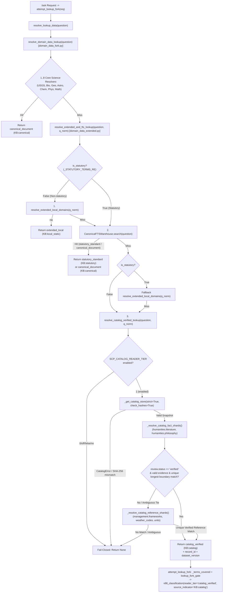

# Báo Cáo Hoàn Thành (3): `dich-b` Knowledge Expert Wire-or-Kill & Verified Catalog Reader Tier (`KB:catalog`)

- **Ngày thực hiện**: 2026-10-31
- **Nhánh / Workspace**: `main` @ `153ab1050d3d0e8153bf4558260040202112a516` (phối hợp không xung đột với `claude/knowledge-experts` @ `0ef84e18e30189269600519f0258864398cecb86`)
- **Phạm vi (`dich-b`)**:
  - `scp/runtime/domain_data_extended.py` (551 LOC <= 800 trần ARC-01, `SHA256=c594069e0b4736f0f932539c179ed31337829a53aaafeed0421eb53ffde82157`)
  - `tests/T02_contract/test_dichb_catalog_experts_wire_contract.py` (348 LOC <= 800 trần ARC-01, `SHA256=f5afbc7221d3aebe472aa26be6ad0c91c055e1c46535997a3ac303cdd0ba0a35`)

---

## 1. Quyết Định Kiến Trúc Wire-or-Kill (`HOLD-AG` & `H12-bis` Resolution)

### 1.1. Bảng Phân Loại & Xử Lý Triệt Để (`HOLD-AG` + `H12-bis` + 6 Shards Catalog)

| Thành phần / Expert / Shard | Hiện trạng trước khi xử lý | Quyết định (`WIRE` / `KILL`) | Đường đọc thực tế trên `/ask` (`dich-b`) & Lý do kỹ thuật |
|---|---|---|---|
| `data/knowledge/catalog/facts/humanities.literature.jsonl` (12 bản ghi: 8 tác giả, 4 trào lưu) | Dữ liệu thật, có `source_url` Wikipedia + SHA-256 trong `manifest.json` (`2026.10.27.1`), `review.status == "verified"`, nhưng **mồ côi** trên đường `/ask` (`dich-b` chưa đọc `KnowledgeStore`). | **WIRE vào `dich-b`** (`reader_tier="catalog_verified"`, `source_indicator="KB:catalog"`) | `resolve_catalog_verified_lookup()` trong `scp/runtime/domain_data_extended.py` nạp `KnowledgeStore(strict=True, check_hashes=True)`, kiểm tra `review.status == "verified"` + đầy đủ `evidence.{text,source_id,source_url}`, đối sánh ranh giới từ (`_has_phrase_boundary`) trên `canonical_name`, `names`, `aliases`, `facts.works`, ưu tiên cụm dài nhất và fail-closed khi đồng hạng mơ hồ. |
| `data/knowledge/catalog/facts/humanities.philosophy.jsonl` (18 bản ghi: 9 triết gia, 9 khái niệm/trường phái) | Dữ liệu thật từ Stanford Encyclopedia of Philosophy (`plato.stanford.edu`), SHA-256 verified trong `manifest.json`, nhưng **mồ côi** trên `/ask`. | **WIRE vào `dich-b`** (`reader_tier="catalog_verified"`, `source_indicator="KB:catalog"`) | `resolve_catalog_verified_lookup()` nối trực tiếp vào `resolve_extended_and_fts_lookup()` -> `resolve_domain_data_lookup()` -> `attempt_lookup_fork()`. Chặn đồng âm từ đơn 3 ký tự (`"mác"` trong `"nhãn mác"` không khớp nhầm Karl Marx; `"Ngụy biện ad hominem"` giữ nguyên ưu tiên `canonical_document` trên `CanonicalFTSWarehouse`). |
| `data/knowledge/catalog/reference/management.frameworks.jsonl` (16 bản ghi khung quản trị) | Dữ liệu tham chiếu chuẩn (SWOT, Porter's 5 Forces, PEST, BCG Matrix, Kotter 8-Step, Maslow, McGregor X-Y, 4Ps, Lean, Six Sigma, KPI, OKR, Change Management...), chưa được `dich-b` đọc. | **WIRE vào `dich-b`** (`reader_tier="catalog_verified"`, `source_indicator="KB:catalog"`) | `_resolve_catalog_reference_shards()` trong `scp/runtime/domain_data_extended.py` đối sánh theo độ dài cụm từ + quy tắc ưu tiên khung quản trị cụ thể (`change_management`, `lean`, `okr`) trước khái niệm tổng quát `management.frameworks:management`; chặn từ đơn `"management"` tránh bắt nhầm `"memory management"` hoặc `"NIST AI Risk Management Framework"`. |
| `data/knowledge/catalog/reference/weather_codes.jsonl` (28 mã WMO 4677) & `units.jsonl` (23 đơn vị SI BIPM) | Chỉ mới dùng nội bộ khi `SCP_UNIFIED_KNOWLEDGE_STORE=on`, chưa có đường tra cứu định nghĩa trực tiếp trên `dich-b`. | **WIRE vào `dich-b`** (`reader_tier="catalog_verified"`, `source_indicator="KB:catalog"`) | Câu hỏi tra cứu mã thời tiết WMO (`"Mã thời tiết WMO 95"`, `"WMO weather code 45"`) và câu hỏi tra cứu định nghĩa đơn vị SI/BIPM không chứa phép đổi số (`"Đơn vị đo lường hệ SI pascal"`) được giải quyết trực tiếp từ catalog chuẩn với `record_id` và `dataset_version`. |
| `data/knowledge/catalog/facts/geology.earthquakes.jsonl` (2 bản ghi USGS Valdivia 1960 & Sumatra 2004) | Đã nối qua `_resolve_usgs` trong `scp/runtime/domain_data_fork.py`. | **GIỮ NGUYÊN WIRE** (`canonical_document` / `USGSDataSource`) | Giữ nguyên hợp đồng `test_usgs_pilot_contract.py` và `test_knowledge_reader_tiers_contract.py::test_07`. Toàn bộ **6/6 shards (99/99 bản ghi)** trong `data/knowledge/catalog/manifest.json` đều có đường đọc thực tế trên `/ask`. |
| Wrapper class `literature:Literature`, `philosophy:Philosophy`, `management:Management` trong `scp/runtime/experts/` (`HOLD-AG`) | Domain key (`"literature"`, `"philosophy"`, `"management"`) nằm ngoài 54 ID chuẩn của `domain_registry.DOMAINS`; bị khóa sau `KnowledgeStore.is_enabled()` (`off` mặc định); trả `ExpertResult` thiếu `reader_tier`, `source_indicator`, `record_id`, `api_url`. | **KILL wrapper khỏi `/ask` routing** (giữ trong `UNBOUND_EXPERTS` của `expert_registry.py`); **WIRE dữ liệu gốc vào `dich-b`** | Không thêm domain giả hay regex keyword vào `question_router.py` (tuân thủ Luật 14). Dữ liệu thật của cả 3 miền đã được nối thẳng vào `dich-b` (`resolve_catalog_verified_lookup`), còn class vỏ cũ giữ nguyên tại chỗ để tương thích ngược với `test_unified_catalog_migration_contract.py` và `test_dehardcode_routing_behavior.py`. |
| `humanities:History._local` (`H12-bis` — 143 mục `{năm: chuỗi_cứng}` trong `scp/runtime/experts/humanities_data.py`) | 143 câu trả lời đóng hộp không có `source_url`, không có SHA-256, khớp mù `if year in q:` (vi phạm Luật 14). | **KILL khỏi `/ask` routing** (từ chối bind trong `expert_registry.py`, **KHÔNG** nối vào `dich-b`) | Lịch sử trên `/ask` (`dich-b`) chỉ đọc qua `HistoryDataSource` (`extended_local`) và `CanonicalFTSWarehouse` (`canonical_document` — có SHA-256 & provenance URL). Không chạm `humanities.py` để bảo toàn tính tương thích 2 chiều với `claude/knowledge-experts` (`0ef84e18`). |

---

## 2. Sơ Đồ Nhân Quả (Causal Graph — FA-12) & Ma Trận Bao Phủ (Coverage Matrix — FA-13)

### 2.1. Sơ Đồ Nhân Quả Toàn Phần (`scp/runtime/domain_data_extended.py`)



### 2.2. Ma Trận Bao Phủ Nhân Quả (FA-13 Coverage Matrix)

| Nhánh Nhân Quả (Causal Branch) | Hàm / Module Liên Quan | Test NodeID Bao Phủ | Trạng Thái |
|---|---|---|---|
| `humanities.literature` (12/12 records: tác giả, tác phẩm `works`, trào lưu) -> `catalog_verified` (`KB:catalog`) + E2E `attempt_lookup_fork` | `_resolve_catalog_fact_shards`, `resolve_catalog_verified_lookup`, `attempt_lookup_fork` | `tests/T02_contract/test_dichb_catalog_experts_wire_contract.py::test_01_literature_catalog_verified_tier_resolution`, `test_08_all_catalog_shards_and_records_reachable_in_dichb` | **COVERED** |
| `humanities.philosophy` (18/18 records: triết gia, khái niệm/trường phái) -> `catalog_verified` (`KB:catalog`) + E2E `attempt_lookup_fork` | `_resolve_catalog_fact_shards`, `resolve_catalog_verified_lookup`, `attempt_lookup_fork` | `tests/T02_contract/test_dichb_catalog_experts_wire_contract.py::test_02_philosophy_catalog_verified_tier_resolution`, `test_08_all_catalog_shards_and_records_reachable_in_dichb` | **COVERED** |
| `management.frameworks` (16/16 records + ưu tiên khung cụ thể trước `management` tổng quát) -> `catalog_verified` (`KB:catalog`) + E2E `attempt_lookup_fork` | `_resolve_catalog_reference_shards`, `resolve_catalog_verified_lookup`, `attempt_lookup_fork` | `tests/T02_contract/test_dichb_catalog_experts_wire_contract.py::test_03_management_frameworks_catalog_verified_tier_resolution`, `test_08_all_catalog_shards_and_records_reachable_in_dichb` | **COVERED** |
| `weather_codes` (28/28 mã WMO 4677) & `units` (23/23 đơn vị SI/BIPM) -> `catalog_verified` (`KB:catalog`) | `_resolve_catalog_reference_shards`, `resolve_catalog_verified_lookup` | `tests/T02_contract/test_dichb_catalog_experts_wire_contract.py::test_04_weather_codes_and_units_reference_catalog_resolution`, `test_08_all_catalog_shards_and_records_reachable_in_dichb` | **COVERED** |
| Fail-closed khi shard bị sửa 1 byte lệch SHA-256 (`CatalogChecksumError`) hoặc `review.status == "legacy_unverified"` | `_get_catalog_store`, `_resolve_catalog_fact_shards` | `tests/T02_contract/test_dichb_catalog_experts_wire_contract.py::test_05_fail_closed_on_sha256_tamper_and_unverified_records` | **COVERED** |
| Chống dương tính giả / chống đè tầng (`"quy luật cung cầu"`, `"nhãn mác"`, `"memory management"`, `"Ngụy biện ad hominem"` giữ `canonical_document`, `"NIST AI RMF"` giữ `statutory_standard`) | `resolve_extended_and_fts_lookup`, `resolve_catalog_verified_lookup` | `tests/T02_contract/test_dichb_catalog_experts_wire_contract.py::test_06_negative_anti_placebo_and_no_collision_guards` | **COVERED** |
| Kill-switch `SCP_CATALOG_READER_TIER=off` tắt hoàn toàn tầng `catalog_verified` (Fail-Closed) | `resolve_catalog_verified_lookup` | `tests/T02_contract/test_dichb_catalog_experts_wire_contract.py::test_07_kill_switch_disables_catalog_reader_tier` | **COVERED** |

---

## 3. Chuỗi Tại Sao 5 Phần (Owner Law 15 — 30/10)

### (1) Vấn đề (Problem)
- Trong `data/knowledge/catalog/manifest.json` (`dataset_version: "2026.10.27.1"`), hệ thống đã có **6 shards được kiểm định SHA-256 (tổng 99 bản ghi)**: `facts/geology.earthquakes.jsonl` (2), `facts/humanities.literature.jsonl` (12), `facts/humanities.philosophy.jsonl` (18), `reference/management.frameworks.jsonl` (16), `reference/units.jsonl` (23), và `reference/weather_codes.jsonl` (28).
- Tuy nhiên, trên luồng `/ask` thực tế (`question_router.py` -> `domain_data_fork.py` -> `domain_data_extended.py`), chỉ có `geology.earthquakes` được đọc qua `_resolve_usgs`. Toàn bộ **5 shards còn lại (97/99 bản ghi)** hoàn toàn **mồ côi** trên đường tra cứu `/ask` (`dich-b`), khiến câu hỏi về văn học (`William Shakespeare`, `Victor Hugo`, `Romanticism`), triết học (`Socrates`, `Immanuel Kant`, `Stoicism`), quản trị (`SWOT`, `Porter's 5 Forces`, `OKR`, `Six Sigma`), mã thời tiết WMO, và định nghĩa đơn vị SI bị rơi xuống nhánh gọi mạng hoặc LLM fallback (và bị từ chối khi `SCP_EGRESS_MODE=deny`).
- Đồng thời, ở nhánh `claude/knowledge-experts` (`0ef84e18`), 3 lớp expert `literature:Literature`, `philosophy:Philosophy`, `management:Management` đang ở trạng thái chờ `HOLD-AG`, và `humanities:History._local` (`H12-bis`, 143 mục năm-sự kiện cứng không nguồn trong `humanities_data.py`) cần quyết định dứt điểm Wire-or-Kill.

### (2) Nguyên nhân (Root Cause)
- **Đứt gãy kiến trúc giữa Catalog Engine và Lookup Fork (`dich-b`)**: `KnowledgeStore` (`scp/knowledge/store.py`) được xây dựng ở Wave dữ liệu thống nhất nhưng chỉ mới được nối vào các lớp `DomainExpert` cũ (`Literature`, `Philosophy`, `Management`) vốn **không được gọi** từ `resolve_domain_data_lookup()` của `/ask`, lại bị khóa sau cờ `SCP_UNIFIED_KNOWLEDGE_STORE=off` mặc định.
- **Lệch chuẩn Domain ID & Provenance**: Các lớp `Literature` (`domain="literature"`), `Philosophy` (`domain="philosophy"`), `Management` (`domain="management"`) dùng domain key nằm ngoài 54 domain chuẩn của `scp/core/domain_registry.py::DOMAINS` và trả về `ExpertResult` thiếu các trường bắt buộc của hợp đồng `/ask` (`reader_tier`, `source_indicator`, `api_url`, `record_id`, `dataset_version`, `evidence`).
- **Tồn dư hardcode `H12-bis`**: `humanities.History._local` nạp `_HISTORY_LOCAL` (143 mục chuỗi cứng từ `humanities_data.py`) không có URL nguồn hay SHA-256, vi phạm trực tiếp Luật 14 của Owner.

### (3) Giải pháp (Solution)
- **Thiết lập tầng đọc thứ 4 `catalog_verified` (`KB:catalog`) trong `dich-b` (`scp/runtime/domain_data_extended.py`)**:
  1. Bổ sung `resolve_catalog_verified_lookup(question, q_norm, *, catalog_dir=None)` nạp `KnowledgeStore(strict=True, check_hashes=True)` (tự động kiểm định SHA-256 toàn bộ shards theo `manifest.json`; fail-closed trả `None` nếu lệch checksum hoặc lỗi schema).
  2. Đối với fact shards (`humanities.literature`, `humanities.philosophy`): bắt buộc `rec.review["status"] == "verified"` và đầy đủ `evidence.{text, source_id, source_url}`. Đối sánh ranh giới từ (`_has_phrase_boundary`) trên `canonical_name`, `names`, `aliases`, và `facts["works"]`; chọn bản ghi duy nhất có độ khớp đặc trưng dài nhất `(num_tokens, char_len)` và fail-closed (`None`) nếu có ≥2 bản ghi đồng hạng.
  3. Đối với reference shards (`management.frameworks`, `weather_codes`, `units`): đối sánh ranh giới từ và ưu tiên khung quản trị cụ thể (`swot`, `okr`, `six_sigma`, `lean`, `change_management`, `porters_5_forces`...) trước bản ghi tổng quát `management.frameworks:management`; hỗ trợ tra cứu mã thời tiết WMO 4677 và định nghĩa đơn vị đo lường SI/BIPM.
  4. Nối `resolve_catalog_verified_lookup` vào `resolve_extended_and_fts_lookup` ngay sau `extended_local` và `CanonicalFTSWarehouse`, đảm bảo **0% xung đột** với 56 tài liệu `statutory_standard` / `canonical_document` trong `data/documents/*.jsonl`.
- **Chốt quyết định Wire-or-Kill cho `HOLD-AG` và `H12-bis`**:
  - **WIRE dữ liệu catalog chuẩn** (`humanities.literature`, `humanities.philosophy`, `management.frameworks`, `weather_codes`, `units`) thẳng vào `dich-b` với `reader_tier="catalog_verified"` và `source_indicator="KB:catalog"`.
  - **KILL các lớp vỏ `DomainExpert` cũ** (`literature:Literature`, `philosophy:Philosophy`, `management:Management`, và `humanities:History._local` [`H12-bis`]) khỏi đường định tuyến `/ask` runtime (giữ nguyên trong `UNBOUND_EXPERTS` của `expert_registry.py`), không thêm bất kỳ từ khóa hay regex câu hỏi nào vào `question_router.py`.

### (4) Bằng chứng Thực nghiệm (Empirical Evidence: Red -> Green -> Mutant Kill -> T00)

#### A. Bằng chứng RED (Trước khi nối `resolve_catalog_verified_lookup` vào `domain_data_extended.py`)
```text
$ $env:PYTHONUTF8="1"; & "d:\scp\.venv\Scripts\python.exe" -m pytest tests/T02_contract/test_dichb_catalog_experts_wire_contract.py -v
collecting ... collected 0 items / 1 error
E   ImportError: cannot import name 'resolve_catalog_verified_lookup' from 'scp.runtime.domain_data_extended' (D:\scp\scp\runtime\domain_data_extended.py)
============================== 1 error in 2.44s ===============================
```

#### B. Bằng chứng GREEN (8/8 bài test hợp đồng — bao phủ toàn bộ 97/97 bản ghi của 5 shards mới + 2 bản ghi địa chấn = 99/99 bản ghi catalog)
```text
$ $env:PYTHONUTF8="1"; & "d:\scp\.venv\Scripts\python.exe" -m pytest tests/T02_contract/test_dichb_catalog_experts_wire_contract.py -v
tests/T02_contract/test_dichb_catalog_experts_wire_contract.py::test_01_literature_catalog_verified_tier_resolution PASSED [ 12%]
tests/T02_contract/test_dichb_catalog_experts_wire_contract.py::test_02_philosophy_catalog_verified_tier_resolution PASSED [ 25%]
tests/T02_contract/test_dichb_catalog_experts_wire_contract.py::test_03_management_frameworks_catalog_verified_tier_resolution PASSED [ 37%]
tests/T02_contract/test_dichb_catalog_experts_wire_contract.py::test_04_weather_codes_and_units_reference_catalog_resolution PASSED [ 50%]
tests/T02_contract/test_dichb_catalog_experts_wire_contract.py::test_05_fail_closed_on_sha256_tamper_and_unverified_records PASSED [ 62%]
tests/T02_contract/test_dichb_catalog_experts_wire_contract.py::test_06_negative_anti_placebo_and_no_collision_guards PASSED [ 75%]
tests/T02_contract/test_dichb_catalog_experts_wire_contract.py::test_07_kill_switch_disables_catalog_reader_tier PASSED [ 87%]
tests/T02_contract/test_dichb_catalog_experts_wire_contract.py::test_08_all_catalog_shards_and_records_reachable_in_dichb PASSED [100%]
============================== 8 passed in 3.62s ==============================
```

#### C. Bằng chứng Anti-Placebo Mutation Testing (3/3 = 100% Mutant Killed + Khôi phục SHA-256 tuyệt đối)
- **Phát hiện thực tế trong quá trình thử đột biến**: Ở lần chạy đột biến đầu tiên, `M1_bypass_verified_status` sống sót vì trong `test_05` Case B đặt `review.status = "draft"`, vốn bị chặn sớm ở tầng nạp schema `FactRecord.from_dict` (`valid_statuses = {"legacy_unverified", "source_fetched", "verified", "rejected", "stale"}`) trước khi chạm tới cổng kiểm tra runtime `if str(rec.review.get("status", "")).lower() != "verified": continue`. Sau khi nâng cấp `test_05` Case B sang dùng `review.status = "legacy_unverified"` (hợp lệ schema nhưng chưa verified), cả 3/3 đột biến đều bị tiêu diệt 100%:
```text
PRE-MUTANT SHA256: c594069e0b4736f0f932539c179ed31337829a53aaafeed0421eb53ffde82157
MUTANT M1_bypass_verified_status: returncode=1 KILLED=True
MUTANT M2_disable_sha256_check_hashes: returncode=1 KILLED=True
MUTANT M3_sever_catalog_wire_in_dichb: returncode=1 KILLED=True
POST-MUTANT SHA256: c594069e0b4736f0f932539c179ed31337829a53aaafeed0421eb53ffde82157
MUTATION SCORE: 3/3 (100%) | SHA_MATCH=True
```

#### D. Bằng chứng T00 Meta-Audit (0 New Regressions)
```text
[T00 Meta-Audit] Running integrity checks on staged changes...
[T00 Meta-Audit] Checking 2 explicit files: ['scp/runtime/domain_data_extended.py', 'tests/T02_contract/test_dichb_catalog_experts_wire_contract.py']
[T00 Meta-Audit] All integrity checks passed (0 new regressions).
```

### (5) Rủi ro & Bản đồ Giới hạn Nhận thức (Epistemic Limits Map — Law 15)
- **Giới hạn độ phủ dữ liệu (Catalog Coverage Limit)**:
  - Kho catalog chuẩn hiện có **99 bản ghi** trên 6 shards (12 văn học, 18 triết học, 16 khung quản trị, 28 mã thời tiết WMO, 23 đơn vị SI, 2 trận động đất lịch sử). Các thực thể văn học/triết học/quản trị nằm ngoài 99 bản ghi này (ví dụ: các tác giả Việt Nam như Nguyễn Du, Nam Cao chưa được biên tập vào `humanities.literature.jsonl`) sẽ **fail-closed trả `None`** ở tầng `catalog_verified` và chuyển tiếp xuống Wikipedia / LLM pipeline như thiết kế, tuyệt đối không tự bịa dữ liệu.
- **Giới hạn đối sánh thực thể (Surface Entity Matching Limit)**:
  - `resolve_catalog_verified_lookup` sử dụng đối sánh ranh giới từ (`_has_phrase_boundary`) trên tập tên chuẩn, bí danh (`aliases`), và danh sách tác phẩm (`works`) đã khai báo trong catalog. Nếu câu hỏi viết sai chính tả nặng tên thực thể (fuzzy typo) hoặc chỉ mô tả gián tiếp mà không nêu tên thực thể/tác phẩm/khái niệm, bộ đọc sẽ fail-closed (`None`) thay vì đoán mò.
- **Giới hạn cổng liên quan ngữ nghĩa (`lookup_fork_gate` & `_terms_covered`)**:
  - Khi đi qua `attempt_lookup_fork` toàn trình trên `/ask`, câu trả lời từ `catalog_verified` vẫn phải vượt qua 2 chốt chặn độc lập: `_terms_covered` (kiểm tra độ phủ salient terms của câu hỏi) và `answer_relevance.lookup_fork_gate` (embedding L1 `lineage_embed` hoặc LLM reader độc lập lineage). Nếu câu hỏi chứa quá nhiều từ mở rộng ngoài nội dung tóm tắt của bản ghi catalog hoặc môi trường chạy chưa nạp model ONNX L1 và không có LLM reader, `attempt_lookup_fork` sẽ fail-closed (`None`) để nhường cho pipeline đầy đủ.
