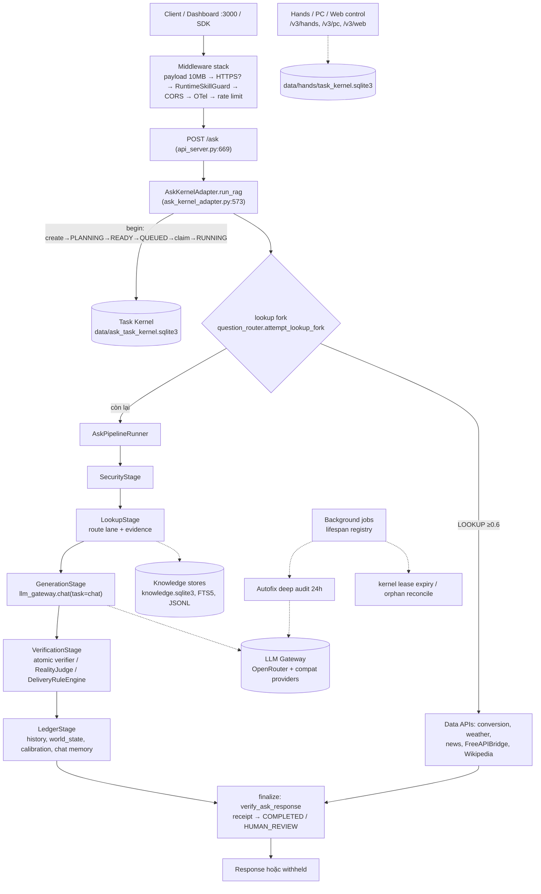

# Bản đồ kiến trúc SCP — snapshot `0e657c8b` (2026-10-28)

> **Vai trò tài liệu:** bản đồ định vị (navigation map) để đọc code nhanh, KHÔNG phải authority và KHÔNG phải runtime evidence.
> Theo GA.md §A1, tài liệu này đứng dưới spec, test bindings và Live Git. Khi code đổi, tin code.
>
> **Phương pháp:** đọc tĩnh, chia 5 vùng. Vùng A–D (bên trong `scp/`) do 4 subagent chỉ-đọc quét độc lập. Vùng E (bên ngoài `scp/`) và phần kiểm tra chéo do orchestrator làm.
> Không chạy test, không bật service. Ngoại lệ duy nhất là 1 probe ở mức hàm (§15).
>
> **Thay thế:** `docs/SCP_ARCHITECTURE_CURRENT.md` đã lỗi thời. File đó đối chiếu HEAD R41 ngày 14/08/2026 và còn mô tả LLM bridge Bun, thứ GA B77 đã gỡ.

---

## 0. Ký hiệu trạng thái bằng chứng

| Nhãn | Nghĩa |
|---|---|
| `STATIC` | Một subagent đọc code và thấy. Chưa ai kiểm lại. |
| `STATIC×2` | Hai subagent quét độc lập cùng thấy một điều. |
| `RE-READ` | Orchestrator đã tự đọc lại đúng các dòng code được dẫn. |
| `PROBE-UNIT` | Đã chạy script tái hiện ở mức hàm. Chưa chứng minh toàn luồng end-to-end. |

Theo FA-09, mọi mục rủi ro ở §15 đều là **giả thuyết** cho tới khi có script repro chạy end-to-end.

---

## 1. SCP là gì (một đoạn)

SCP là một "Agent OS" viết bằng Python, chạy trên FastAPI. Trục chính là endpoint `/ask`: nhận câu hỏi, cho LLM qua gateway đa provider sinh câu trả lời, rồi cho judge (PASS/FAIL/ABSTAIN) kiểm và cho delivery rules quyết định giao câu trả lời hay giữ lại (withheld).

Mỗi request `/ask` được bọc trong một task của **Task Kernel**: một state machine 18 trạng thái lưu bằng SQLite/PG, có lease, journal HMAC, idempotency và recovery.

Xung quanh trục đó có:
- tầng knowledge/evidence (SQLite/JSONL/FTS5 cùng catalog khoảng 2.000 free API);
- tầng "hands" thao tác PC, browser và sandbox;
- tầng tự cải tiến (autofix 37k dòng, meta/WHY-gate);
- bộ governance/test rất dày (T00–T13, 8 CI workflow, FA-01→FA-13).

---

## 2. Quy mô (tracked files tại `0e657c8b`)

| Phần | Kích thước |
|---|---|
| `scp/` Python | 814 file / ~180k dòng |
| `tests/` Python | 564 file / ~114k dòng |
| `tools/` + `scripts/` | ~43,5k dòng |
| `dashboard/` (Next.js, ts/tsx) | ~23k dòng |
| Tổng file tracked | 2.269 |

Các package lớn nhất trong `scp/`, tính theo dòng:

| Package | Dòng |
|---|---|
| `autofix` | 37,2k |
| `core` | 23,3k |
| `security` | 15,0k |
| `runtime` | 13,9k |
| `data_sources` | 13,9k |
| `meta` | 11,6k |
| `knowledge` | 11,4k |
| `api` | 8,9k |
| `task_kernel_parts` | 5,3k |
| `api_server_parts` | 4,7k |

---

## 3. Sơ đồ tầng

---

## 4. Khởi động (boot)

**Các entrypoint**
- `python -m scp` → `scp/__main__.py`. Thứ tự: `load_selected_env()` → `enforce_production_safety()`, nằm ở `security/production_guard.py:8-56` → `uvicorn.run("scp.api_server:app")`. Host lấy từ `SCP_HOST`, mặc định 127.0.0.1; port lấy từ `SCP_PORT`, mặc định 8000.
- `uvicorn scp.main:app`: cách chạy này **bỏ qua** production guard đầy đủ (giả thuyết A-H14).
- `python -m scp.mcp_server`: server Hands qua stdio JSON-RPC, không mở port.

**Lúc import `scp/api_server.py`**
- `:257-262` dựng DI container.
- `:321-393` re-bind các hàm từ `api_server_parts` vào globals của `api_server`.
- `:425-431` chọn profile API qua `api/route_profile.py`: chế độ production dùng `core`, còn lại dùng `full`.

**Lifespan (`api_server_parts/lifespan.py`)**
- Ép `SCP_WHY_LLM_ENABLED=0` và `SCP_EVOLUTION_AUTO=0` trong suốt thời gian chạy (`:67-74`).
- Bắt buộc có `SCP_JWT_SECRET` (≥32 ký tự) và `SCP_ADMIN_KEY` (≥8 ký tự), thiếu thì không boot (`core/config_contract.py`).
- Background registry gồm `deep_audit_scheduler` (24h), `attack_mode_monitor`, `doubt_cron`, `why_verify`, `retry_policy`, `inbox_daemon`, `kernel_lease_expiry` và `kernel_orphan_reconcile`. Hai job kernel là *required*: nếu không start được thì boot abort (`api/background_jobs.py:245-298`).
- Kernel `recover_on_boot` ở `:418-430`; `FreeDiscoveryScheduler` ở `:606-616`.

---

## 5. Luồng `/ask` (call chain chính)

1. Middleware: xem §7.3.
2. `ask()` (`api_server.py:669-709`) chạy lần lượt: slowapi 60/min → `traced_request` (ghi `request_runs.jsonl`) → `verify_jwt_token` → kill switch (`security/kill_switch.is_engaged`) → kiểm `judge_ready`, chưa sẵn sàng thì trả 503.
3. `AskKernelAdapter.begin()` (`ask_kernel_adapter.py:273-389`) gồm các bước:
   - backpressure theo `SCP_ASK_MAX_INFLIGHT`;
   - `create_task` → PLANNING → READY → QUEUED;
   - `claim` → `start` (RUNNING);
   - `idempotency_claim` → `checkpoint`.
   Song song đó có heartbeat cho lease (TTL mặc định 120s).
4. **Lookup fork**, bật khi `SCP_T2_ROUTER` bật (`runtime/question_router.py:630-734`):
   - Router dùng `classify_l0` dựa trên rule (`router_rules.py:465`), sau đó tới LLM `task="route"`. Nếu lỗi thì fail-closed về LANE_CHATBOT.
   - Khi intent là LOOKUP với confidence ≥ `SCP_T2_MIN_CONFIDENCE` (0.6), thử lần lượt: conversion → weather → domain_data_fork → news → FreeAPIBridge → catalog → Wikipedia.
   - Kết quả đi qua relevance gate và antibody, rồi trả PASS/UPHOLD **không qua RealityJudge**.
5. Nếu không rơi vào fork, `AskPipelineRunner` (`api_server_parts/pipeline/runner.py`) chạy 5 stage:
   - **SecurityStage:** DoS slot, jailbreak ảnh/giọng nói, ThreatDetector/WhyEngine.
   - **LookupStage:**
     - `route_question` gán lane CHATBOT / FACTUAL / SECURITY;
     - W14 web search có time signal, lọc qua `inspect_untrusted`;
     - `AutonomousEvidenceRetriever` (KB hit thì confidence 0.90 và bỏ qua web);
     - fact-check đa nguồn.
   - **GenerationStage:**
     - `gateway.chat(task="chat")` với system prompt có pin danh tính;
     - nếu lỗi thì rơi xuống web snippets, rồi tới bản nháp deterministic offline.
   - **VerificationStage:**
     - semantic firewall;
     - `AtomicDeterministicVerifier`: nếu mọi claim được xác minh cục bộ thì PASS 0.98, không gọi LLM;
     - nếu không, `RealityJudge.judge_async` chạy theo thứ tự Tier-1 guard → domain experts → KB → `cross_verify` 2 họ model (hoặc cascade) → map verdict;
     - sau judge: W18 pruning, W8 stale-fact guard, MultiTurnTracker;
     - **`DeliveryRuleEngine.evaluate`** (`runtime/delivery_rules.py:161-483`) quyết định giao hay giữ lại, với 10 nhánh;
     - cuối cùng: post-guard danh tính vendor, FactSeparator, fact-check có trần 10s.
   - **LedgerStage:** ghi risk, history (chỉ khi PASS), world_state, calibration, forecast và chat memory.
6. `finalize` (`ask_adapter_parts/finalize_flow.py`) chuyển RUNNING → VERIFYING rồi gọi `verify_ask_response`:
   - nếu VERIFIED thì ký receipt và `commit_verification_result`, task về COMPLETED;
   - nếu không thì task về HUMAN_REVIEW (chế độ autonomous thì về FAILED);
   - cuối cùng `build_safe_response` thay câu trả lời chưa xác minh bằng thông báo withheld.

**Bảng verdict của judge** (`runtime/judge.py:620-742`)

| Kết quả judge | Verdict / governance |
|---|---|
| PASS | UPHOLD |
| Crosscheck bị exception | DEGRADED |
| Tier-1 bắt marker nội bộ | FAIL / KILL |
| Abstain trung thực | ABSTAIN / ESCALATE |
| Các trường hợp còn lại | FAIL / ESCALATE |

---

## 6. Task Kernel (`scp/task_kernel.py` → `scp/task_kernel_parts/`)

- **Storage** (`kernel_storage.py`): SQLite WAL, mỗi context một connection, ghi bằng `BEGIN IMMEDIATE` có retry 25 lần. Có thể chọn Postgres qua `SCP_KERNEL_BACKEND=postgres` cùng `SCP_KERNEL_PG_DSN`.
- **Bảng dữ liệu** (`taskkernel.py:168-258`): control, tasks, events, leases, checkpoints, idempotency, queue_accounts.
- **18 trạng thái** (`definitions.py:17-46`). Ghi chú: `.agents/AGENTS.md` viết "17 trạng thái", tức đã lệch (drift).

| Từ | Được phép sang |
|---|---|
| CREATED | PLANNING, CANCELLED |
| PLANNING | READY, WAITING_APPROVAL, FAILED, CANCELLED |
| WAITING_APPROVAL | READY (chỉ qua `commit_approval`), CANCELLED |
| READY | QUEUED, CANCELLED |
| QUEUED | LEASED, CANCELLED |
| LEASED | RUNNING, RECOVERING, CANCELLED |
| RUNNING | WAITING_TOOL, VERIFYING, CHECKPOINTED, RECOVERING, HUMAN_REVIEW, RETRY_SCHEDULED, FAILED, CANCELLED |
| WAITING_TOOL | VERIFYING, UNKNOWN, RECOVERING, RETRY_SCHEDULED, FAILED, CANCELLED |
| VERIFYING | VERIFYING, RUNNING, COMPLETED (chỉ qua `commit_completed`), HUMAN_REVIEW, RETRY_SCHEDULED, FAILED |
| CHECKPOINTED | RUNNING, QUEUED, CANCELLED |
| UNKNOWN | RECONCILING, HUMAN_REVIEW, RECOVERING, FAILED, CANCELLED |
| HUMAN_REVIEW | READY, CANCELLED, FAILED |
| RECOVERING | RECONCILING, CHECKPOINTED, QUEUED, HUMAN_REVIEW, FAILED |
| RECONCILING | RECOVERING, CHECKPOINTED, QUEUED, HUMAN_REVIEW, FAILED, CANCELLED |
| RETRY_SCHEDULED | QUEUED, FAILED, CANCELLED |
| COMPLETED / FAILED / CANCELLED | (terminal) |

**Guard của `transition()`** (`state_machine.py`)
- Không cho tự đi tới COMPLETED/FAILED; state terminal là bất biến.
- OCC theo `version`.
- Lease Authority Gate (`:287-333`) đòi cả lease trong DB lẫn `_bound_leases` trong RAM.
- WHY-gate (regex, chặn nếu gate crash) khi chuyển sang RUNNING / CHECKPOINTED / VERIFYING — đây KHÔNG phải WHY "chốt" theo hợp đồng W1; UPHOLD vẫn cho qua (W0 2026-10-29).

**Lease** (`lease_manager.py`)
- Fencing token = MAX+1.
- `assert_lease_impl` kiểm expiry, released, kill epoch, token và worker.
- Sweep khi lease hết hạn: LEASED/RUNNING/WAITING_TOOL → RECOVERING; VERIFYING → HUMAN_REVIEW.

**Journal**
- Chuỗi prev-hash, HMAC-SHA256 với khóa `SCP_CAPABILITY_SECRET`, cùng anchor toàn cục.
- `verify_journal`, `verify_integrity`, `rebuild_projection`, `reanchor` nằm trong `lease_manager.py`.

**Checkpoint, idempotency, recovery**
- Checkpoint từ chối key/giá trị trông giống secret.
- Idempotency key = `stable_hash(task, step, action, resource)`.
- Recovery có 4 hướng RECONCILE / RETRY / STOP / REVIEW; `reconcile_unknown` đòi evidence.

**Kill switch**
- Kernel: `set_global_kill`, chỉ được kiểm ở `claim`, `claim_next` và `commit_approval`.
- Bộ đọc hợp nhất file + env + kernel: `security/kill_switch.py:129-149`.

**Approval và receipt**
- `commit_approval` gọi `verify_approval_authority`, chấp nhận 3 định dạng token.
- `AutonomousCheckerGate` (`autonomous_checker_gate.py:451-621`) lần lượt: kiểm path → patch trong RAM → AST → blast radius ≤80 dòng → quét pattern nguy hiểm → T00 → ký receipt → **tự mint approval token** → commit.
- `VerifierReceipt` (`core/verifier_receipt.py`): HMAC, cửa sổ lệch giờ 300s.

**Hai kernel DB tách biệt:** `data/ask_task_kernel.sqlite3` cho `/ask` và `data/hands/task_kernel.sqlite3` cho hands bridge. Mỗi DB có global kill riêng.

---

## 7. Capability, auth và security

### 7.1 Mô hình capability
- **`CapabilityAuthority`** (`security/capability_epoch.py:94-256`): file JSON lưu epoch, file hỏng thì coi như đã thu hồi.
  - Token ký HMAC trên (subject : epoch : id : iat).
  - `revoke`/`restore` tăng epoch. Token không có expiry, không giới hạn số lần dùng; subject có dạng `hands:<action>`.
- **Compact token** `mint_token`/`verify_token` (`core/capability_token.py:271-312`): TTL 3600s.
- **Ai được mint:** `AutonomousCapabilityGovernor`, `AutonomousCheckerGate`. HandsExecutor và PCController chỉ validate.
- **Không có symbol `RiskAuthority` trong `scp/`** (`RE-READ`, grep ra 0). Trong khi đó GA §A4 nêu invariant "RiskAuthority không được gọi Tool trực tiếp". `risk_intelligence/containment.py` chỉ có quyền revoke.
- **Mức capability của autofix** (`meta/capability_levels.py`): mặc định **FULL_PRODUCTION = `["*"]`**, đọc lại env `SCP_CAPABILITY_LEVEL` ở mỗi lần gọi. `.env.example:455` cũng đặt FULL_PRODUCTION. Đây là chủ ý thiết kế (`RE-READ`).

### 7.2 Gói `security/` (các phần chính)
- **Admin auth** (`auth.py`): so sánh constant-time, kèm JWT role admin; khóa sau 5 lần sai trong 60s theo IP.
- **JWT** (`jwt_guard.py`): HS256; danh sách thu hồi jti nằm trong RAM hoặc file.
- **Egress** (`policy/egress.py:225-357`): mặc định allowlist, luôn chặn metadata endpoint, cho phép loopback. `url_safety.py` lo SSRF/private-IP.
- **Lệnh PowerShell:** `PCController.evaluate` chặn chaining/redirection rồi áp allowlist; thêm `core/safe_process`.
- **DOM prompt-injection** (`web_control/dom_safety.sanitize_dom_for_llm`): **chỉ được import, không có call site** (`RE-READ`).

### 7.3 Middleware (thứ tự suy ra từ quy tắc Starlette, chưa kiểm runtime)
1. Payload ≤10MB, vượt thì trả 413.
2. HTTPSRedirect, chỉ khi `SCP_FORCE_HTTPS` bật.
3. `RuntimeSkillGuardMiddleware` (`middleware/runtime_skill_guard.py:192-611`): path traversal, URL/egress, provenance cho route knowledge, circuit breaker, transition/journal, kill switch, capability token, timeout 30s/60s.
4. CORS. Ở production nếu không cấu hình thì danh sách rỗng.
5. OTel.
6. `rate_limit_middleware` (lớp trong cùng).

### 7.4 Hands, PC, Web, Sandbox
- **`HandsExecutor`** kiểm theo thứ tự: token → subject → registry → capability → revalidate → ledger intent → dispatch → ledger outcome.
- **`TaskKernelHandsBridge`:** action có tính mutating được bọc thành một kernel task đầy đủ. Receipt ở đây là **tự ký** (`hands-executor-self-verifier-v1`).
- **`PCController`:** token → policy → mức ≥3 thì cần HumanConfirmation → audit fsync → `powershell -Command`.
- **web_control:** `browse_public` gate lại mọi bước redirect. CDP `navigate_and_read` chỉ resolve DNS một lần.
- **sandbox_evaluator:** pytest chạy trên bản copy tạm; chỉ dùng bwrap trên Linux.

---

## 8. LLM Gateway (`scp/llm_gateway/`)

- **Provider:** `OpenRouterProvider` theo từng task (autofix, why, learning, fast_learning, judge, chat, route, default). Có thêm openai_compat, gemini_compat, deepseek, groq, mistral, và provider tùy biến qua `SCP_LLM_FALLBACK_PROVIDERS`.
- **Thứ tự** (`client.py`): openai_compat → openrouter → gemini_compat → …
  - `preferred_provider` đưa provider được chọn lên đầu; nếu không có thì xoay vòng round-robin mỗi lần gọi.
  - Có hedge race khi bật `SCP_LLM_HEDGE`; nếu không thì failover tuần tự, trần 90s.
- **Fallback trong một provider:**
  - Bắt đầu từ `OPENROUTER_MODEL`, mặc định `deepseek/deepseek-v4-flash-0731`.
  - Judge thì dùng `OPENROUTER_MODEL_JUDGE_PRIMARY`.
  - Sau đó tới model free theo task, rồi `openrouter/free`. Autofix map sang `deepseek/deepseek-r1:free`.
- **Circuit breaker theo provider:**
  - Ngưỡng 3 lỗi, cooldown 300s.
  - Cache model chết: 404/402 thì đánh dấu chết ngay; 429 thì chết sau 3 lần liên tiếp.
- **Rate limit:** gateway không có token bucket riêng, chỉ phân loại mã 429/402 rồi failover.
- **Egress:** `llm_egress_allowed` (chỉ HTTPS, theo allowlist) cộng `url_safety.enforce_egress_policy`, cài lúc import.
- **Ngoại lệ:** autofix có đường gọi thẳng OpenRouter khi gateway lỗi (`autofix/llm_fix_parts/_call_openrouter.py`), tức là **đi vòng qua gateway**.

---

## 9. Knowledge và evidence

### Nơi lưu trữ

| Nơi lưu | Nội dung |
|---|---|
| `data/knowledge/<domain>.jsonl` | `DomainKnowledgeStore`, có TTL theo tier |
| `data/knowledge.sqlite3` | `DomainKnowledge` (`knowledge_records`, mỗi câu hỏi một câu trả lời) |
| `data/canonical_kb_fts5.sqlite` | Kho FTS5 canonical |
| `data/quarantine_ingestion.sqlite` | Khu cách ly của `AutoWebIngestor` |
| `data/free_api_catalog.json` | Catalog free API (FreeAPIAdapterBridge, tier 0–3) |
| `data/foundation/epistemic.sqlite` | `EvidenceStore` (chỉ v106 routes tạo) |

### Ba chuỗi "dữ liệu ngoài → knowledge"
- **(a) Chuỗi hình thức:** `EvidenceStore` → `LineageStore` → ladder RAW→…→GOLD. **Không có caller production** cho `GoldLifecycle`, và chuỗi này không nằm trên đường `/ask`.
- **(b) Ingest web:** quarantine → corroboration từ ≥2 host độc lập (SimHash), hoặc 1 nguồn Tier-1 cộng receipt → ghi vào FTS5.
- **(c) Runtime `/ask`:** web snippets → `inspect_untrusted` → context cho judge cộng KB hit.

### Ngưỡng truy hồi
- `domain_store`: Jaccard ≥0.35 với ≥2 token chung, hoặc ≥0.4.
- SQLite fallback: khớp chính xác, rồi `LIKE` trên 3 token đầu.
- FTS: AND, rồi OR với ≥75% token chung.

### Retriever khác
`rag/` (`CanonicalRetriever`) dùng corpus `data/rag_corpus`, thư mục này không tồn tại. Caller duy nhất là `v105_routes.py:757`.

---

## 10. Autofix (`scp/autofix/`, 37k dòng)

**Điểm vào**
- Job `deep_audit` mỗi 24h (`lifespan.py:244-336`).
- `POST /v105/autofix/run-audit` với 4 chế độ: observe, deterministic worker, deterministic inline, full LLM.
- `agent_autofix_adapter` (`allow_llm=False`).
- Supervisor PowerShell chạy `deterministic_worker --watch`.

**Pipeline**
1. `run_once` (`runner.py`) lấy bug từ:
   - danh sách truyền vào, `data/audit_bugs.jsonl`;
   - output pytest, failure ledger;
   - quét AST cùng các ingestor log/test/kernel-crash.
   Lọc qua kill switch (fail-closed) → cooldown → WHY-gate (**fail-open** khi gate lỗi) → ưu tiên theo impact.
2. Ứng viên fix, thử theo thứ tự: SEARCH/REPLACE định sẵn → bare-except → deterministic → catalog AST → evolution → speculative cache → **LLM**.
3. Context gửi LLM:
   - cả file nếu ≤2000 dòng, nếu dài hơn thì ±250 dòng quanh lỗi;
   - 2 file liên quan;
   - test liên quan;
   - global symbol index;
   - anti-pattern lấy từ failure ledger.
4. LLM: `chat_sync(task='autofix')`, refine tối đa `SCP_AUTOFIX_MAX_ROUNDS=3` vòng. Lời phê bình được đưa vào vòng sau.
5. Engine phân tier:
   - Tier 1/2: tự sửa.
   - Tier 3: xin phép (`_request_permission`), có thể tự duyệt qua `SCP_AUTO_APPROVE_TIER3`.
   - Tier 4: tối đa 20 lần/giờ.
6. Gate (`autofix_mixin.py:101-304`) theo thứ tự:
   - `SCP_IMMUTABLE_RUNTIME`;
   - protected paths;
   - capability `can_do`;
   - `verify_chain` (fail-open);
   - rate 200 lần/chu kỳ;
   - WHY (fail-open);
   - policy gate IMP-24 (default-deny).
7. Trước khi ghi:
   - mở transaction ShadowSnapshot;
   - `validate_patch`, mô phỏng trong RAM;
   - confidence ranker, blast radius, type-flow;
   - shadow canary;
   - realtime verifier.
8. Ghi: `CodeEvolutionAgent._apply_fix`, kẹp giữa AST parse và DriftGuard trước/sau.
9. Sau khi ghi:
   - `_verify_fix` gồm AST, quét lại và so pytest với baseline;
   - `run_full_post_fix_verify`;
   - lỗi ở bất kỳ pha nào thì rollback.
   Tiếp theo là audit, regression watcher 60s và shadow commit.
10. Sau cả batch, `SubsystemReviewer.review_pending_fixes(auto_prune=True)`:
    - chỉ chạy khi ở FULL_PRODUCTION;
    - gate gồm WHY (fail-open), DriftGuard và shadow canary;
    - xong thì ghi file nguyên tử.

**Code sống và code mồ côi trong autofix**

| Cơ chế | Được nối từ runtime | Mồ côi / legacy |
|---|---|---|
| Reviewer | `subsystem_reviewer.py` | `autonomous_reviewer.py` |
| Rollback | ShadowSnapshot, `RollbackTokenRegistry` | `rollback_registry.py` (0 importer) |
| Evidence replay | `evidence_replay.py` | `runner_phases/evidence_replay.py` (stub trả "seeded") |
| Sinh fix | `llm_fix`, `deterministic_patches` | `CodeEvolutionAgent.run_cycle`, `speculative_branching`, `evolution.evolve_cycle` (chỉ CLI) |
| Scanner | `runner_phases/ast_scan` | `scanners/*` (20 module, chỉ gọi được từ CLI) |
| Callgraph | blast radius, symbol index | `callgraph_delta` (ghi nhưng không ai đọc), `BugReport.callgraph_context` (không bao giờ được điền) |
| Khác | — | `feedback_loop.py`, `repro_generator.py`, `replay_probe_runner.py` (0 importer) |

---

## 11. Meta, audit, benchmark

- **`scp/meta/`** là namespace trộn lẫn:
  - `why_gate.py` là gate chính. Lớp LLM mặc định tắt, chỉ quyết định REJECT mới chặn.
  - Ngoài ra có `capability_levels.py` và `understanding_check.py`.
  - Judge lazy-load `falsification_engine` và `governance_v97`.
  - Khoảng 20 module có 0 importer từ bên ngoài, ví dụ `constitution.py` và `meta.py` (V14).
- **`runtime_audit/`** là tool chạy ngoài process (`tools/run_runtime_audit.py`):
  - probe SQLite, journal anchor và HTTP;
  - không quan sát được thì trả UNKNOWN chứ không trả PASS;
  - lưu vào `data/runtime_audit.sqlite3`.
- **`audit_engine/`** là "dead zone": runner trả hằng số, chỉ test import tới.
- **`benchmark/`** là CLI gọi HTTP API. Riêng `world_standard_verifiability_benchmark.py` tự chấm trên claim hardcode.

---

## 12. Bên ngoài `scp/`

### Target spec (`spec/`)
`scp_future_target_manifest.yaml` ghép base 4.0.1 với overlay thành **4.0.2**. Kết quả: 12 core systems (S01–S12), 8 cross-cutting (X01–X08), 138 capabilities, 67 edges, 34 invariants, 12 gate T00–T11.

| ID | Hệ thống | ID | Hệ thống |
|---|---|---|---|
| S01 | Execution OS | S07 | Experience |
| S02 | Zero-Cost Intelligence Fabric *(tên vẫn còn dù B13 đã phế truất zero-cost)* | S08 | Reasoning |
| S03 | Internet Acquisition | S09 | Self-Improvement |
| S04 | Internet Safety & KQ Firewall | S10 | Risk Intelligence |
| S05 | Evidence | S11 | Governance |
| S06 | Knowledge | S12 | Self-Awareness & Audit |

Cross-cutting: X01 Identity/Trust, X02 Observability, X03 Resource Governor, X04 Supply Chain, X05 Disaster Recovery, X06 Simulation/Digital Twin, X07 Multi-Agent Coordination, X08 World-State/Temporal.

`spec/protected_invariants.yaml` liệt kê các vùng `REQUIRE_GOVERNANCE`:

| Nhóm | Phạm vi |
|---|---|
| DNA | `.agents/skills/scp-dna/**` |
| Reference | `spec/complete_scp_reference.yaml` |
| Test integrity | `tests/**` |
| Capability PEP | `capability_epoch.py`, `hands_executor.py` |
| Secret boundary | `auth.py`, `auth_config.py`, `production_guard.py` |
| Egress | `egress_policy.py`, `policy/egress.py`, `url_safety.py` |
| Evidence authority | `evidence_store.py` |
| Reality authority | `verifier.py` |
| Kill / rollback | `task_kernel*`, `scp/autofix/**` |
| Release authority | `.github/workflows/**` |

### Test (`tests/`, số file `.py`)

| Thư mục | Số file |
|---|---|
| T00 integrity | 17 |
| T01 boot / pipeline | 11 + 7 |
| T02 contract / security | 83 + 8 |
| T03 capability | 88 |
| T04 governance / kernel | 3 + 46 |
| T05 gateway / verification | 29 + 2 |
| T06 verifier | 11 |
| T07 learning | 42 |
| T08 runtime | 3 |
| T09 golden | 6 |
| T10 recovery | 6 |
| T11 release | 9 |
| T12 unified chatbot | 6 |
| T13 runtime audit | 3 |
| `reality-tests` | 69 |
| `internal` | 21 |
| file ở gốc `tests/` | 69 |

### CI (`.github/workflows/`)

| Workflow | Chạy gì |
|---|---|
| `scp_guardrails.yml` | T00 meta-audit, scan secrets, audit deps, coverage thresholds |
| `scp-refactor-freeze.yml` | compileall, ruff E9/F63/F7/F82, import purity, full pytest, acceptance, mutation |
| `scp-release-gate.yml` | Pre-RC verification (non-authoritative) |
| `scp-rc-promotion.yml` | Promote RC |
| `scp-system-audit.yml` | Strict system audit |
| `scp-meta-test-audit.yml` | Meta-test audit theo lịch |
| `container-publish.yml` | Build/publish container |
| `ci.yml` | Baseline, non-blocking |

### Docker (`docker-compose.full.yml`, tất cả bind 127.0.0.1)
- backend :8000
- agent-desktop :6080 (noVNC)
- loop-scheduler :3030
- brain-console :8090
- dashboard :3000

`compose.yml` bản rút gọn có scp-api, loop-scheduler, swe-bench-runner và sandbox-evaluator.

### Thành phần khác
- `dashboard/`: Next.js, 21 API route.
- `mini-services/`: brain-console, loop-scheduler.
- `sdk/`: python, typescript.
- `desktop/`: Electron.
- `integrations/typesafe`: chỉ dùng trong workflow của agent, không phải runtime.

### Tooling chính
- `tools/t00_meta_audit.py` (pre-commit + CI)
- `tools/verify_scp_future_target.py`
- `tools/run_runtime_audit.py`
- `scripts/run_reality_tests_portable.py`

**Môi trường trên PC này:** `python` trên PATH chỉ là alias của Windows Store, chạy không được (exit 49). Interpreter dùng được là `.venv/Scripts/python.exe`.

---

## 13. Trạng thái lưu trữ chính (`data/`, gitignored)

| Nhóm | Đường dẫn |
|---|---|
| Kernel | `ask_task_kernel.sqlite3` (+ wal/shm), `ask_task_kernel_trace.jsonl`, `kernel-backups/`, `hands/task_kernel.sqlite3` |
| Ledger | `request_runs.jsonl`, `trace_ledger.jsonl`, `history_evidence.jsonl`, `failure_ledger.sqlite3`, `policy_blocks.jsonl` |
| Knowledge | `knowledge.sqlite3`, `knowledge/`, `canonical_kb_fts5.sqlite`, `quarantine_ingestion.sqlite`, `free_api_catalog.json`, `kb_evolve.sqlite` |
| Autofix | `autofix_audit.jsonl`, `llm_fix_cache.json`, `global_symbol_index.json`, `shadow/`, `regression_watch.jsonl`, `governance/proposals/`, `pending_fixes/` (ở gốc repo) |
| Security / hands | `security/capability_state.json`, `hands/{audit,checkpoints,autonomous_ledger}.jsonl`, `pc_controller/{audit.jsonl,KILL_SWITCH}`, `human_confirmations.jsonl` |
| Khác | `chat_memory.jsonl`, `calibration.sqlite`, `runtime_audit.sqlite3`, `v13.db` |

---

## 14. Lệch giữa tài liệu và code (doc drift)

1. `.agents/AGENTS.md`: tài liệu ghi Task Kernel "17 trạng thái", code có **18** (`definitions.py:17-22`).
2. GA §A4: tài liệu nêu invariant về `RiskAuthority`, nhưng symbol này **không tồn tại** trong `scp/`.
3. `spec/*`: B13 đã phế truất zero-cost, nhưng ID `S02_ZERO_COST_INTELLIGENCE` vẫn còn. Có thể là chủ ý giữ ID ổn định, chưa xác minh.
4. `docs/SCP_ARCHITECTURE_CURRENT.md`: lỗi thời từ R41 (14/08), còn mô tả Bun bridge.
5. `security/url_safety.py:12`: docstring ghi egress mode chưa đặt thì "không giới hạn", nhưng code mặc định là allowlist (`policy/egress.py:244`).
6. `PROJECT.md`: các mục R6-02/R6-03 còn nhắc LLM Bridge port 8081, thứ đã bị gỡ theo B77.
7. `llm_gateway/__init__.py:6-7`: docstring ghi free catalog lọc routing, nhưng danh sách refresh chỉ được đọc cho mục stats.
8. `autofix/llm_fix_parts/_call_openrouter.py`: docstring ghi "exact-$0 proof", nhưng code không có kiểm tra đó.

---

## 15. Sổ giả thuyết rủi ro (ưu tiên kiểm chứng)

Sắp theo mức ảnh hưởng **nếu đúng**. Cột ID ghi vùng phát hiện: A = request path, B = reasoning/knowledge, C = kernel/security, D = autofix/meta.

| # | Giả thuyết | Vị trí | Trạng thái |
|---|---|---|---|
| R1 | **Tier-1 grounding bị vô hiệu trên `/ask`:** context đưa cho judge là evidence nối thêm chính câu trả lời, nên overlap luôn bằng 1.0. Prompt crosscheck "ONLY on the Context" cũng thấy câu trả lời. | `verification_stage.py:191` → `judge.py:476` → `tier1_guard.check_grounding` | **PROBE-UNIT**: câu trả lời sai bị loại (0.45) khi chỉ so với evidence, nhưng PASS khi nối câu trả lời vào context. Toàn luồng end-to-end chưa chứng minh. |
| R2 | `_ctx_header` chỉ được gán khi ngôn ngữ là `vi`. Câu hỏi không phải tiếng Việt có history sẽ gây UnboundLocalError, bị nuốt như lỗi LLM, nên LLM không được gọi mà rơi xuống fallback. | `generation_stage.py:44-50` | **STATIC×2 + RE-READ** |
| R3 | `commit_completed` có nhánh legacy không ký: `verdict='VERIFIED'` cộng một `evidence_ref` bất kỳ là đủ COMPLETED. `autonomous_cycle` dùng nhánh này với ref `evidence://…/nominal`. | `commit_approval.py:126-133`, `core/autonomous_cycle.py:356-399` | Đã RE-READ đoạn `commit_approval`. Phần caller là STATIC. |
| R4 | Autofix: patch cuối bị chặn bởi Tier-3 hoặc protected path vẫn được xếp hàng. Ở FULL_PRODUCTION (mặc định), SubsystemReviewer có thể merge mà không kiểm protected path, policy gate, pytest hay kill switch. | `process_bug_with_llm.py:328-334`, `subsystem_reviewer.py` | STATIC (mặc định FULL_PRODUCTION: RE-READ) |
| R5 | Một secret duy nhất `SCP_CAPABILITY_SECRET` khóa journal, token, receipt và ledger. Checker gate tự mint approval; bridge tự ký receipt. Điều này căng với FA-05 và tách bạch Maker–Checker. | `autonomous_checker_gate.py:590-609`, `task_kernel_bridge.py:536-555` | STATIC |
| R6 | `verify_journal` chấp nhận hash legacy không có khóa; `reanchor` ký lại cả chuỗi sai. Hệ quả có thể là "tẩy trắng" một journal bị viết lại. | `lease_manager.py:532-564` | STATIC |
| R7 | `transition()` generic cho phép HUMAN_REVIEW→READY và RECONCILING→QUEUED mà không cần lease, token hay evidence, và không kiểm kill. | `state_machine.py:183-200, 295-315` | STATIC |
| R8 | Shadow canary chạy `exec_module` trên module đã bị LLM vá **ngay trong process server**. | `autofix/shadow_canary.py:460-464` | STATIC |
| R9 | PCController allowlist `type`/`cat`/`get-content` kiểm path theo từ vựng, nhưng PowerShell lại mở rộng `$HOME`, `$env:` và wildcard. `.ssh` không có trong `SENSITIVE_PARTS`. | `pc_controller.py:118, 135, 266-319` | STATIC |
| R10 | Sandbox evaluator không có bwrap (Windows/macOS) sẽ chạy code không cô lập nếu không bật strict. Handler event-bus không có auth. | `sandbox_evaluator/evaluator.py:424-439`, `loop.py:50-75` | STATIC |
| R11 | Lookup-fork trả PASS/UPHOLD mà bỏ qua RealityJudge, SecurityStage và LedgerStage. | `question_router.py:703-708` | STATIC×2 |
| R12 | Timeout 60s của guard ngắn hơn lease 120s. `CancelledError` không bị bắt nên kernel task kẹt ở trạng thái non-terminal. | `runtime_skill_guard.py:587-597, 627` | STATIC |
| R13 | Đường dẫn data bị tách: boot recovery dùng `'data'` tương đối; adapter dùng `<repo>/data` hoặc env; DomainKnowledge và judge KB phụ thuộc CWD. | `lifespan.py:420-422`, `ledger_stage.py:33`, `domain_knowledge.py:99` | STATIC×2 |
| R14 | Forecast hook luôn lỗi âm thầm vì sai chữ ký `ForecastLedger`. | `ledger_stage.py:134-149` | STATIC |
| R15 | Sanitize DOM chống prompt injection không có call site. | `web_control/dom_safety.py:73` | **RE-READ** |
| R16 | Rate limiter là lớp middleware trong cùng và fail-open khi storage lỗi. Adapter Redis không được dùng. | `rate_limiting.py:207-209`, `composition.py:58` | STATIC |
| R17 | `/auth/token` đọc thẳng `SCP_ADMIN_KEY` từ env, bỏ qua biến thể `_FILE`. | `api_server.py:660` | STATIC |
| R18 | `/health` công khai lộ commit, pid, host và tên provider. | `server_helpers.py:59-86` | STATIC |

Ngoài bảng này, các báo cáo vùng còn liệt kê khoảng 40 giả thuyết nhỏ hơn.

---

## 16. Vùng chưa đọc (giới hạn của bản đồ)

- **`scp/core`:** khoảng 85/95 file mới đọc outline, gồm `phase0`, `fast_learning_engine_parts`, `smart_cache`, `partition`, `code_evolution_agent` (một phần), `multi_source_verifier`.
- **`scp/security`:** các module `attack_*`, `threat_*`, `defense_antibody_*`, `intel_*`, `unified_detector`, `multi_turn_tracker`, `memory_guard`, `slsa_provenance`.
- **`scp/autofix`:** 20 module `scanners/*`, `type_flow_verifier`, `realtime_verifier`, `restricted_exec`, phần thân của `deterministic_worker`, `evolution_parts`/`evolution_modes`.
- **`scp/meta`:** khoảng 35 module (`cognitive_layers`, `why_sources`, `why_engine_parts`, `kb_evolve`, `falsification_engine`).
- **`scp/data_sources`:** khoảng 60 adapter domain. **`scp/knowledge`:** `antibody_*`, `claim_extractor`, `trust_hierarchy`, `exact_truth_gate`.
- **`dashboard/`, `desktop/`, `sdk/`:** chưa đọc code.
- **Nội dung test:** chưa đọc, mới đếm file.
- **Toàn bộ:** không có runtime evidence. Chưa boot SCP, chưa chạy test. Không suy ra maturity nào từ bản đồ này (FA-07).
