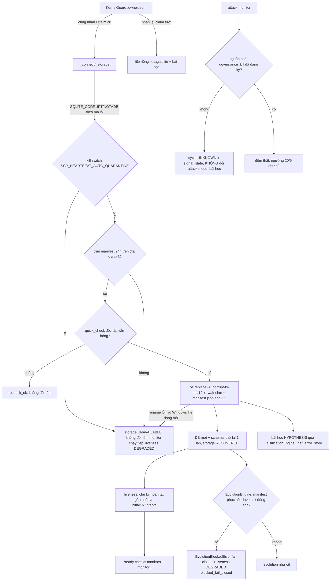

# heartbeat-recovery — DONE (maker, chưa có checker)

- Lane: `heartbeat-recovery` · Maker: Claude (Opus 5.5) · Ngày: 2026-10-31
- Branch `claude/heartbeat-recovery` · worktree `D:/scp/.claude/worktrees/heartbeat-recovery`
- **Commit fix: `7a3f0a2e`** · parent `f1ea1bcd` (main lúc commit; branch tạo từ `dee3ee5e`, fast-forward lên main vì hook T00 so với main hiện tại — không trùng file)
- Commit thứ 2 chỉ thêm file này vào `docs/evidence/heartbeat-recovery-done.final.md` (bản y hệt).
- KHÔNG push/merge, KHÔNG đụng `D:/scp` main tree, KHÔNG ghi/đổi tên/xoá gì trong `D:/scp/data`, KHÔNG restart container production, KHÔNG đọc `.env`, KHÔNG sửa `evolution_parts/*`.
- Thang bằng chứng: `VERIFIED-RUN` · `VERIFIED-STATIC` · `HYPOTHESIS` · `UNKNOWN` · `DISPROVEN (trong phạm vi thử)`. PASS chỉ nghĩa là không thấy lỗi trong phạm vi đã nêu.

## 1. Gốc lỗi

### Bằng chứng (đều làm trên BẢN SAO trong scratch; sha256 file sống trước/sau = `59bc4e06…2668`, không đổi)
- File: `subsystem_heartbeat.sqlite` 2.035.712 B, mtime 30/10 14:10:20 +07 (07:10:20Z); `-wal` 0 B; `-shm` 32 KB (mtime vẫn đổi hôm nay 12:05/12:18/12:57 +07 ⇒ còn tiến trình nào đó mở file — UNKNOWN là ai).
- Header: page_size 4096, **in-header db size = 500 trang, file thật = 497 trang**, version-valid-for = change_counter = 496 (header hợp lệ). Trang 4 (interior của `subsystem_heartbeat_events`, 494 cell) trỏ tới con **498, 499, 500 — không tồn tại** ⇒ `SQLITE_CORRUPT` (11) ngay khi mở (SQLite chặn nPage > nPageFile). VERIFIED-RUN.
- Salvage (writable_schema, immutable): hàng nhất quán cuối cùng do **container pid 1** ghi: `deep_audit`/`attack_monitor` last_tick **05:09:37Z 30/10**; events đọc được tới seq 8435 = `attack_monitor` cycle_completed **05:06:47Z**. VERIFIED-RUN.
- Ledger JSONL (append trước khi ghi DB, cùng `_write`): `attack_monitor_runs.jsonl` 3.965 dòng, **74 cặp (owner_pid, parent_pid)**: container (1,0) 1.776, (7,1) 306 … và **67 nhóm PID Windows** (vd 16336, 2884, 10264, 19096). `fast_learning_runs.jsonl` có host PID ghi lúc **05:09:44Z**, 05:11:47Z, 05:58, 06:07, 06:17, 06:30, 06:35, 06:44Z; `deep_audit`/`attack_monitor` host pid 19096 (ppid 16324) 20 lần `started` trong 07:05:08–07:05:35Z (≈10 lần boot app trong 27s = TestClient/pytest). VERIFIED-RUN.
- Chu kỳ attack monitor container dừng sau 05:06:47Z (chu kỳ kế lẽ ra 05:11:47Z không có dòng ledger) ⇒ vòng chết ở `heartbeat_sleep→tick` (tick nằm NGOÀI try trong lifespan). VERIFIED-STATIC + dữ liệu.
- Log container (đọc `docker logs`, container tạo lại 31/10 03:45Z nên log 30/10 đã mất): 03:46:00 Deep audit + Attack mode monitor "failed to start: database disk image is malformed"; 03:46:05 "[EVOLUTION] Runtime initialization failed: database disk image is malformed". VERIFIED-RUN.
- Mount: `D:\scp\data` bind vào **cả** `/app/data` và `/var/lib/scp/data`; Docker Desktop WSL2. VERIFIED-RUN (`docker inspect`).

### Tái hiện cơ chế (thư mục scratch, container dùng-xong-xoá từ image `scp-backend:full`, `--memory 256m`)
| Thử nghiệm | Kết quả | Nhãn |
|---|---|---|
| (a) **1 tiến trình host Windows + 1 container Linux** cùng 1 file WAL qua bind-mount, 37–40s, đúng pattern `_connect/_write` (WAL, busy_timeout 15s, BEGIN IMMEDIATE, AUTOINCREMENT) | host: 40 ok / **4.767 lỗi** (4.763 "malformed", 4 "not a database"); file cuối **"file is not a database"** từ cả 2 phía | **VERIFIED-RUN** |
| Đối chứng: 3 tiến trình host cùng file 30s | 3.122 ghi, 0 lỗi, integrity ok | VERIFIED-RUN |
| Đối chứng: 2 container (cùng nhân VM) cùng file 30s | 1.965 ghi, 0 lỗi, integrity ok cả 2 phía | VERIFIED-RUN |
| (c) kill giữa giao dịch: 15× `taskkill /F` host + 6× `docker kill -s KILL` container khi đang ghi | integrity ok cả 2 | **DISPROVEN** (trong phạm vi; mất điện/VM crash: UNKNOWN) |

### Kết luận các nhánh
- **(a) VERIFIED-RUN — gốc trực tiếp:** writer từ HAI NHÂN (Windows host + VM WSL2) trên cùng file SQLite WAL qua bind-mount ⇒ khoá + `-shm` không chia sẻ ⇒ hỏng. Thời điểm: giữa 05:09:37Z (hàng tốt cuối của container) và 05:09:52Z (tick kế không có) ngay sau host ghi 05:09:44Z. Chuỗi byte chính xác (vì sao mất đúng 3 trang đuôi): **HYPOTHESIS** (checkpoint của một phía với view WAL lỗi thời).
- **(d) VERIFIED-RUN — điều kiện mở cửa:** test/tool chạy từ `D:/scp` dùng `data_dir` mặc định `"data"` (conftest không đặt `SCP_DATA_DIR`) ⇒ ghi vào data sống. Thuộc lane `l0a-test-isolation`; tôi không sửa conftest.
- **(b) DISPROVEN trong phạm vi:** nhiều tiến trình/luồng CÙNG nhân không hỏng (đối chứng 3 host / 2 container). Đa-luồng trong 1 tiến trình không thử riêng (bao bởi đa-tiến-trình mạnh hơn).
- **(c) DISPROVEN trong phạm vi:** kill -9 không làm hỏng. Restart-loop 31/10 **không phải gốc**: file đã hỏng từ 30/10 ~05:09Z (VERIFIED-RUN qua salvage + log 03:46 31/10).

### Phát hiện phụ (VERIFIED, ngoài phạm vi sửa)
- Deep audit **chưa bao giờ hoàn tất chu kỳ** không chỉ vì DB: boot-run bị bỏ qua (`SCP_DEEP_AUDIT_BOOT_RUN` unset) + nhịp 24h + container restart thường xuyên hơn 24h ⇒ 3.789 `STARTING`, 0 hoàn tất. Liveness mới giờ báo `never_completed_a_cycle` (dùng mốc khởi đầu bền vững cũ nhất ⇒ restart không che được) — nhưng sau khi cách ly, lịch sử bền vững bị reset (xem rủi ro §7).
- Probe: trên profile `full` không có `_judge.notifications` ⇒ attack monitor báo `NO_NOTIFIER` (chứ không chỉ `NO_SOURCE`).

## 2. Thiết kế (DNA: tự chặn + tự phục hồi từ bằng chứng của chính mình, không im lặng)

1. `scp/core/heartbeat_store.py` (mới): `is_corruption` (mã lỗi sqlite, không so chuỗi — luật 9), `quarantine_corrupt` (kiểm lại độc lập ⇒ đổi tên kèm UTC timestamp + sha12, giữ byte-identical, manifest JSON có sha256 đầy đủ + sidecar), trần bền vững `SCP_HEARTBEAT_QUARANTINE_MAX_PER_DAY` (mặc định 3, đếm manifest trên đĩa ⇒ restart-loop không vượt được), kill switch `SCP_HEARTBEAT_AUTO_QUARANTINE=0`; `KernelGuard` (một file WAL chỉ một nhân: Linux `boot_id`, khác `platform:node`; sidecar `.owner.json` TTL `SCP_HEARTBEAT_OWNER_TTL_S`=900s; nhân lạ + claim tươi ⇒ file `subsystem_heartbeat.k-<sha12(kernel)>.sqlite`; tắt bằng `SCP_HEARTBEAT_KERNEL_GUARD=0`); `record_lesson` HYPOTHESIS/verified=False/never_automatic qua wire ErrorStore đã duyệt (không import thẳng `scp.brain`), dedupe theo (kind, nơi); `evolution_block_reason` + `EvolutionBlockedError`.
2. `SubsystemTelemetry`: `_storage()` bao mọi thao tác DB — hỏng ⇒ cách ly + DB mới + thử lại 1 lần; lỗi khác ⇒ `UNAVAILABLE` (log ERROR một lần khi chuyển trạng thái, không spam), **không raise** ⇒ `__init__`/`tick`/`heartbeat_sleep` không còn giết monitor. Schema đảm bảo mỗi lần mở (instance khác có thể vừa cách ly). `declare_cycle()` + `liveness()` (LIVE / PENDING_FIRST_CYCLE / DEGRADED / DISABLED / NOT_DECLARED), mốc hoàn tất MỚI nhất (bộ nhớ ∪ DB) và mốc khởi đầu CŨ nhất; `SCP_MONITOR_LIVENESS_MISSED` (3); `block()` cho fail-closed.
3. `/ready`: thêm `checks.monitors` (`ok|degraded|none_registered|unknown`) + `monitor_<name>`; **không đổi `status`/mã HTTP** (cùng hợp đồng với mục LLM/L1; các test chờ `status=="ready"` giữ nguyên). `/v105/runtime/subsystems` ưu tiên instance monitor đang sống + kèm `liveness`.
4. `governance_kill`: chọn **trạng thái trung thực "không có nguồn"** (không nối emitter vào judge — sẽ đổi đường /ask + kênh thông báo ra ngoài). `register_event_source()`/`event_sources()` + `count_recent_signal()` ⇒ `NO_SOURCE`/`ERROR`/`COUNTED`; `scp/core/attack_mode_cycle.py`: không COUNTED ⇒ chu kỳ `UNKNOWN` + `signal_state`, không đổi attack mode, bài học; UNKNOWN liên tiếp ≥N ⇒ liveness DEGRADED. Khi lane nào nối emitter thật chỉ cần `register_event_source("governance_kill", "<module>")`.
5. **Evolution (đính chính coordinator):** KHÔNG tự hồi sinh. `EvolutionEngine.__init__` (file `scp/autofix/evolution.py`, KHÔNG phải `evolution_parts/*`) gọi `evolution_block_reason`: còn manifest cách ly chưa được NGƯỜI ack đúng sha (`SCP_EVOLUTION_HEARTBEAT_RECOVERY_ACK=<sha12>[,…]`) hoặc storage UNAVAILABLE ⇒ `block()` + raise `EvolutionBlockedError`. Mọi caller `get_evolution_engine` (lifespan bootstrap, autofix_mixin reflect, autofix_helpers XSS, llm_fix, bounded_evolution child, runner) đã bắt exception (VERIFIED-STATIC) ⇒ hành vi giống base (init lỗi) nhưng có lý do + liveness. Đây là **cổng chặn tối thiểu** trong evolution.py (một khối 10 dòng) — ghi rõ theo yêu cầu. Lane evolution-guard nên thay điều kiện bằng guard protected-path thật.
6. Lifespan: `declare_cycle(86400,60)` deep audit, `declare_cycle(300,120)` attack monitor; thân chu kỳ attack monitor tách sang module (lifespan 747 LOC ≤ 800; api_server 799 giữ nguyên số dòng).

## 3. Test đỏ-trước (`tests/T08_runtime/test_heartbeat_recovery.py`, 21 test, chỉ tmp_path + store bài học giả)
- **Base `dee3ee5e`: 21 failed / 0 passed** (`database disk image is malformed`, `file is not a database`, thiếu `declare_cycle`/`liveness`/`active_db_path`, thiếu module `attack_mode_cycle`/`heartbeat_store`, "shared WAL file must not be opened from a foreign kernel"…). Fix `7a3f0a2e`: **21 passed**. Log thô: scratch `…/hb/ev/red_base.log`, `green_fix.log`.
- Helper tạo hỏng đúng HÌNH DẠNG file thật (header khai N trang, cắt 3 trang đuôi ⇒ code 11), dựng bằng sqlite3 thuần (không dùng code đang test).
- Coverage matrix (FA-13): corrupt(11)→cách ly+sha ✔ · notadb(26) ✔ · cap bền vững ✔ · kill switch ✔ · rename lỗi (Windows file mở) ✔ · recheck_ok ✔ · hỏng giữa lúc chạy (heartbeat_sleep) ✔ · không spam log sau phục hồi ✔ · evolution fail-closed sau phục hồi + retry + ack sai/đúng ✔ · evolution chặn khi kill switch giữ file hỏng ✔ · evolution không đổi khi chưa từng phục hồi ✔ · liveness never-completed ✔ · restart không che never-completed ✔ · LIVE→UNKNOWN×3 DEGRADED ✔ · /ready route thật ✔ · /v105 route ✔ · NO_SOURCE ✔ · COUNTED ✔ · nhân lạ claim tươi ✔ · claim cũ takeover + cùng nhân ✔. **UNPROVEN_BRANCH:** (1) race 2 tiến trình cùng claim `.owner.json` đồng thời; (2) `foreign_claim` khi nhân lạ thực sự (chỉ giả lập bằng owner file); (3) KernelGuard trên container thật cạnh host thật (repro chỉ chứng minh lỗi gốc, chưa chạy code mới ở 2 phía); (4) `liveness()` gọi từ /ready dưới tải (đọc DB đồng bộ trong async route, busy_timeout 15s).

## 4. Mutant (14/14 chết, sha256 file khôi phục đúng 14/14, `git diff` sha trước/sau giống nhau)
M01 is_corruption luôn False (6F) · M02 bỏ kiểm lại độc lập (1F) · M03 bỏ trần (1F) · M04 bỏ kill switch (2F) · M05 liveness bỏ mốc bền vững (1F) · M06 không-nguồn đếm thành 0 (1F) · M07 guard luôn primary (1F) · M08 lỗi storage raise lại (4F) · M09 bỏ cổng evolution (2F) · M10 /ready luôn ok (1F) · M11 bỏ UNKNOWN liên tiếp (1F) · M12 ack bất kỳ mở khoá (1F) · M13 UNAVAILABLE không chặn evolution (1F) · M14 khôi phục log spam (1F). Log: scratch `…/hb/ev/mutants.log`.

## 5. Broad (base `dee3ee5e` vs fix, foreground theo chunk, cùng lúc 2 worktree)
- Toàn bộ `tests/` chia: T00/T01/T02_security/T04_governance/T05/T06/T08–T13 + 9 phần × 45 file (T02_contract, T03, T04_kernel, T07, internal, integration, contract, e2e, external_audit, `tests/test_*.py`).
- **Base: 6.882 passed / 35 failed. Fix: 6.900 passed / 36 failed.** `comm -23` (fix sửa) = 0. **`comm -13` (mới ở fix) = 1:** `tests/T04_kernel/test_pg_storage_chaos.py::test_pg_chaos_server_restart_between_claim_lock_type_and_recovery` — chạy lại TUẦN TỰ: fix pass 2/2, base pass 1/1 ⇒ flake do 2 lần chạy song song tranh Postgres hermetic, không liên quan. 35 lỗi chung có sẵn trên base (không thuộc lane).
- Giới hạn: broad chạy trước 2 thay đổi cuối (sửa điều kiện log 1 dòng + test route v105); sau đó chạy lại có mục tiêu: file test 21/21 + `test_observability_functional`, `T07 learning_outcome`, `internal hc39/app_state`, `T02 l1_model_runtime` = 68 passed; + test main mới (`f1ea1bcd`) 50 passed. FA-03: không có một lần `pytest tests/` liền mạch trên đúng SHA `7a3f0a2e`.

## 6. Probe uvicorn thật (port 18801, `SCP_DATA_DIR` = scratch chứa bản sao 3 file hỏng, `SCP_ENV_FILE` rỗng, giá trị test từ conftest)
- Boot: `[HEARTBEAT] QUARANTINED … sha256=59bc4e06…` (subsystem `deep_audit`, code 11), "Deep audit scheduler registered", "Attack mode monitor registered", `[EVOLUTION] BLOCKED fail-closed: heartbeat_recovered_without_protected_path_guard:1_unacknowledged`.
- `/ready` (HTTP 200 `ready`): `monitors=degraded`, `monitor_attack_monitor=pending_first_cycle` → **`live`** sau chu kỳ đầu (~240s), `monitor_deep_audit=pending_first_cycle`, `monitor_evolution=degraded:blocked_fail_closed:…`.
- Hàng SQLite thô của DB mới: `integrity_check=ok`; `attack_monitor` cycles 1/1, `last_cycle_completed_at_utc=2026-10-31T06:59:00Z`; events: started×2, `evolution blocked DISABLED`, `attack_monitor cycle_completed UNKNOWN {"signal":"governance_kill","signal_state":"NO_NOTIFIER"}`. File cách ly sha256 = bản gốc. Log "back to OK" = 0 (probe lần 1 lộ ra spam ⇒ đã sửa + test M14).
- Phát hiện từ probe: `-wal`/`-shm` gốc không còn để cách ly (`sidecars_sha256 = {}`) — SQLite xoá sidecar khi lần mở đầu thất bại. WAL gốc 0 B nên mất bằng chứng tối thiểu, nhưng **hub phải sao lưu cả 3 file trước khi deploy** (§7).
- Evidence: scratch `…/hb/probe2/` (ready_poll.jsonl, uvicorn.log, data/).

## 7. Việc HUB cần làm (tôi KHÔNG làm)
**⚠ KHÔNG deploy bản fix heartbeat lên production trước khi lane `evolution-guard` xong (guard protected-path cho đường ghi `evolution_parts/*mixin.py` + bổ sung `kill_switch.py`, `task_kernel_parts/`, `pc_control/` vào PROTECTED_PATHS), HOẶC owner tắt `SCP_EVOLUTION_ENABLED`.** Cổng fail-closed của tôi chặn evolution sau phục hồi, nhưng chỉ kiểm chứng trong test/probe; một ack `SCP_EVOLUTION_HEARTBEAT_RECOVERY_ACK` đặt nhầm sẽ mở lại evolution.

Thứ tự đề xuất:
1. **Dừng nguồn gốc trước:** merge lane `l0a-test-isolation` (test/tool không ghi `D:/scp/data`), và/hoặc quy ước không chạy pytest/tool từ main tree khi container sống. Nếu không, host vẫn có thể mở file sống (KernelGuard trong bản fix sẽ đẩy host sang file `.k-*.sqlite`, nhưng tiến trình host chạy code CŨ thì không).
2. **Sao lưu (chỉ đọc):** copy `subsystem_heartbeat.sqlite`, `-wal`, `-shm` sang thư mục backup ngoài `data/`, ghi sha256 (file chính hiện `59bc4e06e8680c32fc194ace50a0df90e3bc991bbf46095428c1caed18dd2668`). Rủi ro: thấp.
3. (Tuỳ chọn) **Salvage:** dữ liệu phần lớn đọc được bằng `PRAGMA writable_schema=ON` trên bản sao (`?mode=ro&immutable=1`): 4 hàng `subsystem_heartbeat` + 8.435 event tới 05:06:47Z. `sqlite3 .recover` cần CLI (máy không có). Đây là telemetry, không phải dữ liệu nghiệp vụ ⇒ không bắt buộc. Rủi ro: không (trên bản sao).
4. **Deploy bản fix** (sau điều kiện ⚠): container tự cách ly file hỏng ở boot, tạo DB mới, ghi manifest + bài học; attack monitor + deep audit chạy lại; evolution bị chặn. Không cần thao tác tay trên file. Rủi ro: (a) lịch sử bền vững reset ⇒ liveness deep audit lại "pending" sau mỗi restart cho tới khi lane khác sửa boot-run/nhịp; (b) nếu `D:\scp\data` vẫn bị host ghi bằng code cũ ⇒ hỏng lại ⇒ cách ly tối đa 3/24h rồi UNAVAILABLE (monitor sống, /ready degraded) — cần người.
5. **Kiểm sau deploy:** `/ready` → `checks.monitors`, `monitor_*`; `docker logs` tìm `[HEARTBEAT] QUARANTINED`; trong `D:\scp\data` có `subsystem_heartbeat.sqlite.corrupt-<ts>-59bc4e06e868` + `.json` + `.owner.json` với `kernel=linux:<boot_id>`.
6. **Quyết định vận hành (HUB):** cân nhắc tách volume telemetry khỏi bind-mount Windows (named volume Docker cho `subsystem_heartbeat.sqlite` hoặc toàn `/app/data` các SQLite WAL) — gốc kiến trúc là SQLite WAL trên file share xuyên nhân. Ngoài ra `D:\scp\data` đang mount 2 lần (`/app/data`, `/var/lib/scp/data`). Tôi không đổi compose.
7. Mở lane: (i) nối emitter `governance_kill` thật (hoặc bỏ attack-mode dựa trên đếm), (ii) deep audit boot-run/nhịp để chu kỳ có thể hoàn tất, (iii) xác định ai đang mở `-shm` sống hôm nay (mtime 12:05/12:18/12:57 +07).

## 8. File
Sửa: `scp/core/subsystem_telemetry.py`, `scp/runtime/notifications.py`, `scp/api_server.py` (1 dòng, giữ 799 LOC), `scp/api_server_parts/lifespan.py`, `scp/api_server_parts/server_helpers.py`, `scp/api/routes/v105_routes.py`, `scp/autofix/evolution.py` (cổng chặn tối thiểu + declare_cycle).
Mới: `scp/core/heartbeat_store.py`, `scp/core/attack_mode_cycle.py`, `tests/T08_runtime/test_heartbeat_recovery.py`, `docs/evidence/heartbeat-recovery-done.final.md`.
Không chạm file lane khác (failure_ledger, kb_evolve, ErrorStore, ledger_stage, forecast/calibration, task_kernel*, kernel_storage*, doubt reaction, conftest, evolution_parts/*). Không mẫu câu/regex câu trong `scp/`.

## 9. Dọn dẹp
- Container repro (`hb-repro-*`) đều `--rm`/đã `docker rm`; `docker ps -a | grep hb-repro` rỗng.
- Worktree tạm `heartbeat-recovery-base` đã `git worktree remove` (không --force; chỉ xoá 1 báo cáo tự sinh bởi test).
- uvicorn probe đã dừng (taskkill cây tiến trình). Không background job nào còn chạy.
- Còn lại cho checker: scratch `C:\Users\check\AppData\Local\Temp\claude\D--scp\d38302f7-a0b1-4a9c-91fd-d0ffb01a10bc\scratchpad\hb\` (bản sao file hỏng `orig/`, script repro `scripts/`, log `ev/`, `broad/`, `probe/`, `probe2/`). `data/` trong worktree (gitignored) có file do test/probe ghi (vd `error_store.jsonl` từ bài học của probe vì ErrorStore dùng đường dẫn tương đối — thuộc lane l0a).

## 10. Chuỗi Tại Sao (5 phần)
1. **Vấn đề:** attack monitor, deep audit, evolution chết từ 30/10 ~05:09Z mà không gì báo; attack monitor dù sống cũng đếm thứ không ai phát.
2. **Tại sao chết?** Vì `subsystem_heartbeat.sqlite` hỏng và `SubsystemTelemetry` raise ở `__init__`/`tick` (nằm ngoài try) ⇒ đăng ký thất bại / vòng chết. **Tại sao file hỏng?** Vì container Linux và tiến trình Windows trên host cùng ghi một file SQLite WAL qua bind-mount; hai nhân không chia sẻ khoá/`-shm` (tái hiện: hỏng trong vài giây; cùng-nhân sạch). **Tại sao host ghi data sống?** Vì test/tool chạy từ `D:/scp` dùng `data_dir="data"` mặc định. **Tại sao không ai thấy?** Vì /ready chỉ hỏi "judge sẵn sàng?", không hỏi "monitor có hoàn tất chu kỳ không?"; lỗi chỉ là 1 dòng warning lúc boot. **Tại sao đếm placebo tồn tại?** Vì bộ đếm trả 0 cho cả "không có tấn công" lẫn "không có nguồn" — hai trạng thái khác nhau bị gộp.
3. **Bằng chứng & lineage:** (a) dữ liệu sống chỉ-đọc (header/btree, salvage, ledger PID), (b) runtime (log container, docker inspect), (c) tái hiện độc lập trên hệ điều hành thật + đối chứng âm, (d) mã nguồn. Không dựa vào test xanh có sẵn.
4. **Mảnh còn thiếu:** chuỗi byte chính xác của 3 trang mất (HYPOTHESIS); ai còn mở `-shm` sống hôm nay (UNKNOWN); KernelGuard chưa chạy ở cả hai phía thật; chưa có checker độc lập khác lineage.
5. **Hành động nhỏ, đảo ngược được:** cách ly giữ nguyên bằng chứng (đổi tên, không xoá), trần + kill switch, evolution fail-closed, /ready chỉ thêm mục (không đổi mã HTTP). Rollback: revert `7a3f0a2e`; file `.corrupt-*` có thể đổi tên lại thủ công.

## 11. Lần sau SCP học được gì từ lỗi này?
- **Giám sát chết phải tự lộ ra:** "đã đăng ký thread" ≠ "đang chạy". Mọi monitor khai báo nhịp ⇒ liveness = chu kỳ hoàn tất gần nhất; im lặng quá N nhịp là DEGRADED, không phải "ổn".
- **"0" chỉ có nghĩa khi có nguồn:** bộ đếm phải phân biệt `COUNTED 0` với `NO_SOURCE`; không nguồn ⇒ UNKNOWN, không quyết.
- **Telemetry không được giết thứ nó đo:** lỗi lưu trữ ⇒ trạng thái UNAVAILABLE lộ ra, không exception làm chết monitor.
- **Tự phục hồi phải giữ bằng chứng và có trần:** đổi tên + sha256 + manifest, trần bền vững trên đĩa (restart không reset), kill switch cho người.
- **Phục hồi một phần có thể hồi sinh thứ nguy hiểm:** sửa DB làm evolution chạy lại ⇒ phục hồi phải hỏi "cái gì đang bị chặn *nhờ* lỗi này?" và giữ fail-closed cho tới khi guard thật tồn tại.
- **SQLite WAL chỉ an toàn trong một nhân:** dữ liệu sống trên bind-mount Windows không được có writer từ host; test phải dùng `SCP_DATA_DIR` tạm (lane l0a); doubt_cron có thể phát hiện PID/nhân lạ trong ledger sống.
- Các bài học trên được ghi tự động dạng HYPOTHESIS (kind `heartbeat_db_corrupt`, `foreign_kernel_fallback`, `foreign_claim_stale_takeover`, `monitor_signal_no_source`) — không bao giờ tự thành tri thức verified.
