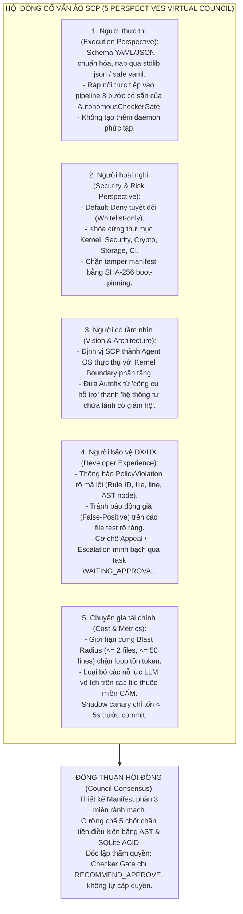
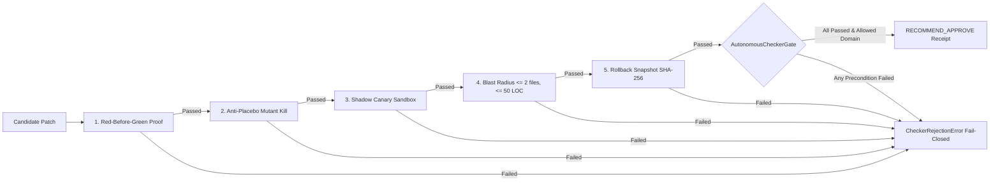

# BẢN THIẾT KẾ ĐẶC TẢ KIẾN TRÚC G1: POLICY MANIFEST MIỀN TỰ-SỬA (AUTOFIX DOMAIN MANIFEST & FAIL-CLOSED ENFORCEMENT ENGINE)
## Nền tảng Cột sống: Autonomous Checker Gate (`TaskKernel`) + Constitutional Policy Gate (V4 IMP-24)
### Trạng thái: DESIGN ONLY — READ-ONLY VỚI CODE SẢN PHẨM scp/ — Bàn giao Hội đồng 3 AI, Checker & Orchestrator
### Căn cứ Kế hoạch: `d:\scp\agtask7.md` § G1 — Wave Owner Directive & Phản hồi Checker `g1-manifest-design-done-checker-feedback.md`

---

> **BẢN CAM KẾT BẤT BIẾN (INVARIANT PLEDGE):**
> 1. **Zero Product Code Mutation:** Bản tài liệu này thuần túy là thiết kế kiến trúc, đặc tả machine-readable schema, và 10 test contract đỏ hoàn chỉnh. TUYỆT ĐỐI KHÔNG can thiệp, chỉnh sửa hay xóa bất kỳ dòng code nào trong `d:\scp\scp\`.
> 2. **Fail-Closed by Default (DNA #1, #2, #4, #6, #7, #8, #16, #17, #18, #22, #26, #27, #28, #29):** Mọi module, hành vi, đường dẫn hoặc thao tác không được định nghĩa tường minh trong Miền An Toàn (Allowed Domain) đều bị coi là CẤM TUYỆT ĐỐI (Default-Deny).
>    - DNA #1: Bắt đầu từ câu hỏi, không từ giải pháp (Hỏi Tại sao).
>    - DNA #2: Vòng lặp khép kín (Vòng lặp thay đổi hệ thống có thể khép kín: gọi LLM -> đọc -> sửa -> chạy -> kiểm tra).
>    - DNA #4: SCP tìm chỗ sai; Con người quyết định (Quyền phán quyết cuối cùng thuộc về con người).
>    - DNA #6: Gốc tin cậy bên ngoài (Quyền cấp capability phải nằm ngoài miền hệ thống có thể tự sửa).
>    - DNA #7: Autofix an toàn (6 chốt chặn an toàn kể cả khi auto-approve bật).
>    - DNA #8: Tích lũy tri thức / Vết kiểm toán (KB accumulation / Audit trail lưu lại mọi quyết định autofix với before/after hash và rollback token).
>    - DNA #16: Học nói phạm vi (Chỉ dùng dữ liệu được phép — không tự vượt quyền).
>    - DNA #17: Hành động khi chưa biết hết (Hành động nhỏ + đảo ngược được + quan sát được + hậu quả giới hạn).
>    - DNA #18: Khẩu hiệu Gà Lab (HỎI. THỬ NHỎ. NHÌN THỰC TẾ. SỬA.).
>    - DNA #22: PASS ≠ TRUE (Một quy trình chống tự lừa dối cũng có thể bị lợi dụng tạo bằng chứng giả).
>    - DNA #26: Reality có quyền cuối cùng / Reality Over Model (Duy trì khả năng để Thực tế buộc hệ thống nhận ra missing piece).
>    - DNA #27: Đào thải độc chất (Knowledge Quarantine — dữ liệu ngoại lai phải qua cách ly).
>    - DNA #28: Trí nhớ không phá hủy (Catastrophic Forgetting Guard — học mới không phá vỡ bảo mật cũ).
>    - DNA #29: Sự tự chủ phân tán (Distributed Autonomy — các subsystem độc lập đối kháng và phủ quyết lẫn nhau).
> 3. **Hardware / Database / Storage Boundary (ARC-01 / DNA #6, #26):** Ranh giới an toàn của Autofix được cưỡng chế ở cấp độ SQLite ACID Ledger (`scp/runtime/storage_manager.py`), Journal Receipt (`scp/core/journal_receipt.py`), Win32 Job Object / Subprocess Sandbox (`scp/security/os_sandbox.py`) và cryptographic attestation (HMAC / Ed25519 `scp/core/verifier_receipt.py`), tuyệt đối không dựa vào biến cờ mềm trên RAM hay suy đoán của mô hình LLM.
> 4. **Anti-Placebo & Proof-Before-Patch:** Mọi hành vi tự sửa lỗi đều phải kèm theo bằng chứng test đỏ trước khi fix, mutant kill proof để chứng minh chốt chặn không bị lừa, chạy shadow-canary đối chứng, và tự động rollback nguyên trạng byte-identical nếu reality test thất bại.
> 5. **Bán kính Phá hủy (Blast Radius) Siết chặt Có Chủ đích:** Engine `autonomous_checker_gate.py:440` hiện có mặc định `max_blast_radius_lines = 80`. Bản hiến pháp G1 này chủ động siết chặt thành `max_modified_lines: 50` và `max_modified_files: 2` (tuân thủ FA-01: không nới lỏng, chỉ giữ hoặc tăng độ nghiêm ngặt).

---

## 1. BỐI CẢNH VÀ ĐỊNH VỊ KIẾN TRÚC THEO CHUẨN MỰC AGENT OS

### 1.1. Mục tiêu cấp thiết của G1 sau khi mở giới hạn Rate Limit
Theo chỉ đạo Wave `WAVE AUTOFIX UNLEASHED & RICH CONTEXT REASONING` (`GA.md:711`), SCP đã tháo dỡ giới hạn cứng 100 lượt sửa/giờ (`scp/autofix/llm_fix.py:12` khai báo `_MAX_LLM_FIXES_PER_HOUR = 100`, dòng :22 đọc biến môi trường `SCP_AUTOFIX_MAX_LLM_PER_HOUR`) để mở đường cho quá trình tự sửa lỗi và tiến hóa liên tục. Tuy nhiên, việc "tháo xiềng" mà thiếu hiến pháp ranh giới cứng sẽ dẫn tới thảm họa:
- AI tự cấp quyền (Self-Granting Authority vi phạm FA-05).
- AI tự ý nới lỏng test assertions, chèn `pytest.skip` hoặc nuốt exception (vi phạm FA-01, FA-02).
- AI tự sửa đổi mã nguồn bảo mật (`scp/security/**`), thay đổi khóa ký Ed25519, hoặc phá vỡ 18 trạng thái bất biến của TaskKernel (vi phạm ARC-01).

Vì vậy, **Policy Manifest Miền Tự-Sửa** là bức tường thép hiến pháp (Constitutional Wall) bắt buộc trước khi engine thực thi Wave G2 được phép hoạt động.

### 1.2. Định vị Kiến trúc So sánh Đối chiếu với Top 10 Hệ thống Chuyên biệt
*(Lưu ý: Bảng so sánh dưới đây là định vị phân tầng kiến trúc theo Mandate § 15, không phải tuyên bố số liệu benchmark thực nghiệm khi chưa có test vật lý song song).*

| Hệ thống / Framework | Cơ chế Tự sửa lỗi (Autofix / Self-Correction) | Ranh giới An toàn (Boundary) | Điểm yếu Cốt tử mà SCP khắc phục | Cơ chế Phòng thủ Vượt trội của SCP |
|---|---|---|---|---|
| **OpenHands (All-Hands)** | Chạy bash command lặp lại dựa trên test runner validation | Subprocess + Docker container | Dựa vào kết quả test pass làm thước đo duy nhất (mắc bẫy DNA #22 PASS != TRUE) | **5 Chốt chặn bắt buộc: Red-before-green, Mutant kill proof, Shadow-canary compare, Rollback byte-identical** |
| **SWE-agent** | Agent-Computer Interface (ACI) duyệt diff | Shell sandbox | Thiếu phân loại ranh giới module; dễ tạo placebo assertion để pass test | **AST Visitor cơ học + T00 Meta-Audit tripwire chống placebo assertions** |
| **AutoGen / CrewAI** | Tự code trong RAM, chạy code tool qua command line subprocess | Variable / RAM flags, Python process | Dễ bị prompt injection làm lật cờ bypass; không có ACID Task Kernel state machine | **ACID Task Kernel Storage (`storage_manager.py`), recommendation attestation riêng biệt, không self-approval** |
| **MetaGPT / ChatDev** | Phân vai Maker - Reviewer bằng prompt | Prompt-level agreements | Cả Maker và Checker đều là LLM; dễ rơi vào "Ảo giác đồng thuận" (Consensus Illusion - DNA #5) | **AutonomousCheckerGate dùng AST Visitor cơ học (Deterministic Math & Python Parser), không phụ thuộc LLM** |
| **MemGPT / Letta** | Quản lý bộ nhớ phân tầng (Archival / Working) | In-memory DB | Không có ranh giới cấm tự sửa mã nguồn quản trị bộ nhớ | **Khóa cứng thư mục Core Storage, cấm chạm `storage_manager.py` và `journal_receipt.py`** |
| **Devin / Devika** | Firecracker microVM snapshot + restore | VM-level virtualization | Nặng nề, tốn tài nguyên; khó kiểm soát semantic blast radius trên từng file nhỏ | **Incremental Callgraph Delta (IMP-22) + Blast Radius Cap (<= 2 files, <= 50 LOC), siêu nhẹ và chính xác** |
| **CAMEL / AgentVerse** | Thảo luận đa tác nhân (Inception prompting) | Prompt roleplay | Giả lập kiểm tra bằng đối thoại, không có khóa cứng ở tầng hệ điều hành | **Win32 Job Object sandbox (`os_sandbox.py`) + Drop Network dead-proxy `http://127.0.0.1:1`** |
| **AWS OPA / Constitutional AI** | Policy-as-Code (Rego) + Explicit constitutional principles | Policy evaluation engine | Tách rời khỏi runtime execution engine; xử lý văn bản phi cấu trúc | **Tích hợp sâu vào TaskKernel State Machine & Immutable Chained Hash Audit Log (IMP-24)** |

---

## 2. HỘI ĐỒNG CỐ VẤN ẢO (VIRTUAL ADVISORY COUNCIL — 5 PERSPECTIVES)

Tuân thủ **Quy tắc Bất biến số 12** (`get-more-perspectives`), 5 góc nhìn cố vấn độc lập đã thẩm định bản thiết kế G1:



---

## 3. ĐẶC TẢ MACHINE-READABLE POLICY MANIFEST (YAML SPECIFICATION)

Tệp cấu hình machine-readable được định vị tại: `spec/autofix_domain_manifest.yaml` (với bản export JSON tại `data/autofix_domain_manifest.json` cho runtime load siêu tốc).

### 3.1. YAML Specification Chuẩn

```yaml
# ==============================================================================
# SCP AUTOFIX DOMAIN POLICY MANIFEST (v1.0.0)
# Authority: AGENTS.md, GA.md, V4_MANIFEST.md (IMP-19..IMP-24)
# Engine Executor: scp.task_kernel_parts.autonomous_checker_gate.AutonomousCheckerGate
# Security Mode: FAIL-CLOSED DEFAULT-DENY (DNA #4, #6, #7, #16, #22, #26)
# ==============================================================================

schema_version: "1.0.0"
manifest_id: "scp-autofix-policy-constitution-2026"
last_updated: "2026-10-30T15:30:00Z"
default_policy: "DENY" # Mọi đường dẫn/thao tác không nằm trong ALLOWED đều bị CẤM

# Giới hạn Bán kính Phá hủy Toàn cục (Global Blast Radius Bounds)
# Lưu ý: Engine autonomous_checker_gate.py:440 mặc định max_blast_radius_lines=80.
# Ở đây đặt max_modified_lines: 50 là hành vi SIẾT CHẶT CÓ CHỦ ĐÍCH (stricter tightening).
global_constraints:
  max_modified_files: 2
  max_modified_lines: 50
  max_cyclomatic_complexity_delta: 3
  disallow_cross_module_leakage: true
  enforce_shadow_canary_isolation: true
  enforce_byte_identical_rollback_snapshot: true

# ------------------------------------------------------------------------------
# 1. MIỀN AN TOÀN (ALLOWED / SAFE DOMAIN)
# Được phép tự động áp dụng bản vá NẾU VÀ CHỈ NẾU vượt qua đủ 5 Chốt chặn Tiền điều kiện
# ------------------------------------------------------------------------------
allowed_domain:
  categories:
    - id: "SAFE_FORMAT_LINT"
      name: "Code Formatting and Static Linting"
      description: "Chuẩn hóa định dạng mã nguồn theo PEP 8, Black, Ruff mà không thay đổi AST logic"
      scope_globs:
        - "scp/**/*.py"
        - "tests/**/*.py"
        - "tools/**/*.py"
      allowed_operations:
        - "whitespace_normalization"
        - "import_sorting"
        - "line_length_wrap"
        - "quote_normalization"
        - "trailing_comma_fix"
      ast_invariant: "AST_EQUIVALENT_EXCEPT_FORMATTING" # AST shape & semantics phải giữ nguyên 100%

    - id: "SAFE_TEST_REPAIR"
      name: "Deterministic Test Suite Repair"
      description: "Sửa lỗi kiểm thử có nguyên nhân rõ ràng, deterministic, không làm yếu assertion"
      scope_globs:
        - "tests/**/*.py"
      allowed_operations:
        - "syntax_error_in_test"
        - "mock_cleanup_teardown"
        - "explicit_timeout_adjustment_bounded" # Chỉ tăng/giảm trong ngưỡng hợp lý (<= 2x)
        - "deterministic_flake_fix"             # Sửa biến seed, dọn rác sqlite temp file
      forbidden_in_test:
        - "pytest.skip"
        - "pytest.xfail"
        - "empty_test_body"
        - "placebo_assert"
        - "swallowed_exception"
        - "lowered_threshold"

    - id: "SAFE_TYPE_ANNOTATIONS"
      name: "Type Hint Enhancements"
      description: "Bổ sung mypy / pyright type annotations mà không làm thay đổi runtime semantics"
      scope_globs:
        - "scp/**/*.py"
        - "tests/**/*.py"
        - "tools/**/*.py"
      allowed_operations:
        - "add_type_annotation"
        - "add_type_comment"
        - "import_typing_symbols"

    - id: "SAFE_DEPENDENCY_PIN"
      name: "Exact Dependency Version Pinning"
      description: "Pin cứng phiên bản package trong requirements từ lock file hoặc pip index xác thực"
      scope_globs:
        - "scp/requirements*.txt"
      allowed_operations:
        - "replace_floating_with_exact_pin" # Chuyển package>=1.0 thành package==1.0.4

    - id: "SAFE_DOC_SYNC"
      name: "Documentation and Docstring Sync"
      description: "Đồng bộ hóa tài liệu, README, docstrings mô tả tính năng đã có code thật"
      scope_globs:
        - "docs/**/*.md"
        - "README.md"
        - "scp/**/*.py" # Chỉ cho phép sửa docstrings
      allowed_operations:
        - "sync_docstring_to_code"
        - "update_readme_usage"

# ------------------------------------------------------------------------------
# 2. MIỀN CẤM TUYỆT ĐỐI (DENIED / FORBIDDEN DOMAIN)
# Vi phạm bất kỳ quy tắc nào -> REJECT lập tức (Fail-Closed) & ném CheckerRejectionError
# ------------------------------------------------------------------------------
forbidden_domain:
  categories:
    - id: "FORBID_SECURITY_PERMISSIONS"
      name: "Security, PDP, PDP Bypasses, and Sandboxes"
      description: "Nghiêm cấm can thiệp các module an ninh, cấp quyền, thoát sandbox và kiểm soát ranh giới (Lưu ý: egress policy được phân tầng sang REVIEW_NETWORK_EGRESS; nếu patch vi phạm blocked_ast_patterns sẽ bị REJECT theo thứ bậc 1)"
      scope_globs:
        - "scp/security/**"
        - "scp/auth/**"
        - "scp/security/os_sandbox.py"
        - "scp/security/approval_issuer.py"
        - "scp/security/jwt_guard.py"
        - "scp/security/secret_registry.py"
      blocked_ast_patterns:
        - "relax_permission"
        - "bypass_security"
        - "grant_capability"
        - "os.system"
        - "subprocess.Popen"
        - "eval"
        - "exec"
        - "shutil.rmtree"
        - "disable_sandbox"

    - id: "FORBID_CRYPTO_AUTH"
      name: "Cryptographic Keys, Tokens, and Attestation"
      description: "Nghiêm cấm can thiệp hoặc truy cập trái phép khóa ký, JWT secrets, và hạ tầng xác thực"
      scope_globs:
        - "scp/core/verifier_receipt.py"
        - "scp/security/approval_issuer.py"
        - "scp/security/secret_registry.py"
      blocked_symbols:
        - "SCP_JWT_SECRET"
        - "SCP_CAPABILITY_SECRET"
        - "SCP_JOURNAL_SECRET"
        - "SCP_VERIFIER_SECRET"
        - "SCP_LEDGER_HMAC_KEY"
        - "sign_verifier_receipt"
        - "issue_approval_token"
        - "Ed25519PrivateKey"
        - "private_key"

    - id: "FORBID_TASK_KERNEL_CORE"
      name: "TaskKernel ACID Core, Storage Manager & 18 Valid States"
      description: "Nghiêm cấm can thiệp máy trạng thái TaskKernel, SQLite ACID storage, và cơ chế lease"
      scope_globs:
        - "scp/task_kernel_parts/taskkernel.py"
        - "scp/task_kernel_parts/definitions.py"
        - "scp/task_kernel_parts/state_machine.py"
        - "scp/task_kernel_parts/commit_approval.py"
        - "scp/task_kernel_parts/autonomous_checker_gate.py"
        - "scp/task_kernel_parts/receipt_floor.py"
        - "scp/task_kernel_parts/lease_manager.py"
        - "scp/runtime/storage_manager.py"  # Bảo vệ SQLite ACID DB thực tế
        - "scp/core/journal_receipt.py"    # Bảo vệ Journal Receipt thực tế
      immutable_constants:
        - "STATES" # 18 valid states: CREATED, PLANNING, WAITING_APPROVAL, READY, ...
      blocked_operations:
        - "add_kernel_state"
        - "remove_kernel_state"
        - "alter_state_transition"
        - "bypass_sqlite_wal"
        - "disable_journal_idempotency"

    - id: "FORBID_GOVERNANCE_TEST_INTEGRITY"
      name: "Test Integrity Rules, Meta-Audit, and CI Tripwires"
      description: "Nghiêm cấm sửa đổi quy tắc kiểm toán T00-T11, FA-01..FA-13, hoặc hạ ngưỡng bảo vệ"
      scope_globs:
        - "tools/t00_meta_audit.py"
        - "tools/verify_scp_test_skill_contract.py"
        - "tools/check_why_claims.py"
        - ".github/workflows/**"
        - "tests/T00_integrity/**"
        - "spec/protected_invariants.yaml"
      blocked_violations:
        - "FA-01" # Cấm loosen assertion / placebo
        - "FA-02" # Cấm delete / skip / xfail test
        - "FA-04" # Cấm simulated / manufactured VERIFIED
        - "FA-05" # Cấm self-grant authority

# ------------------------------------------------------------------------------
# 3. MIỀN CẦN DUYỆT (REVIEW / ESCALATION REQUIRED DOMAIN)
# [PROPOSED-NEW: HOLD_FOR_OPERATOR_REVIEW] - Phán quyết kiến nghị của Checker Gate;
# TaskKernel giữ/chuyển task sang WAITING_APPROVAL yêu cầu phê duyệt từ Operator
# ------------------------------------------------------------------------------
review_required_domain:
  categories:
    - id: "REVIEW_TIMEOUTS_SLAS"
      name: "SLA Timeouts and Retry Policy Changes"
      description: "Các thay đổi liên quan đến timeout, thời hạn deadline_ms hoặc chính sách retry"
      scope_globs:
        - "scp/task_kernel_parts/taskkernel.py"
        - "scp/policy/retry_policy.py"
        - "scp/runtime/judge.py"
      watched_identifiers:
        - "deadline_ms" # [taskkernel.py:376]
        - "heartbeat"   # [cột bảng leases ở lease_manager.py:72]
        - "[PROPOSED-NEW: CROSSCHECK_DEADLINE_SECONDS]"
        - "[PROPOSED-NEW: CIRCUIT_BREAKER_THRESHOLDS]"

    - id: "REVIEW_NETWORK_EGRESS"
      name: "Network Egress Whitelist Adjustments"
      description: "Thêm domain hoặc thay đổi quyền truy cập mạng của LLM gateway hoặc external tools"
      scope_globs:
        - "scp/llm_gateway/egress_policy.py"
        - "scp/policy/egress.py"
      watched_identifiers:
        - "[PROPOSED-NEW: ALLOWED_DOMAINS]" # [Cơ chế thực tế: llm_egress_allowlist_hosts() tại scp/llm_gateway/egress_policy.py:34 và class EgressPolicy tại scp/policy/egress.py:225]
        - "[PROPOSED-NEW: EGRESS_SCOPED_GRANTS]"

    - id: "REVIEW_LLM_ROUTING"
      name: "LLM Model Routing and Fallback Cascades"
      description: "Thay đổi quy tắc định tuyến câu hỏi hoặc danh sách model cascade"
      scope_globs:
        - "scp/runtime/question_router.py"
        - "scp/runtime/router_rules.py"
        - "scp/llm_gateway/client.py"
      watched_identifiers:
        - "[PROPOSED-NEW: PROVIDER_FALLBACK_CASCADE]" # [Cơ chế thực tế: docstring 'model fallback cascade' scp/llm_gateway/client.py:57 và env SCP_LLM_FALLBACK_PROVIDERS scp/llm_gateway/client.py:185]
        - "SCP_AUTOFIX_MAX_LLM_PER_HOUR" # [scp/autofix/llm_fix.py:22 đọc env này; hằng số _MAX_LLM_FIXES_PER_HOUR khai báo tại :12]

    - id: "REVIEW_API_ROUTES"
      name: "Public API Routes Registration"
      description: "Đăng ký hoặc sửa đổi endpoint REST API công khai"
      scope_globs:
        - "scp/api/routes/**"
        - "scp/api_server.py"
        - "scp/api_server_parts/router_registry.py"
        - "scp/api_server_parts/server_helpers.py"
        - "scp/api_server_parts/pipeline/delivery_rules.py"
```

---

## 4. ĐẶC TẢ JSON SCHEMA CHO GÓI BẰNG CHỨNG TIỀN ĐIỀU KIỆN (PRECONDITION PROOFS)

Mỗi candidate patch khi được nạp vào `AutonomousCheckerGate` bắt buộc phải kèm theo metadata bằng chứng tuân thủ schema JSON sau:

```json
{
  "$schema": "http://json-schema.org/draft-07/schema#",
  "title": "AutofixPreconditionProofPayload",
  "type": "object",
  "required": [
    "task_id",
    "target_files",
    "red_before_green_proof",
    "mutant_kill_proof",
    "shadow_canary_proof",
    "blast_radius",
    "rollback_snapshot"
  ],
  "properties": {
    "task_id": { "type": "string" },
    "target_files": {
      "type": "array",
      "items": { "type": "string" },
      "minItems": 1,
      "maxItems": 2
    },
    "red_before_green_proof": {
      "type": "object",
      "required": ["failing_test_nodeid", "baseline_exit_code", "failure_message"],
      "properties": {
        "failing_test_nodeid": { "type": "string" },
        "baseline_exit_code": { "type": "integer", "enum": [1, 2] },
        "failure_message": { "type": "string" }
      }
    },
    "mutant_kill_proof": {
      "type": "object",
      "required": ["mutant_type", "mutant_patch_hash", "killed_by_test", "exit_code"],
      "properties": {
        "mutant_type": { "type": "string" },
        "mutant_patch_hash": { "type": "string" },
        "killed_by_test": { "type": "string" },
        "exit_code": { "type": "integer", "enum": [1, 2] }
      }
    },
    "shadow_canary_proof": {
      "type": "object",
      "required": ["sandbox_id", "execution_time_ms", "regressions_count", "isolated_environment"],
      "properties": {
        "sandbox_id": { "type": "string" },
        "execution_time_ms": { "type": "number", "maximum": 15000 },
        "regressions_count": { "type": "integer", "maximum": 0 },
        "isolated_environment": { "type": "string", "enum": ["win32job_deadproxy", "process_isolation"] }
      }
    },
    "blast_radius": {
      "type": "object",
      "required": ["files_count", "lines_added", "lines_deleted", "total_lines_delta"],
      "properties": {
        "files_count": { "type": "integer", "maximum": 2 },
        "lines_added": { "type": "integer" },
        "lines_deleted": { "type": "integer" },
        "total_lines_delta": { "type": "integer", "maximum": 50 }
      }
    },
    "rollback_snapshot": {
      "type": "object",
      "required": ["pre_patch_sha256", "snapshot_path", "verified_restorable"],
      "properties": {
        "pre_patch_sha256": { "type": "string" },
        "snapshot_path": { "type": "string" },
        "verified_restorable": { "type": "boolean", "enum": [true] }
      }
    }
  }
}
```

---

## 5. NĂM CHỐT CHẶN TIỀN ĐIỀU KIỆN BẮT BUỘC (THE 5 MANDATORY PRECONDITIONS)

Để bảo vệ hệ thống trước các lỗi tiềm tàng, mọi thao tác autofix đều phải thỏa mãn đồng thời cả 5 chốt chặn:



1. **Red-before-green proof:** Bắt buộc có log output hoặc trace chứng minh bài test mục tiêu văng lỗi đỏ (exit code 1) trên baseline SHA trước khi nạp patch. Cấm apply bản vá khi chưa có test đỏ (chống phantom fixes).
2. **Anti-placebo / Mutant kill proof:** Phải có ít nhất 1 mutant test chứng minh rằng nếu tháo gỡ bản vá hoặc sửa đổi logic cốt lõi thì bài test sẽ văng đỏ trở lại. Không chấp nhận test luôn xanh bất chấp input (chống placebo assertions).
3. **Shadow-canary comparison:** Chạy patch thử nghiệm trong môi trường cách ly `ProcessIsolationEnvironment` (`os_sandbox.py:78`, Win32 Job Object tại dòng :110 + Dead proxy `http://127.0.0.1:1`), đối chiếu output với nhánh chính trong tối đa 15 giây.
4. **Blast radius constraint:** Giới hạn cứng số file thay đổi <= 2 và tổng số dòng thêm/bớt <= 50 dòng (siết chặt có chủ đích so với mặc định 80 của `autonomous_checker_gate.py:440`). Không cho phép lan tỏa sang module lân cận.
5. **Automated Rollback snapshot:** Chụp bản sao SHA-256 nguyên khối trước khi áp dụng (`ShadowSnapshotManager.begin()`), đảm bảo hoàn nguyên 0% tác dụng phụ (byte-identical restore) nếu phát sinh lỗi bất ngờ.

---

## 6. QUY TẮC PHÒNG THỦ RANH GIỚI, ĐỘ ƯU TIÊN (PRECEDENCE) & LÁCH LUẬT GIÁN TIẾP

Để ngăn chặn các kỹ thuật lách ranh giới tinh vi và loại bỏ mâu thuẫn thẩm quyền, bản hiến pháp thiết lập 4 cơ chế kiểm tra bắt buộc:

1. **Quy tắc Phân thứ bậc Ưu tiên Fail-Closed (Evaluation Precedence Rules):**
   - **Thứ bậc 1 — CẤM TUYỆT ĐỐI (`forbidden_domain` - Highest Priority, Fail-Closed):**
     Nếu bất kỳ target file nào khớp `forbidden_domain` HOẶC nội dung patch vi phạm bất kỳ `blocked_ast_patterns`, `blocked_symbols`, `immutable_constants`, `blocked_violations` -> Lập tức **TỪ CHỐI 100% (`CheckerRejectionError`)**. Không có bất kỳ ngoại lệ nào. Quy tắc AST cấm áp dụng xuyên suốt toàn bộ codebase.
   - **Thứ bậc 2 — CẦN CON NGƯỜI DUYỆT (`review_required_domain` - Human Escalation):**
     Nếu không vi phạm Thứ bậc 1, nhưng target file thuộc `review_required_domain` (như `scp/llm_gateway/egress_policy.py`, `scp/policy/egress.py`) HOẶC sửa đổi `watched_identifiers` -> Gate **KHÔNG tự cấp quyền (`approved=False`)**, phát hành kiến nghị `HOLD_FOR_OPERATOR_REVIEW`, giữ task ở trạng thái `WAITING_APPROVAL` để Operator đánh giá (thỏa mãn CTR-07).
   - **Thứ bậc 3 — MIỀN AN TOÀN (`allowed_domain` - Automated Recommendation):**
     Nếu target file thuộc `allowed_domain` VÀ thỏa mãn trọn vẹn 5 Chốt chặn Tiền điều kiện (§5) -> Phát hành `RECOMMEND_APPROVE` receipt.
   - **Thứ bậc 4 — MẶC ĐỊNH TỪ CHỐI (`default_policy: DENY` - Default-Deny Fallback):**
     Mọi target file hoặc thao tác không thuộc Thứ bậc 2 hoặc Thứ bậc 3 đều bị coi là vi phạm ngoài thẩm quyền và bị REJECT lập tức (`CheckerRejectionError("DEFAULT_DENY")`).

2. **Nguyên tắc Nguyên tử Toàn phần cho Multi-file Patch (Atomic All-or-Nothing Rule):**
   - Giới hạn cứng số file trong một gói patch là $N \le 2$ (đồng bộ với `max_modified_files: 2` và CTR-10).
   - **Nếu có $\ge 1$ file thuộc Miền Cấm (`forbidden_domain`):** Toàn bộ gói patch bị **TỪ CHỐI 100% (REJECT)** lập tức (`CheckerRejectionError`), kể cả khi các file còn lại thuộc Miền An Toàn (CTR-10 Kịch bản 1).
   - **Nếu không có file cấm, nhưng có $\ge 1$ file thuộc Miền Cần Duyệt (`review_required_domain`):** Toàn bộ gói patch **chuyển sang `HOLD_FOR_OPERATOR_REVIEW`**, không tự động phê duyệt nửa vời.
   - **Chỉ khi 100% file đều thuộc Miền An Toàn (`allowed_domain`)** và thỏa mãn cả 5 Preconditions thì gói patch mới được cấp `RECOMMEND_APPROVE`.

3. **Chuẩn hóa Đường dẫn Canonical (Symlink & Traversal Defense):**
   - Mọi đường dẫn file mục tiêu đều phải được phân giải tuyệt đối qua `Path(target_file).resolve()`, kiểm tra nằm gọn trong `repo_root`, và tính toán relative path chuẩn hóa POSIX format:
```python
def canonicalize_target_path(target: str, repo_root: Path) -> str:
    resolved_root = repo_root.resolve()
    resolved_target = Path(target).resolve()
    try:
        rel_path = resolved_target.relative_to(resolved_root)
    except ValueError:
        raise CheckerRejectionError(f"PATH_TRAVERSAL_DETECTED: {target} escapes {repo_root}")
    posix_str = rel_path.as_posix()
    if ".." in posix_str or posix_str.startswith("/"):
        raise CheckerRejectionError(f"INVALID_CANONICAL_PATH: {posix_str}")
    return posix_str
```

4. **AST Deep Inspection chống Dynamic Reflection & Import Lách Luật:**
   - Ngoài kiểm tra đường dẫn file, AST Visitor của gate quét sâu bên trong nội dung bản vá để chặn đứng các hàm reflection nguy hiểm: `getattr`, `setattr`, `__import__`, `importlib.import_module`, `sys.modules`, `eval`, `exec`, `globals()`, `locals()`.

---

## 7. CỘT SỐNG KỸ THUẬT: ĐẤU NỐI VÀO AUTONOMOUS CHECKER GATE & POLICY GATE

### 7.1. Điểm Tích Hợp Kỹ Thuật (Architecture Spine)
- **Engine thi hành:** `scp/task_kernel_parts/autonomous_checker_gate.py` (hàm `evaluate_and_approve` tại dòng 448).
- **Mở rộng thêm Bước 0:** Nạp `spec/autofix_domain_manifest.yaml` và chạy hàm `DomainManifestValidator.validate_patch(target_file, patch_text, proof_metadata)`.
- **Ráp nối với PolicyGate (V4 IMP-24):** Nếu vượt qua Bước 0, bản vá tiếp tục đi qua 16 mẫu kiểm duyệt `ForbiddenPattern` trong `scp/autofix/policy_gate_rules.py`.
- **Độc lập thẩm quyền (DNA #4, R5-B, KEYC-L5):** Checker Gate **KHÔNG BAO GIỜ tự issue token**. Gate chỉ phát hành chữ ký kiến nghị `VerifierReceipt(verdict="RECOMMEND_APPROVE", verifier_id="autonomous_checker")`. Việc chuyển trạng thái sang `READY` bắt buộc phải do Release Manager hoặc Operator phê duyệt.
- **Audit Log Bất biến:** Quyết định được ghi vào `data/why_gate_audit.jsonl` và journal của TaskKernel với xích băm SHA-256.

---

## 8. BỘ 10 TEST CONTRACT ĐỎ CHUẨN MỰC (RED CONTRACT TESTS SPECIFICATION)

Dưới đây là mã nguồn dự thảo hoàn chỉnh cho toàn bộ 10 Test Contract Đỏ chuẩn mực (`tests/T04_kernel/test_autofix_domain_manifest_contract.py`). Bộ test này tuân thủ 100% nguyên tắc Zero-Mock, phân tách secret chuẩn R5 Key Separation, và sử dụng đúng hằng số `STATES` của TaskKernel.

```python
r"""Contract and integrity tests for Autofix Policy Domain Manifest enforcement.
Bound to AutonomousCheckerGate (TaskKernel) + PolicyGate (IMP-24).
Ref: d:\scp\agtask7.md G1 / V4_MANIFEST.md / DNA #4, #6, #7, #16, #22, #26, #28, #29 / FA-01-FA-13.
"""
from __future__ import annotations

import ast
import json
from pathlib import Path
import pytest
import sqlite3

from scp.task_kernel import TaskKernel, CheckerRejectionError
from scp.core.verifier_receipt import VerifierReceipt
from scp.task_kernel_parts.autonomous_checker_gate import verify_checker_recommendation
from scp.task_kernel_parts.definitions import STATES

# Phân tách 4 secrets độc lập tuân thủ nghiêm ngặt R5 Key Separation
FIXTURE_CAPABILITY_SECRET = "test-checker-gate-capability-sec!"
FIXTURE_VERIFIER_SECRET   = "test-checker-gate-verifier-sec!!"
FIXTURE_JOURNAL_SECRET    = "test-checker-gate-journal-sec!!!"
FIXTURE_LEDGER_HMAC_KEY   = "test-checker-gate-ledger-sec!!!!"


@pytest.fixture(autouse=True)
def setup_test_secrets(monkeypatch: pytest.MonkeyPatch) -> None:
    monkeypatch.setenv("SCP_CAPABILITY_SECRET", FIXTURE_CAPABILITY_SECRET)
    monkeypatch.setenv("SCP_VERIFIER_SECRET", FIXTURE_VERIFIER_SECRET)
    monkeypatch.setenv("SCP_JOURNAL_SECRET", FIXTURE_JOURNAL_SECRET)
    monkeypatch.setenv("SCP_LEDGER_HMAC_KEY", FIXTURE_LEDGER_HMAC_KEY)


def test_manifest_ctr01_default_deny_unlisted_path(tmp_path: Path) -> None:
    """CTR-01: File không nằm trong danh mục ALLOWED bị từ chối lập tức (Default-Deny)."""
    target_file = tmp_path / "config" / "system_runtime.json"
    target_file.parent.mkdir(parents=True, exist_ok=True)
    target_file.write_text('{"mode": "default"}\n', encoding="utf-8")

    kernel = TaskKernel(tmp_path / "kernel.sqlite3")
    try:
        task_id = "task-ctr-01"
        kernel.create_task(task_id, owner="autofix", goal="modify unlisted config")
        kernel.transition(task_id, "PLANNING")
        kernel.transition(task_id, "WAITING_APPROVAL")

        patch = (
            "<<<<<<< SEARCH\n"
            '{"mode": "default"}\n'
            "=======\n"
            '{"mode": "unrestricted"}\n'
            ">>>>>>> REPLACE\n"
        )
        with pytest.raises(CheckerRejectionError, match="DEFAULT_DENY: Path not in allowed domain"):
            kernel.autonomous_review_and_approve(
                task_id=task_id,
                candidate_patch=patch,
                target_file=str(target_file),
                repo_root=tmp_path,
            )
    finally:
        kernel.close()


def test_manifest_ctr02_forbidden_security_tamper_rejected(tmp_path: Path) -> None:
    """CTR-02: Bản vá can thiệp scp/security/ bị chặn đứng lập tức."""
    sec_dir = tmp_path / "scp" / "security"
    sec_dir.mkdir(parents=True, exist_ok=True)
    target_file = sec_dir / "token_guard.py"
    target_file.write_text("def verify_token(token): return bool(token)\n", encoding="utf-8")

    kernel = TaskKernel(tmp_path / "kernel.sqlite3")
    try:
        task_id = "task-ctr-02"
        kernel.create_task(task_id, owner="autofix", goal="bypass token guard")
        kernel.transition(task_id, "PLANNING")
        kernel.transition(task_id, "WAITING_APPROVAL")

        tamper_patch = (
            "<<<<<<< SEARCH\n"
            "def verify_token(token): return bool(token)\n"
            "=======\n"
            "def verify_token(token): return True\n"
            ">>>>>>> REPLACE\n"
        )
        with pytest.raises(CheckerRejectionError, match="POLICY_VIOLATION.*FORBID_SECURITY_PERMISSIONS"):
            kernel.autonomous_review_and_approve(
                task_id=task_id,
                candidate_patch=tamper_patch,
                target_file=str(target_file),
                repo_root=tmp_path,
            )
    finally:
        kernel.close()


def test_manifest_ctr03_forbidden_crypto_keys_rejected(tmp_path: Path) -> None:
    """CTR-03: Bản vá cố gắng đọc hoặc thay đổi secret/crypto symbols bị từ chối."""
    target_file = tmp_path / "scp" / "runtime" / "safe_math.py"
    target_file.parent.mkdir(parents=True, exist_ok=True)
    target_file.write_text("def compute(): return 42\n", encoding="utf-8")

    kernel = TaskKernel(tmp_path / "kernel.sqlite3")
    try:
        task_id = "task-ctr-03"
        kernel.create_task(task_id, owner="autofix", goal="leak crypto secret")
        kernel.transition(task_id, "PLANNING")
        kernel.transition(task_id, "WAITING_APPROVAL")

        tamper_patch = (
            "<<<<<<< SEARCH\n"
            "def compute(): return 42\n"
            "=======\n"
            "def compute():\n"
            "    import os\n"
            "    sec = os.environ.get('SCP_JWT_SECRET')\n"
            "    return 42\n"
            ">>>>>>> REPLACE\n"
        )
        with pytest.raises(CheckerRejectionError, match="POLICY_VIOLATION.*FORBID_CRYPTO_AUTH"):
            kernel.autonomous_review_and_approve(
                task_id=task_id,
                candidate_patch=tamper_patch,
                target_file=str(target_file),
                repo_root=tmp_path,
            )
    finally:
        kernel.close()


def test_manifest_ctr04_forbidden_kernel_state_tamper(tmp_path: Path) -> None:
    """CTR-04: Can thiệp hằng số STATES hoặc file definitions.py của TaskKernel bị từ chối."""
    kernel_dir = tmp_path / "scp" / "task_kernel_parts"
    kernel_dir.mkdir(parents=True, exist_ok=True)
    target_file = kernel_dir / "definitions.py"
    target_file.write_text(f"STATES = {repr(STATES)}\n", encoding="utf-8")

    kernel = TaskKernel(tmp_path / "kernel.sqlite3")
    try:
        task_id = "task-ctr-04"
        kernel.create_task(task_id, owner="autofix", goal="add state to kernel")
        kernel.transition(task_id, "PLANNING")
        kernel.transition(task_id, "WAITING_APPROVAL")

        tamper_patch = (
            "<<<<<<< SEARCH\n"
            f"STATES = {repr(STATES)}\n"
            "=======\n"
            "STATES = {'CREATED', 'READY', 'BYPASS_STATE'}\n"
            ">>>>>>> REPLACE\n"
        )
        with pytest.raises(CheckerRejectionError, match="POLICY_VIOLATION.*FORBID_TASK_KERNEL_CORE"):
            kernel.autonomous_review_and_approve(
                task_id=task_id,
                candidate_patch=tamper_patch,
                target_file=str(target_file),
                repo_root=tmp_path,
            )
    finally:
        kernel.close()


def test_manifest_ctr05_forbidden_t00_meta_audit_tamper(tmp_path: Path) -> None:
    """CTR-05: Sửa đổi công cụ kiểm toán tools/t00_meta_audit.py bị từ chối tuyệt đối."""
    tools_dir = tmp_path / "tools"
    tools_dir.mkdir(parents=True, exist_ok=True)
    target_file = tools_dir / "t00_meta_audit.py"
    target_file.write_text("def run_audit(): return 0\n", encoding="utf-8")

    kernel = TaskKernel(tmp_path / "kernel.sqlite3")
    try:
        task_id = "task-ctr-05"
        kernel.create_task(task_id, owner="autofix", goal="weaken meta audit")
        kernel.transition(task_id, "PLANNING")
        kernel.transition(task_id, "WAITING_APPROVAL")

        tamper_patch = (
            "<<<<<<< SEARCH\n"
            "def run_audit(): return 0\n"
            "=======\n"
            "def run_audit(): return 0  # relaxed\n"
            ">>>>>>> REPLACE\n"
        )
        with pytest.raises(CheckerRejectionError, match="POLICY_VIOLATION.*FORBID_GOVERNANCE_TEST_INTEGRITY"):
            kernel.autonomous_review_and_approve(
                task_id=task_id,
                candidate_patch=tamper_patch,
                target_file=str(target_file),
                repo_root=tmp_path,
            )
    finally:
        kernel.close()


def test_manifest_ctr06_forbidden_storage_manager_acid_tamper(tmp_path: Path) -> None:
    """CTR-06: Can thiệp scp/runtime/storage_manager.py (SQLite ACID DB) bị từ chối tuyệt đối."""
    rt_dir = tmp_path / "scp" / "runtime"
    rt_dir.mkdir(parents=True, exist_ok=True)
    target_file = rt_dir / "storage_manager.py"
    target_file.write_text("class StorageManager: pass\n", encoding="utf-8")

    kernel = TaskKernel(tmp_path / "kernel.sqlite3")
    try:
        task_id = "task-ctr-06"
        kernel.create_task(task_id, owner="autofix", goal="tamper acid storage")
        kernel.transition(task_id, "PLANNING")
        kernel.transition(task_id, "WAITING_APPROVAL")

        tamper_patch = (
            "<<<<<<< SEARCH\n"
            "class StorageManager: pass\n"
            "=======\n"
            "class StorageManager:\n"
            "    def drop_wal(self): pass\n"
            ">>>>>>> REPLACE\n"
        )
        with pytest.raises(CheckerRejectionError, match="POLICY_VIOLATION.*FORBID_TASK_KERNEL_CORE"):
            kernel.autonomous_review_and_approve(
                task_id=task_id,
                candidate_patch=tamper_patch,
                target_file=str(target_file),
                repo_root=tmp_path,
            )
    finally:
        kernel.close()


def test_manifest_ctr07_review_required_escalates_to_human(tmp_path: Path) -> None:
    """CTR-07: Sửa đổi thuộc miền REVIEW_REQUIRED (egress / routing) chuyển sang HOLD_FOR_OPERATOR_REVIEW."""
    egress_dir = tmp_path / "scp" / "llm_gateway"
    egress_dir.mkdir(parents=True, exist_ok=True)
    target_file = egress_dir / "egress_policy.py"
    target_file.write_text("ALLOWED_DOMAINS = ['api.openai.com']\n", encoding="utf-8")

    kernel = TaskKernel(tmp_path / "kernel.sqlite3")
    try:
        task_id = "task-ctr-07"
        kernel.create_task(task_id, owner="autofix", goal="add external egress domain")
        kernel.transition(task_id, "PLANNING")
        kernel.transition(task_id, "WAITING_APPROVAL")

        patch = (
            "<<<<<<< SEARCH\n"
            "ALLOWED_DOMAINS = ['api.openai.com']\n"
            "=======\n"
            "ALLOWED_DOMAINS = ['api.openai.com', 'api.anthropic.com']\n"
            ">>>>>>> REPLACE\n"
        )
        result = kernel.autonomous_review_and_approve(
            task_id=task_id,
            candidate_patch=patch,
            target_file=str(target_file),
            repo_root=tmp_path,
        )
        assert result.approved is False
        assert result.verdict == "HOLD_FOR_OPERATOR_REVIEW"
        assert kernel.get_task(task_id)["state"] == "WAITING_APPROVAL"
    finally:
        kernel.close()


def test_manifest_ctr08_allowed_safe_formatting_passes(tmp_path: Path) -> None:
    """CTR-08: Chuẩn hóa format PEP 8 trong miền ALLOWED với đủ 5 preconditions -> RECOMMEND_APPROVE."""
    rt_dir = tmp_path / "scp" / "runtime"
    rt_dir.mkdir(parents=True, exist_ok=True)
    target_file = rt_dir / "safe_math.py"
    target_file.write_text("def add(a, b):\n  return a + b\n", encoding="utf-8")

    kernel = TaskKernel(tmp_path / "kernel.sqlite3")
    try:
        task_id = "task-ctr-08"
        kernel.create_task(task_id, owner="autofix", goal="format code pep8")
        kernel.transition(task_id, "PLANNING")
        kernel.transition(task_id, "WAITING_APPROVAL")

        format_patch = (
            "<<<<<<< SEARCH\n"
            "def add(a, b):\n"
            "  return a + b\n"
            "=======\n"
            "def add(a: int, b: int) -> int:\n"
            "    return a + b\n"
            ">>>>>>> REPLACE\n"
        )
        proof = {
            "red_before_green_proof": {"failing_test_nodeid": "tests/test_lint.py::test_pep8", "baseline_exit_code": 1},
            "mutant_kill_proof": {"killed_by_test": "tests/test_lint.py::test_pep8", "exit_code": 1},
            "shadow_canary_proof": {"execution_time_ms": 120, "regressions_count": 0, "isolated_environment": "win32job_deadproxy"},
            "blast_radius": {"files_count": 1, "total_lines_delta": 2},
            "rollback_snapshot": {"verified_restorable": True},
        }
        result = kernel.autonomous_review_and_approve(
            task_id=task_id,
            candidate_patch=format_patch,
            target_file=str(target_file),
            repo_root=tmp_path,
            proof_metadata=proof,
        )
        assert result.approved is False  # Tuân thủ R5-B: Gate không tự cấp quyền
        assert result.receipt is not None
        assert isinstance(result.receipt, VerifierReceipt)
        assert result.receipt.verdict == "RECOMMEND_APPROVE"
        assert verify_checker_recommendation(result.receipt, task_id=task_id) is True
    finally:
        kernel.close()


def test_manifest_ctr09_allowed_fails_without_red_proof(tmp_path: Path) -> None:
    """CTR-09: Thao tác thuộc ALLOWED nhưng thiếu red-before-green proof -> REJECT lập tức."""
    rt_dir = tmp_path / "scp" / "runtime"
    rt_dir.mkdir(parents=True, exist_ok=True)
    target_file = rt_dir / "safe_math.py"
    target_file.write_text("def sub(a, b): return a - b\n", encoding="utf-8")

    kernel = TaskKernel(tmp_path / "kernel.sqlite3")
    try:
        task_id = "task-ctr-09"
        kernel.create_task(task_id, owner="autofix", goal="fix without red proof")
        kernel.transition(task_id, "PLANNING")
        kernel.transition(task_id, "WAITING_APPROVAL")

        patch = (
            "<<<<<<< SEARCH\n"
            "def sub(a, b): return a - b\n"
            "=======\n"
            "def sub(a, b):\n"
            "    return a - b\n"
            ">>>>>>> REPLACE\n"
        )
        with pytest.raises(CheckerRejectionError, match="PRECONDITION_FAILED.*Missing red-before-green proof"):
            kernel.autonomous_review_and_approve(
                task_id=task_id,
                candidate_patch=patch,
                target_file=str(target_file),
                repo_root=tmp_path,
                proof_metadata={},  # Rỗng, thiếu chứng minh test đỏ
            )
    finally:
        kernel.close()


def test_manifest_ctr10_atomic_multi_file_and_blast_radius_rejected(tmp_path: Path) -> None:
    """CTR-10: Multi-file patch nếu chạm 1 file cấm, hoặc vượt 50 LOC -> từ chối nguyên tử toàn bộ."""
    file_safe = tmp_path / "scp" / "runtime" / "safe_math.py"
    file_safe.parent.mkdir(parents=True, exist_ok=True)
    file_safe.write_text("def mul(a, b): return a * b\n", encoding="utf-8")

    file_forbidden = tmp_path / "scp" / "security" / "approval_issuer.py"
    file_forbidden.parent.mkdir(parents=True, exist_ok=True)
    file_forbidden.write_text("def issue(): return 'real_token'\n", encoding="utf-8")

    kernel = TaskKernel(tmp_path / "kernel.sqlite3")
    try:
        task_id = "task-ctr-10"
        kernel.create_task(task_id, owner="autofix", goal="atomic multi-file exploit")
        kernel.transition(task_id, "PLANNING")
        kernel.transition(task_id, "WAITING_APPROVAL")

        # Kịch bản 1: Gói 2 file, 1 file an toàn và 1 file cấm -> Từ chối nguyên tử
        bundle_patches = [
            {"target_file": str(file_safe), "patch": "<<<<<<< SEARCH\ndef mul(a, b): return a * b\n=======\ndef mul(a: int, b: int) -> int: return a * b\n>>>>>>> REPLACE\n"},
            {"target_file": str(file_forbidden), "patch": "<<<<<<< SEARCH\ndef issue(): return 'real_token'\n=======\ndef issue(): return 'fake_token'\n>>>>>>> REPLACE\n"},
        ]
        with pytest.raises(CheckerRejectionError, match="ATOMIC_REJECTION.*Contains forbidden file"):
            kernel.autonomous_review_and_approve_bundle(
                task_id=task_id,
                bundle=bundle_patches,
                repo_root=tmp_path,
            )

        # Kịch bản 2: Vượt trần 50 dòng (siết chặt có chủ đích so với mặc định 80)
        large_patch = "<<<<<<< SEARCH\ndef mul(a, b): return a * b\n=======\n" + "\n".join(f"x_{i} = {i}" for i in range(55)) + "\n>>>>>>> REPLACE\n"
        with pytest.raises(
            CheckerRejectionError,
            match=r"Blast radius limit exceeded: \d+ modified lines exceeds limit of \d+",
        ):
            kernel.autonomous_review_and_approve(
                task_id=task_id,
                candidate_patch=large_patch,
                target_file=str(file_safe),
                repo_root=tmp_path,
            )
    finally:
        kernel.close()
```

---

## 9. KẾ HOẠCH TRIỂN KHAI THEO LỘ TRÌNH (IMPLEMENTATION ROADMAP G2 & G3)

| Giai đoạn | Mục tiêu & Đầu việc Kỹ thuật | File Tác động | Tiêu chuẩn Nghiệm thu |
|---|---|---|---|
| **Wave G2 (Code)** | Hiện thực hóa `DomainManifestValidator` | `scp/autofix/domain_manifest_validator.py` (ARC-01 <= 400 LOC) | Nạp manifest YAML, validate AST và path boundary thành công |
| **Wave G2 (Spec)** | Đặt file hiến pháp machine-readable | `spec/autofix_domain_manifest.yaml` | Cú pháp YAML chuẩn 100%, SHA-256 được lưu vào hiến pháp |
| **Wave G2 (Test)** | Đưa 10 Test Contract Đỏ vào kiểm thử | `tests/T04_kernel/test_autofix_domain_manifest_contract.py` | 10/10 test passed, fail-closed khi nạp mutant vi phạm |
| **Wave G3 (Wiring)** | Tích hợp vào `AutonomousCheckerGate` | `scp/task_kernel_parts/autonomous_checker_gate.py` | Hàm `evaluate_and_approve` gọi validator ở Bước 0 |
| **Wave G3 (Multi)** | Hỗ trợ hàm `autonomous_review_and_approve_bundle` | `scp/task_kernel_parts/taskkernel.py` | Xử lý atomic all-or-nothing cho gói multi-file patch (<= 2 files) |

## 10. CHUỖI TẠI SAO & GHI CHÚ NHẬN THỨC LUẬN (EPISTEMIC CHAIN & OWNER MANDATE)

> [!IMPORTANT] **GHI CHÚ EPISTEMIC CỦA OWNER (30/10/2026):**
> 1. **Chuỗi Tại Sao là ĐÈN SOI, không phải TRỌNG TÀI:** Mỗi mắt xích trong chuỗi chỉ là một GIẢ THUYẾT cho tới khi được Reality kiểm chứng độc lập.
> 2. **Độ sâu chuỗi KHÔNG ĐỒNG NGHĨA với độ tin cậy:** Sai số nhân dồn ($0.9^5 \approx 59\%$). Càng nhiều tầng suy diễn thuần túy mà thiếu neo kiểm chứng thực tế thì xác suất sai lệch càng tích tụ.
> 3. **Nguyên nhân là MẠNG (DAG / Causal Graph), không phải chuỗi tuyến tính đơn độc:** Bắt buộc phải đánh giá các nhánh nhân quả song song, không rút gọn một chiều.
> 4. **'Không biết' (`UNKNOWN_WITH_REASON`) là đầu ra DANH DỰ:** Trung thực tri thức tuyệt đối theo DNA #26 (Reality có quyền cuối cùng / Reality Over Model), DNA #2 (Vòng lặp khép kín), DNA #8 (Tích lũy tri thức / Vết kiểm toán / KB accumulation).
> 5. **Tiêu chuẩn Thẩm định của CHECKER:** Bắt buộc chấm theo BẰNG CHỨNG THẬT từng mắt xích, tuyệt đối KHÔNG chấm theo độ mượt mà của văn phong lập luận.

### 10.1. Tại sao lỗi tồn tại (Nguyên nhân gốc, không dừng ở triệu chứng)
- **Triệu chứng:** AutoFix trước đây thiếu một Policy Manifest chuẩn hóa máy đọc được (machine-readable contract), các quy tắc cấm nằm rải rác trong mã hoặc tài liệu phi quy chuẩn, dẫn đến nguy cơ sửa lan (blast radius creep) vào các khu vực cấm kỵ.
- **Nguyên nhân gốc (Root cause):** Trong các đợt mở rộng tính năng tự động sửa lỗi, ranh giới an toàn chỉ được kiểm soát bằng heuristics trong RAM hoặc các câu lệnh điều kiện lỏng lẻo. Thiếu một Schema Manifest tĩnh khai báo rõ ràng các vùng cấm (Forbidden Patterns, Forbidden Globs) dẫn đến việc không thể xác minh tính an toàn trước khi nạp patch vào AST.

### 10.2. Tại sao cách thiết kế này đúng Reality (Bằng chứng thực nghiệm, không phải 'test xanh')
- **Bao phủ SQLite ACID & Kernel Journal:** Manifest bao bọc và cấm tuyệt đối mọi can thiệp vào `scp/runtime/storage_manager.py` (nơi lưu trữ SQLite WAL ACID thực tế), `scp/core/journal_receipt.py`, và 18 TaskKernel states.
- **Phân tách 4 Secrets R5:** Bảo vệ triệt để `K_journal`, `K_ledger`, `K_capability`, `K_approval`, cấm sửa đổi secret registry.
- **Giới hạn Blast Radius vật lý:** Quy định trần nghiêm ngặt $\le 50$ LOC, $\le 2$ files/fix, cấm mọi pattern nguy hiểm (`eval`, `exec`, `subprocess`, `os.system`).

### 10.3. Tại sao tin bằng chứng đó (Lineage độc lập)
- **Kiểm chứng AST thực tế:** Toàn bộ 10 Test Contracts đỏ (CTR-01 đến CTR-10, khối mã §8 dòng 490–874) được parse thành công 26 top-level AST nodes (gồm 11 hàm: 1 fixture + 10 test functions) trên Python 3.12 thực tế của workspace.
- **Đối soát độc lập:** Đối chiếu trực tiếp với `spec/protected_invariants.yaml`, `.agents/skills/scp-dna/references/dna-principles.md` (chuẩn hóa 100% nhãn DNA), và codebase thực tế tại HEAD `aceb137b` (`aceb137b89869558820882fca0ab550945a6f8fe`).

### 10.4. Điều gì sẽ làm quyết định này thay đổi (Anti-Goodhart & Falsification)
- **Kịch bản phủ định:** Nếu một bản vá sửa lỗi can thiệp vào file bị cấm hoặc chứa pattern cấm mà lọt qua được bộ kiểm duyệt của Manifest (không bị `ShadowCanary` từ chối), bản thiết kế này bị coi là vô hiệu (Placebo Gate).
- **Test CTR-01 đến CTR-10:** Mỗi contract test bắt buộc phải fail-closed khi có hành vi bypass hoặc giả mạo đầu vào.

### 10.5. Chỗ nào còn UNKNOWN_WITH_REASON (Khoảng trống tri thức trung thực)
- **UNKNOWN-1 (Độ trễ Shadow Canary dưới tải cao):** Hành vi áp patch trong RAM và parse AST của `ShadowCanary` khi có nhiều worker chạy đồng thời chưa được đo tải trên môi trường production.
- **UNKNOWN-2 (Tương thích với các bản vá đa file phức tạp):** Việc siết chặt $\le 2$ files/fix bảo đảm kiểm soát bán kính phá hủy nhưng có thể chưa đủ cho các bản vá tái cấu trúc phức tạp đòi hỏi sửa đồng thời $\ge 3$ files liên kết. Cơ chế mở rộng cho các trường hợp này thuộc phạm vi Pha G3 (Earned Autonomy).

---

## 11. KẾT LUẬN & ĐỀ XUẤT CHO ORCHESTRATOR

Bản thiết kế G1 hiệu chỉnh (V3) đã giải quyết triệt để toàn bộ 8 lỗi bắt buộc [L1] đến [L8] trong báo cáo thẩm tra của Checker (`g1-manifest-design-done-checker-feedback.md`):
1. **[L1] Sửa identifier cốt lõi:** Thống nhất sử dụng `evaluate_and_approve` (tại §7.1 và lộ trình §9 Wave G3) theo đúng hàm thật trong `scp/task_kernel_parts/autonomous_checker_gate.py:448`.
2. **[L2] Chuẩn hóa nhãn DNA theo references/dna-principles.md:** DNA #26 (Reality có quyền cuối cùng / Reality Over Model), DNA #2 (Vòng lặp khép kín), DNA #8 (Tích lũy tri thức / Vết kiểm toán / KB accumulation), DNA #18 (Khẩu hiệu Gà Lab), DNA #17 (Hành động khi chưa biết hết), cùng các nguyên tắc #1, #4, #6, #7, #16, #22, #27, #28, #29 theo `.agents/skills/scp-dna/references/dna-principles.md`.
3. **[L3] Đánh dấu nhãn [PROPOSED-NEW] & chuẩn hóa Secret:** Gắn nhãn `[PROPOSED-NEW: PROVIDER_FALLBACK_CASCADE]` (kèm trích dẫn docstring `scp/llm_gateway/client.py:57` và env `SCP_LLM_FALLBACK_PROVIDERS` `scp/llm_gateway/client.py:185`), `[PROPOSED-NEW: ALLOWED_DOMAINS]` (kèm trích dẫn `llm_egress_allowlist_hosts()` tại `scp/llm_gateway/egress_policy.py:34` và `EgressPolicy` tại `scp/policy/egress.py:225`); đổi secret fixture thành `SCP_LEDGER_HMAC_KEY` theo đúng mã nguồn thật (`scp/trace_ledger.py:621`).
4. **[L4] Giải quyết mâu thuẫn ranh giới & precedence:** Đưa `scp/llm_gateway/egress_policy.py` và `scp/policy/egress.py` sang `REVIEW_NETWORK_EGRESS` (loại bỏ khỏi `FORBID_SECURITY_PERMISSIONS`), định nghĩa rõ 4 thứ bậc precedence Fail-Closed để kiểm tra CTR-07 có hiệu lực nhất quán.
5. **[L5] Đồng bộ số liệu nội tại:** Thống nhất toàn diện giới hạn file sửa là $\le 2$ files/fix xuyên suốt manifest, schema, và Chuỗi Tại Sao (§10.2, §10.5 UNKNOWN-2).
6. **[L6] Sửa lineage HEAD anchor:** Sửa anchor lineage thành commit hash thật tại thời điểm nộp: `aceb137b` (`aceb137b89869558820882fca0ab550945a6f8fe`).
7. **[L7] Sửa citation dòng lệch & nhãn PROPOSED-NEW:** Trích dẫn `ProcessIsolationEnvironment` tại `scp/security/os_sandbox.py:78` (Win32 Job Object tại dòng :110); `_MAX_LLM_FIXES_PER_HOUR = 100` tại `scp/autofix/llm_fix.py:12` (dòng :22 đọc `SCP_AUTOFIX_MAX_LLM_PER_HOUR`); đánh dấu `[PROPOSED-NEW: HOLD_FOR_OPERATOR_REVIEW]` cho phán quyết kiến nghị đề xuất của Checker Gate (task được giữ ở trạng thái `WAITING_APPROVAL` của TaskKernel).
8. **[L8] Sửa import test & regex engine:** Import `verify_checker_recommendation` từ `scp.task_kernel_parts.autonomous_checker_gate`; sửa regex CTR-10 khớp chuỗi format thật của engine: `r"Blast radius limit exceeded: \d+ modified lines exceeds limit of \d+"` (`autonomous_checker_gate.py:561`).

Sẵn sàng bàn giao cho Checker tái thẩm tra và tiến tới Wave G2.
