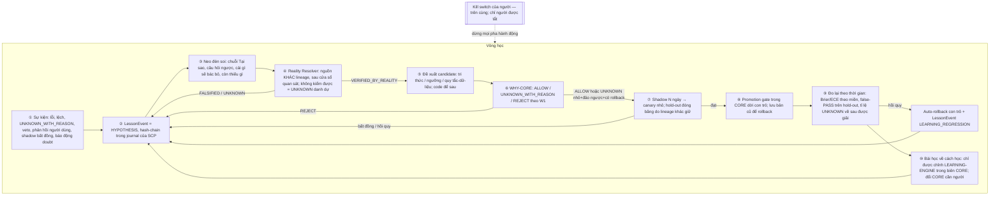

# THIẾT KẾ VÒNG TỰ HỌC / TIẾN HÓA CỦA SCP — KIỂM KÊ THẬT + VÒNG CẦN CÓ + LANE

- **Vai trò:** Kiến trúc sư / Auditor — CHỈ ĐỌC. Không sửa `scp/`, không commit.
- **Snapshot:** `main` @ `c9aa96e7` lúc đo gốc (nay `main` = `dee3ee5e`; số liệu sống được đo lại 31/10 09:52, xem mục Vòng sửa) (container sống `scp-full-backend-1` cũng báo HEAD `c9aa96e7`). Ngày 2026-10-31.
- **Skill đã nạp (đọc file thật):** `scp-dna`, `scp-learning-loop-guard`, `scp-continuous-operations-loop`; tham chiếu `WHY-GATE-restoration-plan.md` (W1–W6), `why-w2b-plan-done.md`, `g1-manifest-design-done.md`, `r8-shadow-canary-design.md`, `MUC-TIEU-HOAN-THIEN-SCP.md` (Cổng 2), truyện Gà R10 §33.
- **Tầm nhìn owner (31/10):** SCP không phải "cái gì cũng biết", mà phải **tự học, tiến hóa như một con người, càng ngày càng tốt hơn**. Mọi lỗi, lệch, `UNKNOWN_WITH_REASON` là **bài học**.
- **Mức bằng chứng của báo cáo này:**
  - (S) Static: `rg` caller trên `scp/ tools/ scripts/` (không tính `tests/`); có thể sót import động không theo tên module.
  - (R) Reality-state: đọc **chỉ-đọc** (`sqlite3 ?mode=ro`, `tail`) dữ liệu sống. Đã xác minh `scp-full-backend-1` bind-mount `D:\scp\data → /app/data` ⇒ `data/` trên host **chính là** dữ liệu runtime sống. Đây là quan sát *trạng thái*, chưa phải probe *hành vi* (không chạy request mới).
  - Một lineage (Claude) ⇒ verdict tối đa `STRONGLY_SUPPORTED` cho tới khi CHECKER khác lineage tái chạy các lệnh ở Phụ lục A.
  - Không đọc `.env` ⇒ cờ env trong container chỉ là giá trị process env; `.env` có thể ghi đè (UNKNOWN).

---

## Vòng sửa 31/10 (theo checker ca89)

Mọi số được chạy lại chỉ-đọc lúc 31/10 09:52 (main = `dee3ee5e`). Khi lệch checker, ghi cả hai.

| # | Điểm checker | Chỗ đã sửa | Số cũ -> mới | Lệnh tái chạy |
|---|---|---|---|---|
| 1 | failure_ledger "224/235 /tmp/pytest, 95%" | Tóm tắt mục 6, row #19, bảng 1.2, mục 5 | 224 / 95% -> pytest-marker 204 (đo lại) / 205 (checker) trên 235; 182 host + 22 container; 31 (checker 30) synthetic; không còn "224"/"95%" trong file (đã grep) | Phụ lục A, lệnh `failure_ledger` |
| 2 | rollback_registry "DEAD" | Row #26, bảng autofix 1.2, Phụ lục B | DEAD -> LIVE (bug token-not-found, 16 dòng, đo lại 16); replay_probe_runner STAGED-SUBPROCESS; repro_generator TOOL-REFERENCED | `rg -n inject_v2_extensions scp/autofix`; lệnh regression_watch |
| 3 | kb_evolve 30/30 `/tmp/pytest-of-scpuser` | Tóm tắt, row #7, mục 5, bảng 1.2 | -> 15 container + 15 host `pytest-of-check` (đo lại 15/15) | Phụ lục A, lệnh `kb_evolve` |
| 4 | metawhy 50 ký tự | row #6, Phụ lục B | 50 -> 100 (`[:100]` tại `metawhy_monitor.py:75-76`); 150 -> 155 dòng (đo lại 155) | `rg -n "\[:100\]" scp/meta/metawhy_monitor.py`; lệnh metawhy |
| 5 | why_gate "14 file" | row #4 | 14 -> 9 import trực tiếp / 19 file nhắc chuỗi (đo lại; checker 20); tiêu chí nêu trong row | 2 lệnh `rg -l` trong Phụ lục A |
| 6 | Hồ sơ cắt cụt | file này nằm trong repo `docs/architecture/LEARNING_LOOP_DESIGN.md`; có đủ L0a–L8, mục 5 "Chuỗi Tại Sao", Phụ lục A/B | - | `git show claude/learning-loop-design:docs/architecture/LEARNING_LOOP_DESIGN.md` |
| 7 | Luật 14 không mẫu câu | giữ nguyên | - | - |
| 8 | L1 đã triển khai | Ghi chú đối chiếu dưới L1 (lesson_ledger.py untracked trong main tree, 7/7 test) giữ nguyên | - | `ls scp/learning/lesson_ledger.py` |

Kiểm "người duyệt": các chỗ còn nhắc là (a) mô tả LangGraph ở mục 4 (hệ ngoài), (b) "owner đã duyệt" mẫu W6 (quá khứ), (c) "không người duyệt trong luồng" (Q1). Vòng học của SCP giữ đúng DNA: HYPOTHESIS -> Reality kiểm độc lập -> WHY -> shadow -> áp dụng/bác; người chỉ giữ kill switch.

---

## 0. TÓM TẮT (10 dòng)

1. SCP có **nhiều giác quan nhưng không có hệ thần kinh**: ít nhất 7 nơi đang ghi "sự cố/chưa rõ" (calibration, WHY plans, doubt ledger, failure ledger, metawhy, evidence_resolution, veto note) nhưng **không có consumer nào biến chúng thành bài học** (R+S).
2. Calibration: **661 dự đoán, 0 lần đối chiếu Reality**; 0/661 có `subject_claim_id`/`input_hash`/`tested_sha` ⇒ **về cấu trúc không thể đối chiếu** được (R).
3. Vòng nền WHY chạy thật: 16 plan, 12 executed (**cả 12 = UNKNOWN**), 4 pending; kết quả ghi ngược vào bảng rồi **không ai đọc** (R+S).
4. Doubt cron chạy 4.217 vòng (25→30/10), ~2.280 lần `DOUBT_DETECTED` (kernel_integrity hỏng) — **báo động không thành hành động/bài học** (R).
5. Các module "đóng vòng" đều **chết hoặc là vỏ**: Neo (`cognitive_engine`) 0 caller; `ReVerifyScheduler` 0 caller (docstring nói "Wired to /ask: YES" — **sai**); `CognitiveOrchestrator` tự ghi là no-op; `LessonAuthority/HypothesisAuthority/PromotionAuthority` không có caller runtime (S).
6. Hai kho "bài học" duy nhất đang được ghi **bị test đầu độc**: `kb_evolve` **30/30** lesson (15 container `/tmp/pytest-of-scpuser` + 15 host `pytest-of-check`) và `failure_ledger` **235/235** bản ghi từ nguồn test (chứa pytest marker: 204 đo lại 31/10 09:52 (182 `pytest-of-check` host Windows + 22 `/tmp/pytest` container; checker ca89 đo 205 — lệch 1 do drift/tiêu chí khớp chuỗi), phần còn lại 31 (checker: 30) trỏ module synthetic của fixture: `broken_module.py`, `exhaust_test.py`, `scp/unfixable.py`...; 0 bản ghi runtime) (R). `why_gate` đọc `kb_evolve` để cộng +0.1 confidence cho autofix; `failure_ledger` được đưa vào prompt LLM của autofix ⇒ **đường tự đầu độc có thật** (đường đi: S; mức ảnh hưởng: HYPOTHESIS, chưa probe).
7. Thước đo tiến hóa `fitness_engine` (golden 100 ca, nằm trong `tests/`) **chưa từng fail** trong 4.217 vòng (accuracy 1.0) ⇒ bão hòa, maker nhìn thấy được ⇒ **không dùng làm hold-out** được (R+S).
8. Không có kênh phản hồi người dùng nào (`learning/continual.py` chết); veto hậu kiểm (esc-auto) chỉ là ghi chú, không thành bài học (S).
9. Thiết kế đề xuất = **tổng quát hóa mẫu W6 owner đã duyệt** (CORE bất biến + ENGINE học được + cổng thăng cấp nằm trong CORE + con trỏ + shadow + hold-out khác lineage) cho mọi thứ học được (tri thức, ngưỡng, quy tắc dữ liệu), **code để sau** R8 + G1.
10. 11 lane có thứ tự; **đa số là REWIRE** code có sẵn (Neo, ReVerify, why_verify, calibration, LearningDB, Lesson/Hypothesis/Promotion authority, brain_layer shadow/promotion, CognitiveOrchestrator làm driver). Chỉ viết mới: sổ sự kiện bài học (spine), LEARNING-CORE nhỏ, kho candidate + con trỏ, custody hold-out.

---

## 1. KIỂM KÊ THẬT (inventory)

Ký hiệu trạng thái:
- **LIVE** — chạy trong luồng sống, có người đọc kết quả.
- **LIVE-SINK** — chạy và ghi, nhưng **không ai đọc** kết quả để đổi hành vi.
- **ON-DEMAND** — chỉ chạy khi gọi route/CLI.
- **DORMANT** — có wiring nhưng tắt theo env mặc định.
- **TEST-ONLY** — chỉ test gọi.
- **SHELL** — có class/schema nhưng thân là no-op.
- **DEAD** — 0 caller runtime.

### 1.1 Bảng kiểm kê

| # | Module | Vai trò dự định | Caller runtime (S) | Route / job | Test (file có nhắc) | Guard | Dữ liệu sống (R) | Trạng thái |
|---|---|---|---|---|---|---|---|---|
| 1 | `meta/cognitive_engine.py` (Neo) + `cognitive_layers/*` | WHY đệ quy 5 tầng: MetaFalsifier, UnknownState, CounterQuestion, ProofGraph, RecursiveWhy | **0** (chỉ nhắc trong docstring `why_gate.py:8`; layers chỉ được `cognitive_engine` import) | — | engine 0; recursive_why 1; meta_falsifier 1; 3 layer còn lại 0 | không | — | **DEAD** (gỡ từ `86fef978`) |
| 2 | `meta/cognitive_gate.py` | feedback từ re-verify về cognitive | chỉ `scripts/diagnostics/patch_s_b1a_meta.py` | — | 0 | — | — | **DEAD** |
| 3 | `meta/reverify_scheduler.py` | Đưa verdict confidence thấp vào hàng chờ, chấm lại sau cooldown, so độ ổn định | chỉ `tools/stale_code_tripwire.py` (chỉ kiểm file **tồn tại**) | — | **0** | tripwire tồn tại | `v13.db.reverify_queue = 0` | **DEAD** — header dòng 23 ghi *"Wired to /ask: YES — judge.py:613-617"* là **sai** (`rg reverify scp/runtime` = 0) |
| 4 | `meta/why_gate.py` | Cổng WHY | 9 file import trực tiếp (`rg 'from.*why_gate import'` trên `scp/ tools/ scripts/`), 19 file nhắc chuỗi 'why_gate' (đo 31/10 09:52; checker đếm 20 — drift; tiêu chí: `rg -l 'why_gate' scp tools scripts --glob '*.py'`, import trực tiếp: `rg -l 'from\s+[\w.]*why_gate\s+import'`; không tính tests/ và .md) (bao gồm autofix runner/engine/subsystem_reviewer, code_evolution_agent, fast learning, lifespan…) | trong autofix/evolution | 9 | regex; `UPHOLD`=cho qua; lỗi → fail-open ở autofix | `why_gate_audit.jsonl` 3,5 MB | **LIVE** nhưng là ADVISORY (đúng như W0 tự khai) |
| 5 | `meta/why_engine*` + `api/cognitive_router.py` | Lập verification plan cho câu rủi ro cao; vòng nền tra nguồn | `security_stage.py:83` → `run_pre_judge_hooks` (tier `high`) ; `lifespan.py:472-503` job `why_verify` 180s/300s | `/ask` | 3 | risk-tier (W2b-A) | 16 plan: 12 `executed/UNKNOWN`, 4 `pending`. Kết quả chỉ được `stats()` đọc | **LIVE-SINK** (W2b-B `judge_why.py` chưa tồn tại; W2b-C "anomaly → doubt_cron" chưa có) |
| 6 | `meta/metawhy_monitor.py` | Phát hiện WHY lặp/bias | `why_execute_plan.py:243` | trong why_verify | 0 | — | `metawhy_patterns.jsonl` 155 dòng, **không ai đọc**; lưu 100 ký tự đầu câu hỏi (:75 cắt `[:100]` của why_plan_target, trái docstring "No PII … not full text" tại dòng 23) | **LIVE-SINK** |
| 7 | `meta/kb_evolve.py` | Lesson + pattern scanner tiến hóa | ghi: `evolution_parts/reflectmixin.py:174-187`; đọc: `why_gate.py:274-288` (+0.1 confidence cho autofix nếu `success_rate>0.7`) | autofix reflect | 2 | GAP-03: lesson chưa verify ghi rate 0 | **30/30 lesson đều từ nguồn test**: 15/30 từ `/tmp/pytest-of-scpuser` (container) + 15/30 từ `pytest-of-check` (host pytest chạy local ghi qua bind-mount); `evolved_patterns` = `'LIMIT'`, `'except:'` | **LIVE nhưng BỊ ĐẦU ĐỘC** |
| 8 | `meta/verdict_predictor.py` | dự đoán verdict | **0** | — | 0 | — | — | **DEAD** |
| 9 | `meta/falsification_engine.py` | phản bác claim | `runtime/judge.py:253` (lazy) | `/ask` | 3 | — | — | LIVE (ngoài phạm vi sâu) |
| 10 | `learning/continual.py` | thu phản hồi người dùng (RLHF-style) | **0** (module-level `buffer = ReplayBuffer()` chạy khi import) | — | 1 | — | — | **DEAD**; repo **không có route feedback** nào |
| 11 | `experience/experience.py` | Experience Engine: lesson → policy_action | chỉ `scripts/learning/diagnostics/...` | — | 1 | — | `v13.db.experiences = 0` | **DEAD** |
| 12 | `consolidator/consolidator.py` | hợp nhất fact đa nguồn | `v104_routes.py` | `POST /v104/learn/consolidate` (admin) | 2 | — | — | **SHELL** (`consolidate()` no-op) |
| 13 | `knowledge/cognitive_orchestrator.py` | Driver "Stale → OpenQuestion → Hypothesis → Experiment → Lesson → Benchmark" | **0** | — | 1 | — | — | **SHELL** — tự khai (A2 AUDIT-F-03): *"NOT wired… 5 no-op stages"* |
| 14 | `knowledge/{lesson,hypothesis,experiment,revalidation,contradiction}_authority.py` | các mắt xích của vòng epistemic | chỉ qua #13 | — | 2 mỗi cái | schema, enum trạng thái | — | **DEAD** (có contract test) |
| 15 | `knowledge/open_question_authority.py` | câu hỏi mở | #13 + `meta/epistemic_boundary.py` | — | 3 | — | — | một phần |
| 16 | `knowledge/learning_db.py` | bảng `open_questions`, `missing_pieces`, `hypotheses` | 8 file trong `knowledge/` | — | 7 | — | — | hạ tầng, chưa có writer sống |
| 17 | `knowledge/promotion_authority.py` + `promotion_contract.py` + `spec/knowledge_promotion.yaml` | PROMOTE/HOLD/DEMOTE/RETIRE kèm evidence_refs, missing_pieces | **0** | — | 1 | YAML contract | — | **DEAD**, thiết kế tốt để rewire |
| 18 | `calibration/ledger.py` | dự đoán → Reality (bất biến, có trigger chặn UPDATE) | `pipeline/ledger_stage.py:102-125` (verdict UNKNOWN/PARTIAL/FLAGGED/ABSTAIN) | `/ask`; resolve chỉ qua `POST` route nhóm `calibration` | 1 | immutable trigger | **661 predictions / 0 resolutions**; 0/661 có subject key; `semantic_verdict` luôn UNKNOWN (hook không truyền) | **LIVE-SINK, không thể đóng** |
| 19 | `epistemic/failure_ledger.py` | "trí nhớ miễn dịch": patch bị bác, anti-pattern | `autofix/llm_fix.py`, `process_bug_with_llm.py`, `runner.py`, `subsystem_reviewer.py` | autofix | 1 | dedupe theo hash | **235 bản ghi từ nguồn test**: chứa marker pytest: 205/235 (checker ca89) / 204/235 (đo lại 31/10 09:52) = 182 `pytest-of-check` host Windows + 22 `/tmp/pytest` container (giao nhau = 0); 30–31/235 còn lại trỏ synthetic fixture (`broken_module.py`, `scp/unfixable.py`…) — 235/235 nguồn test, 0 bản ghi runtime | **LIVE nhưng BỊ ĐẦU ĐỘC** |
| 20 | `core/doubt_cron.py` | "nghi ngờ mặc định": fitness drift, kernel integrity, backlog, WHY anomaly | `lifespan.py:424-459` job `doubt_cron` | nền | 5 | mỗi check bọc riêng | 4.217 vòng; ~2.280 `DOUBT_DETECTED` (kernel_integrity: 9 chain hỏng); không consumer (thiết kế "chỉ báo cho người") | **LIVE-SINK** |
| 21 | `core/fitness_engine.py` | thước đo tiến hóa (golden 100 quyết định) | qua #20 | nền | có | — | `fitness_drift` **0 lần fail** / 4.217 | LIVE nhưng **bão hòa**; dataset ở `tests/golden/` (maker thấy) |
| 22 | `core/fast_learning_engine*` + `real_learning_engine` + `learning_run_ledger` + `learning_outcome` | học fact từ nguồn ngoài, sổ chạy append-only, phân loại kết quả trung thực | `helpers.py:399-431` (chỉ khi `SCP_FAST_LEARNING_THREAD=1`); `/v104/learn/*` | ON-DEMAND / DORMANT | 6 | kill switch ở ingest step; classifier không bịa thành công | `learning_runs.jsonl` 346 run: 280 `PROVIDER_FAILED`, 42 `UNKNOWN`, 12 `SUCCESS`, 12 `VERIFY_REJECTED`; tổng **24** fact lưu | **DORMANT** (env container không đặt cờ) |
| 23 | `core/top_systems_learning.py` | học từ hệ thống top (README/GitHub) | `why_gate.py` advise, lookup/verification stage | `/ask` + autofix | 9 | theo skill learning-loop-guard (chưa audit sâu ở đây) | — | LIVE-READ |
| 24 | `knowledge/inbox_daemon.py` + `inbox_watcher` + `antibody_system` | nạp tri thức từ inbox | `lifespan.py:624-661` (mặc định bật) | nền | 4 | — | `data/inbox_knowledge/` | LIVE (ngoài phạm vi sâu) |
| 25 | autofix pipeline (`runner`, `engine`, `llm_fix`, `shadow_snapshot`, `runner_phases/shadow_canary`, `subsystem_reviewer`, `evolution`) | tự sửa code | deep_audit 24h (`lifespan.py:244-336`), `/v105/autofix/run-audit` | nền | nhiều | ShadowSnapshot, validate, rollback; **WHY fail-open**; **R8 vẫn mở**: `shadow_canary.py:464 exec_module` trong tiến trình server | `regression_watch.jsonl`: rollback 16 dòng *"token … not found in registry"* | **LIVE**; container sống env: `SCP_AUTOFIX_MODE=apply`, `SCP_CAPABILITY_LEVEL=FULL_PRODUCTION` |
| 26 | `autofix/rollback_registry.py`, `replay_probe_runner.py`, `repro_generator.py`, `feedback_loop.py` | hạ tầng rollback & replay autofix | `engine.py:455` import `inject_v2_extensions`; `engine_extensions.py:584-596` inject `get_rollback_registry` vào `AutoFixEngine`; `evidence_replay.py:355-356` gọi `replay_probe_runner.py` dạng staged subprocess; `tools/autofix_benchmark_wp0.py` tham chiếu `repro_generator.py` | autofix rollback | 0 | token lookup | `regression_watch.jsonl`: 16 rollback fail do token không tìm thấy trong registry | `rollback_registry`: **LIVE** (có bug token-not-found cần sửa); `replay_probe_runner`: **STAGED-SUBPROCESS**; `repro_generator`: **TOOL-REFERENCED**; `feedback_loop`: **DEAD** |
| 27 | `task_kernel_parts/autonomous_checker_gate.py` | Checker tự động cho patch (AST, blast radius, T00, receipt khuyến nghị) | `autonomous_review_and_approve` chỉ được **tests T04** gọi | — | ≥4 | R5-B: không còn tự mint approval (bản đồ R5 đã cũ một phần) | — | **TEST-ONLY** |
| 28 | `brain_layer/shadow.py` | chạy model challenger song song, ghi BrainTrace, không đổi đáp án | `generation_stage`, `verification_stage` | `/ask` | 3 | fail-closed, không bao giờ trả output | — | **DORMANT** (cần `SCP_BRAIN_REGISTRY_PATH`, env container trống) |
| 29 | `brain_layer/promotion.py` | PromotionGate challenger→champion theo ngưỡng registry, stateless | chỉ `brain_layer/__init__` | — | 1 | không tự ghi registry | — | **DEAD**, rất hợp để rewire |
| 30 | `history/regression_corpus.py` | corpus hồi quy có lineage | chỉ `scripts/history/r44_build_regression_corpus.py` | CLI | 0 | contract | — | ON-DEMAND (offline) |
| 31 | `core/journal_receipt.py`, `core/verifier_receipt.py`, `security/receipt_authority.py`, `runtime_audit/receipt_auditor.py` | journal hash-chain + receipt HMAC/Ed25519 | verifier_receipt 18 file; auditor chỉ qua `tools/` | — | nhiều | HMAC 1 secret (bản đồ R5) | doubt: 9 chain hỏng | LIVE (journal) / OFFLINE (auditor) |
| 32 | `security/kill_switch.py` | công tắc khẩn của người | đọc bởi autofix runner, auto_web_ingest_step, runtime_skill_guard, stream/v105 routes | — | 4 | chỉ-đọc env/flag/kernel | — | LIVE, **nhưng** `why_verify`, `inbox_daemon`, `kb_evolve`, `doubt_cron`, `evolution.reflect` **không** gọi trực tiếp (S); `kill_switch.py`, `cognitive_engine*`, `why_engine*`, `kb_evolve`, `fitness_engine` **không có** trong `PROTECTED_PATHS` (`ast_scan.py:29-64`, chỉ có `why_gate.py`) |
| 33 | `core/evidence_resolution.py` (esc-auto, mới merge) | tự giải ESCALATE từ bằng chứng; hết lượt ⇒ `UNKNOWN_WITH_REASON` với mã lý do; claim key ngôn ngữ-trung-lập | `on_ask_escalation` | `/ask` | có | fail-closed | — | LIVE — **nguồn bài học tốt nhất hiện có**, chưa ai học từ nó |

### 1.2 Bảng skill learning-loop-guard (rút gọn)

| Nguồn tri thức | Token bucket | Quarantine | Poison check | Kết luận |
|---|---|---|---|---|
| Web ingest (auto_web_ingestor → FTS5) | theo bản đồ: có | có (≥2 host / Tier-1 + receipt) | SimHash corroboration | không re-verify sâu trong lane này |
| Lesson nội bộ (`kb_evolve`, `failure_ledger`) | không áp dụng | **không** — ghi thẳng | **không phân biệt test vs runtime** | **FAIL**: 100% / 100% là dữ liệu test (kb_evolve 30/30: 15 container + 15 host; failure_ledger 235/235: 204–205 pytest marker + 30–31 synthetic fixtures) |
| Calibration | — | — | — | không đóng được (thiếu subject key) |

| Autofix | Thay đổi AST | Blast radius | Rollback | Reality test |
|---|---|---|---|---|
| live full stack (`apply`) | có | có (80 dòng; G1 đề xuất 50/2 file) | ShadowSnapshot có; `rollback_registry` LIVE (được inject vào AutoFixEngine, đang gặp bug 16 lần "token not found" trong regression_watch.jsonl) | shadow canary chạy **trong tiến trình server** (R8 mở) |

**Cảnh báo Catastrophic-Forgetting / Knowledge-Conflict:** lesson từ test (pattern `'LIMIT'`, `'except:'`) có thể làm scanner/WHY "nhớ sai". Bài học về sau đè bài học thật nếu không có provenance (HYPOTHESIS; cần probe).

---

## 2. VÒNG HỌC HIỆN TẠI vs VÒNG HỌC CẦN CÓ

### 2.1 Vòng hiện tại (đứt ở đâu)

```mermaid
flowchart LR
  E[Sự cố: lỗi / lệch / UNKNOWN / veto / phản hồi] -->|ghi rời rạc| S1[(calibration 661/0)]
  E --> S2[(why_verification_plans 12 UNKNOWN)]
  E --> S3[(doubt_ledger ~2280 DOUBT)]
  E --> S4[(failure_ledger 235/235 test: 205 pytest + 30 synthetic)]
  E --> S5[(metawhy_patterns)]
  E --> S6[(evidence_resolution UNKNOWN_WITH_REASON)]
  E --> S7[(veto note control_routes)]
  S1 -.x.-> L[Bản ghi bài học HYPOTHESIS]
  S2 -.x.-> L
  S3 -.x.-> L
  S6 -.x.-> L
  S7 -.x.-> L
  S4 -->|đọc vào prompt autofix| AF[Autofix sửa CODE]
  KB[(kb_evolve 30/30 test: 15 container + 15 host)] -->|+0.1 confidence| WG[WHY gate regex, UPHOLD=cho qua]
  WG --> AF
  AF -->|reflect| KB
  L -.x.-> V[Kiểm chứng Reality khác lineage]
  NEO[Neo: DEAD từ 86fef978] -.x.-> V
  RV[ReVerifyScheduler: DEAD] -.x.-> V
  V -.x.-> P[Đề xuất tri thức/ngưỡng/quy tắc]
  P -.x.-> SH[Shadow/canary theo thời gian: brain shadow DORMANT, PromotionGate DEAD]
  SH -.x.-> M[Đo lại theo thời gian: fitness bão hòa 1.0]
  M -.x.-> META[Bài học về chính cách học]
```

### 2.2 Từng mắt xích đứt + nguyên nhân gốc

| Mắt xích | Hiện trạng | Nguyên nhân gốc (VERIFIED/HYPOTHESIS) |
|---|---|---|
| ① Sự kiện → bản ghi | 7 sink riêng, mỗi sink có schema riêng, không có khóa chủ thể chung | **VERIFIED:** không có schema sự kiện chung; calibration hook không truyền `subject_claim_id/input_hash/tested_sha` dù ledger hỗ trợ (`ledger.py:66-80` vs `ledger_stage.py:114-121`). **HYPOTHESIS:** mỗi tính năng được làm để qua test module riêng, không có test đầu-cuối "sự kiện → bài học". |
| ② Bản ghi = HYPOTHESIS | Có schema (`hypotheses`, `lessons`, `open_questions`) nhưng không có writer | **VERIFIED:** `CognitiveOrchestrator` không được ai gọi, 5 stage là `pass`. |
| ②' Sạch dữ liệu | Kho lesson trộn dữ liệu test với runtime | **VERIFIED:** `get_kb_store(data_dir="data")` mặc định tương đối; `FailureLedger` mặc định `PROJECT_ROOT/data`; test trong container ghi qua bind-mount vào `D:\scp\data`. |
| ③ Kiểm chứng độc lập | WHY plans chạy nhưng kết quả không quay về; calibration không có resolver | **VERIFIED:** consumer duy nhất của `why_verification_plans` là `stats()`; không có caller tự động của `CalibrationLedger.resolve`. ReVerifyScheduler chết. |
| ④ WHY (Neo) đèn soi | Neo gỡ khỏi judge từ `86fef978` | **VERIFIED** (W0/W2a đã ghi). Chất lượng từng tầng Neo **UNVERIFIED** (comment cũ: MAX_DEPTH=5 nhưng không qua được depth 2). `RecursiveWhy` dựa trên bảng `AXIOM_SOURCES` cứng ⇒ phải coi là dữ liệu WHY-ENGINE, thay được. |
| ⑤ Đề xuất thay đổi | Chỉ có đường cho **code** (autofix). Không có đường cho tri thức/ngưỡng/quy tắc dữ liệu | **VERIFIED:** không có writer nào đổi ngưỡng calibration/routing từ bài học. |
| ⑥ WHY gate trước tự sửa | regex, `UPHOLD` = cho qua, autofix fail-open | **VERIFIED** (W0 tự khai, W1.12). W3 chưa làm. |
| ⑦ Shadow/canary theo thời gian | Autofix "shadow canary" là thử **trước khi ghi**, không phải theo thời gian; brain shadow tắt; PromotionGate chết | **VERIFIED** (S + env container). |
| ⑧ Áp dụng/bác + rollback | Code: có ShadowSnapshot; tri thức/ngưỡng: không có con trỏ phiên bản | **VERIFIED** (S). |
| ⑨ Đo lại theo thời gian | Fitness 1.0 suốt 4.217 vòng; không đo calibration theo miền | **VERIFIED** (R). Golden suite nằm trong `tests/` ⇒ maker nhìn thấy ⇒ Goodhart. |
| ⑩ Bài học về cách học | Không có chỉ số sức khỏe của vòng học | **VERIFIED:** không có module nào đo tỉ lệ giả thuyết→xác nhận, tỉ lệ thăng cấp sai, tỉ lệ rollback. |
| Kill switch phủ vòng học | Kill không được kiểm ở why_verify/inbox/kb_evolve/doubt; kill_switch.py không được bảo vệ khỏi autofix | **VERIFIED (S)**; hệ quả thực tế **HYPOTHESIS** (chưa probe engage-kill). |

**Nguyên nhân gốc chung (một câu):** SCP được xây theo kiểu *module có mặt + test module xanh*, không có **hợp đồng đóng vòng đầu-cuối** (event → lesson → verify → change → re-measure) được kiểm bằng Reality; nên các mắt xích tồn tại rời rạc, có mắt xích là vỏ, và nơi duy nhất thật sự "học" lại học từ chính bộ test (Goodhart / tự đầu độc). — VERIFIED về hiện tượng; HYPOTHESIS về động cơ lịch sử.

### 2.3 Vòng cần có



**Bất biến của vòng (phải có test đỏ-trước):**
- I1. Mọi bài học sinh ra là `HYPOTHESIS`; chỉ Resolver khác lineage mới đổi được sang `VERIFIED_BY_REALITY` (FA-04, DNA #5/#14).
- I2. Không candidate nào tự thăng cấp; chỉ promotion gate trong CORE được dời con trỏ (W6.A).
- I3. Candidate chạm CORE / `PROTECTED_PATHS` / kill state / capability ⇒ bị từ chối **trước khi** test (W1.8).
- I4. Maker (sinh đề xuất) ≠ checker (hold-out, mutant) về lineage (W6.S).
- I5. Kill bật ⇒ dừng pha ④–⑨ (hành động + gọi ra ngoài); pha ① vẫn được **ghi** (chỉ ghi, không làm) — chờ owner chọn (Q6).
- I6. Báo động hai chiều: số REJECT/UNKNOWN/cảnh báo **giảm đột ngột** cũng là cảnh báo (R10 §33, W6.FP-b).
- I7. Không có mẫu câu hỏi viết cứng; khóa chủ thể = `evidence_resolution.claim_key` (NFKC + casefold, trung lập ngôn ngữ).
- I8. Dữ liệu test không bao giờ vào kho học runtime (provenance bắt buộc).

---

## 3. THIẾT KẾ LANE (thứ tự phụ thuộc)

Mức tự chủ theo `scp-continuous-operations-loop`: L0–L3 đưa vòng lên **L1_REPORT** (tự phát hiện, tự kiểm, chỉ báo cáo). L4–L7 lên **L2_ASSISTED** cho tri thức/ngưỡng. **L3_UNATTENDED** chỉ khi có bằng chứng recovery + kill + budget qua nhiều vòng thật.

```
L0a ─┬─> L1 ─┬─> L2 ─┬─> L4 ─> L5 ─> L6 ─> L7
L0b ─┤       ├─> L3 ─┘          (L5 cần W2b-B/W3 của WHY)
L0c ─┘       └─> L8
Học CODE: chỉ sau R8 (cách ly canary) + G1 (manifest) + L6 chứng minh được trên tri thức/ngưỡng ≥30 ngày
```

Mỗi lane theo luật mặt trận: maker (Claude/AG) → test đỏ-trước → mutant → probe Reality trong docker → CHECKER khác lineage → hub merge.

### L0a — Cách ly dữ liệu test khỏi kho học sống + provenance  *(SỬA code có sẵn)*
- **Mục tiêu:** chấm dứt tự đầu độc từ test; mọi bản ghi học có `provenance ∈ {runtime, test, legacy_untrusted}`.
- **File:** `scp/epistemic/failure_ledger.py` (DEFAULT_DB_PATH), `scp/meta/kb_evolve.py` (`get_kb_store(data_dir="data")`), `scp/api_server_parts/pipeline/ledger_stage.py` (đường data), `tests/conftest.py` (autouse: `SCP_DATA_DIR` → tmp; kho học **từ chối ghi** khi đang chạy pytest mà đích nằm trong `data/` repo — fail-closed).
- **Dữ liệu cũ:** **không xóa**. Đánh dấu mọi bản ghi trước L0a là `legacy_untrusted` (không dùng regex đường dẫn để phân loại — tránh mã hóa cứng); reader bỏ qua `legacy_untrusted`.
- **Test đỏ-trước:** (1) trong pytest, `FailureLedger()` mặc định và `get_kb_store()` mặc định trỏ vào `data/` repo ⇒ test assert "đường dẫn không thuộc data/ repo" — **đỏ hôm nay**. (2) reader `lookup_lesson` trả lesson `legacy_untrusted` ⇒ phải trả None — đỏ.
- **Mutant:** bỏ autouse fixture ⇒ test (1) đỏ lại.
- **Probe Reality:** ghi `count(*)`, `max(rowid)` của `data/failure_ledger.sqlite3`, `data/kb_evolve.sqlite` → chạy **một** file test autofix trong container test → đọc lại: phải **không đổi**. Negative: cố tình set `SCP_DATA_DIR` = `data/` repo trong pytest ⇒ phải raise.
- **Rủi ro tự đầu độc/Goodhart:** đây chính là lane chặn đầu độc. Rủi ro phụ: test hiện có đang dựa vào việc ghi vào `data/` ⇒ phân loại HARNESS_BROKEN, sửa harness, độ nghiêm giữ nguyên (FA-01).
- **WHY/Neo, kill:** không đụng.

### L0b — Sự thật của chú thích "đã nối"  *(SỬA + mở rộng tool có sẵn)*
- **Mục tiêu:** không còn docstring nói "Wired: YES" khi 0 caller (ReVerifyScheduler dòng 23; tương tự R6-3).
- **File:** `tools/check_why_claims.py` (mở rộng `--check-seams` của W0-A) hoặc `tools/stale_code_tripwire.py`: với mỗi chú thích dạng "Wired to …: YES"/"wired into", kiểm có caller runtime; không có ⇒ exit 1.
- **Test đỏ-trước:** chạy checker trên HEAD ⇒ phải bắt `reverify_scheduler.py` (hôm nay checker không bắt ⇒ đỏ).
- **Probe:** chạy tool trên HEAD, xem nó liệt kê đúng file; negative: thêm caller giả trong fixture ⇒ không báo.
- **Goodhart:** cấm "sửa" bằng cách xóa chú thích mà không quyết wire-or-kill — tool phải ghi danh sách vào báo cáo, không chỉ exit code.

### L0c — Kill phủ vòng học + bảo vệ file lõi  *(SỬA; trùng W3/W1.10)*
- **Mục tiêu:** mọi pha hành động của vòng học kiểm `kill_switch.is_engaged()`; file lõi không cho autofix sửa.
- **File:** `scp/autofix/runner_phases/ast_scan.py` (`PROTECTED_PATHS` thêm `scp/security/kill_switch.py`, `scp/meta/cognitive_engine.py`, `scp/meta/cognitive_layers/`, `scp/meta/why_engine*`, `scp/meta/kb_evolve.py`, `scp/core/fitness_engine.py`, `scp/core/doubt_cron.py`, file LEARNING-CORE mới); tick của `why_verify` (lifespan), `inbox_daemon`, `evolution.reflect` lưu lesson.
- **Test đỏ-trước:** engage kill (flag file trong tmp) ⇒ `why_verify` tick vẫn chạy plan / `save_lesson` vẫn ghi ⇒ đỏ. Autofix nhận candidate sửa `kill_switch.py` ⇒ không bị chặn bởi protected path ⇒ đỏ.
- **Mutant:** bỏ dòng kiểm kill ⇒ test đỏ.
- **Probe:** trong container test, bật kill bằng flag file, chạy 1 tick → không có dòng mới ở `why_verification_plans.executed_at`, `kb_evolve.lessons`.
- **Kill:** không component nào trong vòng học được **tắt** kill (W5.3).

### L1 — Xương sống: Sổ sự kiện bài học (LessonEvent)  *(VIẾT MỚI nhỏ + REWIRE LearningDB/Hypothesis/OpenQuestion)*
> **Ghi chú đối chiếu thực tế:** L1 đã được triển khai tại `scp/learning/lesson_ledger.py` (~150 LOC) với 7/7 unit tests contract tại `tests/T07_learning/test_lesson_ledger_contract.py` passed in 1.17s, script seed `tools/seed_lesson.py` nạp 10 bài học thực tế từ ca89, và đã nghiệm thu tại `lesson-ledger-done.md`.
- **Mục tiêu:** một schema chung cho mọi "bài học thô", append-only, hash-chain trong journal **của chính SCP** (không signer ngoài).
- **Schema tối thiểu:** `event_id, kind ∈ {MISMATCH, UNKNOWN_WITH_REASON, FAILURE, VETO, USER_FEEDBACK, SHADOW_DISAGREE, ALARM, LEARNING_REGRESSION}, source_subsystem, subject_key (= evidence_resolution.claim_key), reason_code, code_sha, policy_hash, evidence_refs[], producer_lineage, observed_at, provenance, status=HYPOTHESIS, prev_hash, hash`. Không lưu nguyên văn câu hỏi (chỉ hash) ⇒ đa ngôn ngữ, riêng tư.
- **File:** `scp/learning/lesson_ledger.py` (đã tạo). Ghi qua `knowledge/learning_db.py` (bảng `hypotheses`, `open_questions`, `missing_pieces` đã có) + `knowledge/hypothesis_authority.py` + `open_question_authority.py`. Adapter 3–10 dòng tại: `ledger_stage.py` (calibration: **thêm** `subject_claim_id`, `input_hash`, `tested_sha`, `semantic_verdict`), `core/evidence_resolution.py` (UNKNOWN_WITH_REASON), `meta/why_execute_plan.py` (kết quả plan), `core/doubt_cron.py` (báo động), `api/routes/control_routes.py` (veto hậu kiểm), `epistemic/failure_ledger.py` (chỉ provenance=runtime), `brain_layer/shadow.py` (bất đồng), `learning_run_ledger` (VERIFY_REJECTED).
- **Giới hạn:** dedupe `(kind, subject_key, code_sha)`; quota mỗi cửa sổ; tràn ⇒ **đếm** số bị bỏ, không im lặng.
- **Test đỏ-trước:** (1) một verdict UNKNOWN trên `/ask` tạo calibration prediction có đủ `subject_claim_id/input_hash/tested_sha` ⇒ **đỏ hôm nay (0/661)**. (2) `evidence_resolution` ra UNKNOWN_WITH_REASON ⇒ có 1 LessonEvent ⇒ đỏ. (3) veto note ⇒ LessonEvent ⇒ đỏ. (4) sửa 1 byte trong sổ ⇒ kiểm chain phát hiện ⇒ đỏ khi chưa có chain.
- **Mutant:** bỏ adapter calibration ⇒ (1) đỏ; bỏ kiểm `prev_hash` ⇒ (4) đỏ.
- **Probe Reality:** trong docker, gửi 1 câu hỏi **thật** (lấy từ người dùng/đề thi tự chọn — không viết mẫu câu trong code) sao cho ra UNKNOWN → đọc `calibration.sqlite` + `lesson_ledger` bằng `?mode=ro`: thấy subject key + event. Negative: sự kiện từ pytest ⇒ không vào sổ runtime.
- **Tự đầu độc/Goodhart:** sự kiện chỉ là quan sát, không đổi được gì. **Cấm** dùng "số sự kiện giảm" làm KPI tốt (I6). Journal tự giữ khóa ⇒ chỉ phát hiện hỏng/ghi chồng ngẫu nhiên và worker cũ, **không** chống được một SCP đã bị chiếm hoàn toàn (giới hạn do owner bỏ anchor ngoài; kill của người là chốt chặn cuối).
- **WHY/Neo:** chưa. **Kill:** vẫn ghi (chỉ ghi) — theo Q6.

### L2 — Reality Resolver: đóng vòng đo  *(REWIRE `ReVerifyScheduler` + job `why_verify` + `why_sources` + `CalibrationLedger.resolve` + `epistemic/lineage.py`)*
- **Mục tiêu:** sau cửa sổ quan sát, đối chiếu từng HYPOTHESIS/prediction có `subject_key` với nguồn **khác lineage** với nguồn đã sinh câu trả lời; ghi `calibration_resolutions` (bất biến) và đổi trạng thái event: `VERIFIED_BY_REALITY` / `FALSIFIED` / `UNKNOWN_WITH_REASON` (đầu ra danh dự, có lý do: nguồn không phủ, nguồn mâu thuẫn, provider lỗi ≠ bị bác).
- **File:** `scp/meta/reverify_scheduler.py` (rewire làm điều phối hàng chờ; sửa lỗi cũ B5 `cognitive_gate` vs `cognitive`), `scp/api_server_parts/lifespan.py` (dùng chung job `why_verify`, không thêm thread), `scp/meta/why_engine_parts/whyengine.py`, `scp/calibration/ledger.py`, `scp/epistemic/lineage.py` (`IndependenceStatus`) + `source_identity.py`.
- **Chọn mẫu:** phân tầng + **ngẫu nhiên** (không chỉ chọn ca dễ); báo **độ phủ** (% resolve được) bên cạnh kết quả.
- **Test đỏ-trước:** (1) prediction quá cửa sổ, nguồn đối chiếu sẵn ⇒ 0 resolution ⇒ đỏ (hôm nay 661/0). (2) Resolver dùng **cùng lineage** với predictor ⇒ phải bị từ chối ⇒ đỏ nếu được nhận. (3) Provider lỗi ⇒ phải ra UNKNOWN, **không** ra FALSIFIED.
- **Mutant:** bỏ kiểm lineage ⇒ (2) đỏ; map provider-error→FALSIFIED ⇒ (3) đỏ.
- **Probe:** 1 chu kỳ trong docker với nguồn thật; đọc `calibration_resolutions` (>0) và cột resolver lineage ≠ predictor. Negative: tắt mạng ⇒ toàn bộ UNKNOWN, 0 FALSIFIED.
- **Tự đầu độc/Goodhart:** **không bao giờ** dùng ý kiến LLM làm resolution (FA-04). Không tối ưu "% đã resolve". Thiên lệch sống sót (chỉ resolve được miền có nguồn) phải hiện trong báo cáo độ phủ.
- **Kill:** bật kill ⇒ dừng resolver (nó gọi ra ngoài).

### L3 — Neo làm ĐÈN SOI cho bài học  *(REWIRE `cognitive_engine` + 5 layer; phối hợp W2b-B)*
- **Mục tiêu:** mỗi LessonEvent được Neo soi: `RecursiveWhy` (vì sao tin nguồn này → tới đâu thì dừng), `CounterQuestion` (đổi cách hỏi), `MetaFalsifier` (thiếu kiểu phản bác nào ⇒ đó là **kế hoạch kiểm** cho L2), `UnknownState` (UNKNOWN thuộc loại nào, cần gì), `ProofGraph`. Mọi mắt xích ghi nhãn HYPOTHESIS tới khi L2 kiểm. **Neo không ra phán quyết** — chỉ soi; phán quyết thuộc Reality (L2) và WHY-CORE (L5).
- **File:** `scp/meta/cognitive_engine.py`, `scp/meta/cognitive_layers/*`, driver: **rewire** `scp/knowledge/cognitive_orchestrator.py::run_tick` (5 stage no-op → gọi L1/L3/L2 thật), đăng ký vào `BackgroundJobRegistry`.
- **Test đỏ-trước:** (1) lesson không có why-chain được ghi journal ⇒ được đi tiếp (hôm nay không có cổng) ⇒ phải REJECT theo W1.5 ⇒ đỏ. (2) `RecursiveWhy` gặp vòng tròn nguồn ⇒ `circular` ⇒ lesson phải ở UNKNOWN. (3) kiểm lại lỗi cũ "không qua depth 2".
- **Mutant:** `SCP_COGNITIVE_LAYERS=none` ⇒ (1) đỏ (W1.6).
- **Probe:** trong docker, 1 tick driver trên event thật từ L1 ⇒ đọc why-chain JSON trong journal.
- **Tự đầu độc/Goodhart:** `AXIOM_SOURCES` là bảng cứng ⇒ xếp vào WHY-ENGINE (thay được dưới W6), **không** vào CORE. Neo chạy ở luồng học (offline) trước — rủi ro thấp hơn luồng `/ask` — đây cũng là chỗ thử chất lượng Neo trước khi W2b-B đặt nó lên đường verdict (hub chọn thứ tự).
- **Kill:** dừng.

### L4 — LEARNING-CORE / LEARNING-ENGINE + kho candidate + con trỏ  *(VIẾT MỚI phần CORE nhỏ + REWIRE `brain_layer/promotion.py`, `knowledge/promotion_authority.py`, `spec/knowledge_promotion.yaml`)*
- **Mục tiêu:** tổng quát hóa W6.A cho mọi thứ học được, **trừ code**:
  - (a) fact tri thức (KB);
  - (b) ngưỡng số theo miền (ví dụ ánh xạ confidence → verdict từ dữ liệu calibration);
  - (c) quy tắc dạng **dữ liệu** (routing, nguồn ưu tiên) — không phải code.
- **Cấu trúc:**
  - Candidate lưu theo nội dung `learned_artifacts/<sha256>/manifest.json` gồm `{class, parent_sha, evidence_ids, why_chain_id, observation_window, rollback_ref, bounds_check}`.
  - Mỗi lớp có **một** con trỏ active.
  - **LEARNING-CORE** (đưa vào `PROTECTED_PATHS`, SCP không sửa được) giữ: lớp nào được học, **biên** (ví dụ ngưỡng chỉ được dịch ≤ X mỗi cửa sổ), tiêu chí thăng cấp, hash hold-out, budget, kiểm kill.
- **File:** mới `scp/learning/core_policy.yaml` + `scp/learning/promotion_gate.py` (bọc `brain_layer.promotion.PromotionGate` + `knowledge.promotion_authority.PromotionAuthority`); không đụng autofix.
- **Test đỏ-trước:**
  - (1) Candidate chạm CORE/`PROTECTED_PATHS` ⇒ phải bị từ chối **trước** khi test (W1.8) ⇒ đỏ.
  - (2) Candidate vượt biên ⇒ từ chối.
  - (3) Actor không phải gate dời con trỏ ⇒ từ chối.
  - (4) Gate tự sửa registry/CORE ⇒ không thể.
- **Mutant:** bỏ kiểm biên ⇒ (2) đỏ.
- **Probe:** trong sandbox docker thử 3 candidate (hợp lệ / vượt biên / chạm CORE) ⇒ đọc journal quyết định.
- **Tự đầu độc/Goodhart:** bài học chỉ **đề xuất**; maker ≠ checker (I4). Biên ngăn "trôi" từng chút. Không học code ở lane này.

### L5 — WHY-CORE trước mọi thăng cấp  *(REWIRE `why_gate.py` theo W1; phụ thuộc W2b-B/W3 của mặt trận WHY)*
- **Mục tiêu:** quyết định ALLOW / UNKNOWN_WITH_REASON / REJECT cho mỗi candidate.
  - Rủi ro theo W1.2: tri thức < ngưỡng < quy tắc.
  - W1.3: UNKNOWN + hậu quả lớn ⇒ REJECT.
  - W1.4: nhỏ + đảo ngược được + có cửa sổ quan sát + rollback **đã test** ⇒ được đi tiếp (vào shadow, chưa phải áp dụng).
  - WHY-CORE đọc chuỗi Neo (L3) + bằng chứng Resolver (L2), journal theo W1.5.
- **File:** `scp/meta/why_gate.py` (hoặc collaborator WHY-CORE theo W2b, không làm judge.py vượt ARC-01), `scp/learning/promotion_gate.py`.
- **Test đỏ-trước:** (1) bỏ WHY ⇒ thăng cấp vẫn qua ⇒ đỏ (W1.6). (2) WHY lỗi ⇒ phải REJECT (không còn UPHOLD) ⇒ đỏ hôm nay (W1.12 xác nhận UPHOLD tồn tại).
- **Probe:** candidate ngưỡng có chuỗi Neo "circular" ⇒ REJECT trong docker.
- **Goodhart:** WHY phải đổi được kết quả trên **hold-out**, không trên test maker viết (W6.S).

### L6 — Shadow → canary theo thời gian + hold-out đóng băng  *(REWIRE `brain_layer/shadow.py` pattern; VIẾT MỚI custody hold-out)*
- **Mục tiêu:**
  - Candidate chạy **bóng** trên lưu lượng thật (không bao giờ đổi đáp án; fire-and-forget như `run_shadow_generate`); bất đồng ⇒ LessonEvent `SHADOW_DISAGREE`.
  - Hết cửa sổ (Q2) và đạt hold-out hai chiều (W6.D):
    - từ chối các ca xấu đã biết;
    - cho qua các ca tốt đã biết, trong ngân sách từ chối nhầm cố định trước.
  - Không có báo động hai chiều ⇒ **canary** % nhỏ ⇒ hồi quy thì auto-rollback con trỏ (journal `{old_sha,new_sha,evidence}`).
- **Hold-out:**
  - Do lineage khác (GLM/AG) tạo và niêm phong.
  - Lưu ngoài vùng ghi của SCP (mount chỉ-đọc).
  - SCP chỉ thấy hash + kết quả.
  - Luân phiên định kỳ.
  - Mỗi chu kỳ có "bất ngờ" do lineage khác cài (R10 §33).
  - `fitness_engine` golden (trong `tests/`, bão hòa 1.0) **không** đủ làm hold-out; chỉ giữ làm smoke.
- **File:** `scp/brain_layer/shadow.py` (tái dùng cơ chế), mới `scp/learning/shadow_runner.py`, `scp/learning/holdout_custody.md` + loader chỉ-đọc.
- **Test đỏ-trước:**
  - (1) candidate bất đồng trong shadow ⇒ không được thăng cấp ⇒ đỏ khi chưa có gate.
  - (2) candidate "REJECT tất cả" ⇒ fail W6.D(iii).
  - (3) hết cửa sổ chưa đủ ⇒ không thăng cấp (đồng hồ inject).
- **Probe:** chạy shadow 24h thật trên 1 candidate ngưỡng trong docker + kiểm journal; cửa sổ dài dùng đồng hồ inject cho test, thời gian thật cho nghiệm thu.
- **Goodhart:** hold-out maker không nhìn thấy; báo động khi tỉ lệ cảnh báo sụp về 0.

### L7 — Đo lại theo thời gian + bài học về chính cách học  *(VIẾT MỚI nhỏ, dựa trên calibration/learning_run_ledger)*
- **Đo sau thăng cấp, theo miền:**
  - Brier/ECE từ `calibration_resolutions`;
  - false-PASS trên hold-out;
  - tỉ lệ UNKNOWN về sau được giải đúng;
  - tỉ lệ rollback;
  - thời gian tới khi resolve.
- **Hồi quy** ⇒ rollback + `LEARNING_REGRESSION`.
- **Chỉ số sức khỏe vòng học:** tỉ lệ giả thuyết→xác nhận, tỉ lệ thăng cấp sai, độ phủ resolver, cảnh báo hai chiều.
- **Bài học-về-học** chỉ được chỉnh **LEARNING-ENGINE** trong biên CORE; đổi CORE cần người (W1.11).
- **File:** mới `scp/learning/loop_health.py`; job dùng chung registry.
- **Test đỏ-trước:** (1) thăng cấp làm Brier xấu đi trên cửa sổ ⇒ phải rollback ⇒ đỏ. (2) cảnh báo sụp về 0 ⇒ phải báo động.
- **Goodhart:** KPI là **độ trung thực đã hiệu chỉnh** (Q7), không phải "nhiều câu trả lời hơn" hay "ít cảnh báo hơn".

### L8 — Tiêu thụ báo động đang bị bỏ quên  *(REWIRE `doubt_cron` → L1)*
- **Mục tiêu:** `DOUBT_DETECTED` (kernel_integrity ~2.280 lần) thành LessonEvent `ALARM`, dedupe theo nguyên nhân gốc (W5.6), kèm **safe outcome** tự động (ví dụ đánh dấu chain hỏng là quarantined trong projection; **không** tự sửa journal).
- **File:** `scp/core/doubt_cron.py`, `scp/learning/lesson_ledger.py`.
- **Test đỏ-trước:** 100 vòng cùng 1 lỗi chain ⇒ đúng 1 event mở (không phải 100) ⇒ đỏ hôm nay (không có event).
- **Probe:** tick doubt trong docker ⇒ 1 event, các lần sau tăng `occurrence_count`.

### Wire-or-kill cho module chết (theo EXECUTION_PROTOCOL Phase 1.1, không xóa test)

| Module | Đề xuất |
|---|---|
| `cognitive_engine` + layers, `reverify_scheduler`, `cognitive_orchestrator`, `lesson/hypothesis/open_question_authority`, `learning_db`, `promotion_authority`, `brain_layer/promotion`, `brain_layer/shadow` | **REWIRE** (L2–L6) |
| `experience/experience.py`, `meta/verdict_predictor.py`, `learning/continual.py`, `meta/cognitive_gate.py`, `autofix/feedback_loop.py` | **RETIRE** sau khi L1–L7 phủ chức năng. Riêng `continual.py`: nhu cầu phản hồi người dùng chuyển sang kind `USER_FEEDBACK` của L1 |
| `autofix/rollback_registry.py` | **GIỮ & SỬA BUG** (LIVE qua `engine_extensions.py`, fix lỗi token-not-found trong lane riêng) |
| `autofix/replay_probe_runner.py`, `autofix/repro_generator.py` | **GIỮ theo dõi** (`replay_probe_runner` chạy staged subprocess từ `evidence_replay.py`; `repro_generator` dùng trong `tools/autofix_benchmark_wp0.py`) |
| `consolidator` (no-op) | quyết ở lane tri thức riêng |

### Học CODE (để sau, có điều kiện)
Chỉ mở khi đủ cả 4:
- R8 xong (canary cách ly tiến trình — `shadow_canary.py:464` vẫn `exec_module` trong server);
- G1 manifest;
- L6 đã chứng minh trên tri thức/ngưỡng;
- shadow ≥30 ngày.

Container sống hiện chạy `SCP_AUTOFIX_MODE=apply` + `FULL_PRODUCTION` ⇒ khuyến nghị hub xem lại (ngoài phạm vi lane này; báo cáo theo FA-11).

---

## 4. ĐỐI CHIẾU HỆ THỐNG TƯƠNG TỰ

> **Toàn bộ mục này là kiến thức huấn luyện của tôi (HYPOTHESIS).** Không trích dẫn, không kiểm chứng trực tuyến trong lane này. Chi tiết phiên bản có thể đã thay đổi.

| Hệ thống | Cách lưu & học bài học (theo hiểu biết của tôi) | SCP nên học | Không hợp DNA SCP |
|---|---|---|---|
| **Reflexion** | Sau mỗi lần thất bại, agent viết "tự phản tỉnh" bằng lời vào bộ nhớ episodic, đưa vào prompt lần sau; tín hiệu đúng/sai thường từ evaluator ngoài (unit test, môi trường) | Gắn bài học vào **lần thử cụ thể** + tín hiệu đánh giá **ngoài** mô hình | Phản tỉnh do chính LLM viết được tin ngay và nhét vào prompt ⇒ tự củng cố sai (đúng kiểu đầu độc như `kb_evolve`) |
| **Voyager** | Thư viện kỹ năng (code) chỉ thêm kỹ năng sau khi kiểm chứng thành công trong môi trường; truy hồi theo embedding; curriculum tự sinh | **Chỉ thêm vào kho sau kiểm chứng**; kho có phiên bản; truy hồi theo ngữ cảnh | Critic tự kiểm cùng lineage; curriculum tối đa hóa "mới lạ" ⇒ Goodhart; học code trực tiếp |
| **MemGPT / Letta** | Bộ nhớ phân tầng (core / recall / archival), agent tự sửa bộ nhớ qua function call | Phân tầng bộ nhớ + thao tác sửa tường minh, có log | Agent tự sửa "core memory" không qua kiểm chứng ⇒ tự phóng thích |
| **OpenHands** | Kiến trúc event stream (mọi action/observation là event, lưu và phát lại được); tri thức repo qua file hướng dẫn/microagent | **Event stream là nguồn duy nhất** ⇒ chính là ý tưởng L1; phát lại để kiểm | File hướng dẫn được tin như chỉ thị prompt |
| **SWE-agent** | Lưu trajectory; cải tiến chủ yếu offline (dùng trajectory làm dữ liệu, đánh giá trên benchmark cố định) | Trajectory = dữ liệu kiểm offline; **benchmark cố định tách khỏi maker** | Không có tự cải tiến online; rủi ro nhiễm benchmark |
| **AutoGen (Teachability)** | Lưu "điều người dạy" vào kho vector, truy hồi lại sau | Kênh phản hồi người dùng có cấu trúc (L1 `USER_FEEDBACK`) | Lời dạy được tin không kiểm ⇒ người dùng đầu độc được |
| **LangGraph** | Checkpointer lưu state bền theo thread; "time travel" quay về checkpoint; store dài hạn; interrupt cho người duyệt | **Checkpoint + replay** để chạy phản thực (shadow) và rollback con trỏ | Người duyệt trong luồng thường (owner đã bỏ) |
| **MetaGPT / ChatDev** | Kho kinh nghiệm rút từ trajectory thành công (ChatDev "experiential co-learning") | Rút "lối tắt" từ đường đã thành công **sau khi** Reality xác nhận | Thành công do chính các agent cùng hệ chấm |
| **Darwin Gödel Machine** (agent tự sửa code, kho biến thể) | Lưu kho biến thể, chấm bằng benchmark; theo tôi nhớ có ghi nhận hiện tượng agent "lách" cơ chế phát hiện ảo giác | Kho biến thể + chọn theo đánh giá tự động | **Bài học cảnh báo:** tự sửa + tự chấm ⇒ lách thước đo. Đúng lý do SCP cần hold-out khác lineage + CORE bất biến |
| **AlphaEvolve** (tiến hóa code với evaluator tự động) | Chỉ tiến hóa ở miền có evaluator máy kiểm được | **Chỉ tự học ở nơi Reality chấm được bằng máy** (L2 độ phủ) | — |

**Điểm SCP khác bản chất (HYPOTHESIS cần đối chứng):** các hệ trên chủ yếu nhét "bài học" vào prompt/bộ nhớ và tin nó. SCP coi bài học là **giả thuyết**, đòi Reality khác lineage, có cổng WHY đổi được kết quả, có CORE bất biến và kill của người ở trên cùng.

---

## 5. CHUỖI TẠI SAO CHO CHÍNH THIẾT KẾ NÀY (5 MỤC BẮT BUỘC)

1. **Vì sao SCP hiện chưa tự học?**
   - **VERIFIED:** sự kiện được ghi vào nhiều sink nhưng 0 consumer (calibration 661/0; WHY plans chỉ `stats()`; doubt ~2.280 báo động không hành động; metawhy không reader). Module đóng vòng là vỏ/chết (Neo, ReVerify, CognitiveOrchestrator). Kho bài học duy nhất đang ghi bị test đầu độc: `kb_evolve` 30/30 (15 container `/tmp/pytest-of-scpuser` + 15 host `pytest-of-check`), `failure_ledger` 235/235 (204–205 pytest marker gồm 182 host Windows + 22 container, 30–31 synthetic fixture, 0 runtime).
   - **HYPOTHESIS (gốc sâu hơn):** quy trình thưởng cho "module có mặt + test module xanh" mà không có test đầu-cuối đóng vòng ⇒ Goodhart ở cấp kiến trúc (FA-07).
2. **Vì sao thiết kế này đúng?**
   - **HYPOTHESIS.** Nó là tổng quát hóa mẫu W6 owner đã duyệt (CORE bất biến, ENGINE học được, cổng trong CORE, hold-out khác lineage). Mỗi mắt xích có test đỏ-trước + probe đo được. Đa số là rewire nên ít bề mặt mới.
   - Chưa đúng cho tới khi L1+L2 chứng minh **đóng được vòng trên dữ liệu thật** (ít nhất 1 prediction được resolve bởi nguồn khác lineage, có journal). Hiện L1 đã được seed 10 bài học thực nghiệm tại `data/lessons/lessons.jsonl`.
3. **Vì sao tin bằng chứng?**
   - **VERIFIED có giới hạn:** caller bằng `rg` (Static, có thể sót import động). Số liệu từ đọc chỉ-đọc `data/` qua `sqlite3 ?mode=ro` trên container sống và host — đã xác minh `D:\scp\data` bind-mount vào container `scp-full-backend-1`, HEAD container = `c9aa96e7`.
   - Đây là bằng chứng *trạng thái*, chưa phải probe *hành vi*. Một lineage ⇒ tối đa `STRONGLY_SUPPORTED`. CHECKER khác lineage tái chạy Phụ lục A để kiểm chứng độc lập.
4. **Điều gì sẽ đổi thiết kế?**
   - Nếu L2 cho thấy nguồn độc lập chỉ resolve được rất ít subject (độ phủ thấp) ⇒ chuyển trọng tâm sang veto/phản hồi/shadow-disagreement.
   - Nếu probe Neo (W2a/L3) cho thấy các tầng kém ⇒ Neo chỉ giữ vai soi provenance.
   - Nếu owner không cho tự áp dụng lớp nào ⇒ vòng dừng ở L1_REPORT (L0–L3).
   - Nếu wire-or-kill tìm ra caller động bị sót ⇒ sửa kiểm kê (như đã phát hiện `rollback_registry.py` qua `engine_extensions.py`).
   - Nếu W2b-B đổi API của WhyEngine ⇒ L3/L5 bám theo.
5. **Chỗ UNKNOWN (Đầu ra danh dự):**
   - `.env` có ghi đè cờ không (không đọc).
   - Profile API sống có mount `/v104/learn/*` và nhóm `calibration` không (env `SCP_PRODUCTION_MODE=1` gợi ý `core`).
   - Chất lượng thật của 5 tầng Neo.
   - Độ phủ đa ngôn ngữ của nguồn đối chiếu.
   - Cửa sổ bao lâu thì đủ ý nghĩa thống kê.
   - Ảnh hưởng thực tế của lesson test lên quyết định WHY/autofix (đường đi có, chưa probe).
   - Journal tự giữ khóa (1 secret, bản đồ R5) chỉ phát hiện hỏng ngẫu nhiên/worker cũ, không chống được SCP bị chiếm hoàn toàn. Đây là giới hạn chấp nhận theo ràng buộc "không anchor ngoài"; kill switch của người là chốt cuối.

---

## 6. QUYẾT ĐỊNH CẦN OWNER (kèm khuyến nghị)

| # | Câu hỏi | Khuyến nghị |
|---|---|---|
| Q1 | Lớp nào SCP được tự áp dụng sau khi qua đủ cổng (không người duyệt trong luồng)? | Tri thức + ngưỡng số **trong biên**. Quy tắc-dữ-liệu sau. **Code: không**, tới khi R8+G1+30 ngày shadow |
| Q2 | Cửa sổ chạy bóng tối thiểu | Tri thức 7 ngày; ngưỡng 14 ngày; quy tắc 30 ngày; code ≥30 ngày (khớp Cổng 2) |
| Q3 | Ai giữ đề thi kín (hold-out) và cài "bất ngờ"? | Một lineage AI khác (GLM/AG) tạo + niêm phong; SCP chỉ thấy hash + kết quả; owner chỉ giữ kill |
| Q4 | Dữ liệu học cũ bị test làm bẩn | Đánh dấu `legacy_untrusted`, **không xóa**; mở sổ mới sạch |
| Q5 | Thu phản hồi người dùng (👍/👎/sửa) không? | Có, chỉ lưu hash, mọi ngôn ngữ, là tín hiệu **yếu**; không bao giờ một mình đủ thay đổi gì |
| Q6 | Khi kill bật, vòng học làm gì? | Dừng mọi hành động + mọi gọi ra ngoài; **vẫn ghi sự kiện** (chỉ ghi) |
| Q7 | Thước đo "tốt hơn theo thời gian" | Độ trung thực đã hiệu chỉnh: nói chắc thì đúng (Brier/ECE), false-PASS trên hold-out, tỉ lệ UNKNOWN về sau giải được. **Không** đo số câu trả lời hay số cảnh báo |

---

## Phụ lục A — Lệnh tái lập (cho CHECKER)

```bash
cd D:/scp && git rev-parse HEAD   # c9aa96e7...
# Static caller
rg -n "cognitive_engine|CognitiveEngine" scp --glob '*.py'
rg -n -i "reverify" scp/runtime scp/api_server_parts --glob '*.py'
rg -n "autonomous_review_and_approve" scp tools scripts --glob '*.py'
rg -n "CognitiveOrchestrator|cognitive_orchestrator" scp tools scripts --glob '*.py'
rg -n "\.resolve\(" scp/api/routes/calibration_routes.py
rg -n "exec_module" scp/autofix/runner_phases/shadow_canary.py
# why_gate direct imports & mentions
rg -n "from\s+[\w\.]*why_gate\s+import" scp tools scripts --glob '*.py'
rg -n "why_gate" scp tools scripts --glob '*.py'
# Live data = bind mount
docker inspect scp-full-backend-1 --format '{{range .Mounts}}{{.Source}} -> {{.Destination}}{{"\n"}}{{end}}'
# Reality-state (read-only sqlite3 qua container hoặc host)
docker exec scp-full-backend-1 python -c "import sqlite3;c=sqlite3.connect('file:/app/data/calibration.sqlite?mode=ro',uri=True);print('calib:', c.execute('select count(*) from calibration_predictions').fetchone(), c.execute('select count(*) from calibration_resolutions').fetchone(), c.execute('select count(*) from calibration_predictions where subject_claim_id is not null or input_hash is not null').fetchone())"
docker exec scp-full-backend-1 python -c "import sqlite3;c=sqlite3.connect('file:/app/data/kb_evolve.sqlite?mode=ro',uri=True);print('kb_evolve:', c.execute('select count(*) from lessons').fetchone(), 'tmp:', c.execute(\"select count(*) from lessons where bug_file like '%/tmp/pytest%' \").fetchone(), 'host:', c.execute(\"select count(*) from lessons where bug_file like '%pytest-of-check%' \").fetchone())"
docker exec scp-full-backend-1 python -c "import sqlite3;c=sqlite3.connect('file:/app/data/failure_ledger.sqlite3?mode=ro',uri=True);rows=c.execute('select target_module from failure_records').fetchall();print('failure_ledger total:', len(rows), 'pytest marker:', sum(1 for r in rows if 'pytest' in (r[0] or '')), 'synthetic fixture:', sum(1 for r in rows if 'pytest' not in (r[0] or '')))"
docker exec scp-full-backend-1 python -c "import sqlite3;c=sqlite3.connect('file:/app/data/v13.db?mode=ro',uri=True);print('why_plans:', c.execute('select status,verdict,count(*) from why_verification_plans group by 1,2').fetchall())"
# Regression watch rollback failure count
docker exec scp-full-backend-1 python -c "with open('/app/data/regression_watch.jsonl') as f: print('rollback token not found count:', sum(1 for line in f if 'not found in registry' in line))"
# Metawhy monitor inspection
docker exec scp-full-backend-1 python -c "with open('/app/data/metawhy_patterns.jsonl') as f: print('metawhy lines:', len(f.readlines()))"
```

Lưu ý: số đếm ở `doubt_ledger.jsonl` lấy ở 2 lần đọc cách nhau vài phút nên lệch nhẹ (2.280 vs 2.282). Mọi số liệu là snapshot 31/10 ~02:00 giờ máy.

## Phụ lục B — Phát hiện lân cận (FA-11, không sửa, chỉ báo)
- `pipeline/ledger_stage.py:130`: hook Forecast dùng danh sách từ khóa cứng `["sẽ","dự đoán","tương lai","will","predict"]`. Trái luật "không mã hóa cứng" và luật đa ngôn ngữ. Static; cần probe.
- `metawhy_monitor` lưu 100 ký tự đầu câu hỏi (cắt `[:100]` tại `metawhy_monitor.py:75`), trái docstring của chính nó ("No PII… not full text" tại dòng 23). VERIFIED trên dữ liệu.
- `reverify_scheduler.py:23`: chú thích "Wired to /ask: YES" sai (L0b).
- Container sống `SCP_AUTOFIX_MODE=apply` + `FULL_PRODUCTION`, trong khi R8 còn mở (`shadow_canary.py:464` `exec_module` trong tiến trình server) và các file kill_switch/WHY không được bảo vệ khỏi autofix. Cần hub cân nhắc.
- `regression_watch.jsonl`: 16 dòng rollback báo *"token … not found in registry"* (từ đường test) do bug token registry trong `rollback_registry.py` khi inject qua `engine_extensions.py`. Cần lane sửa riêng.

---
## Ghi chú orchestrator (Claude main, 31/10) — spot-check độc lập
- VERIFIED (tôi tự grep/exec): `ReVerifyScheduler` chỉ được nhắc trong chính file của nó + comment, 0 caller ngoài. `CognitiveEngine` chỉ xuất hiện trong scp/meta/cognitive_engine.py + cognitive_gate.py. `PROTECTED_PATHS` (scp/autofix/runner_phases/ast_scan.py) không chứa kill_switch / cognitive / why.
- **CẦN HUB XỬ LÝ GẤP (VERIFIED):** container production `scp-full-backend-1` đang chạy `SCP_AUTOFIX_MODE=apply`, trong khi R8 còn mở (shadow_canary exec_module chạy trong tiến trình server) và các file kill_switch/WHY không được bảo vệ khỏi autofix. Đề xuất: hạ về chế độ shadow/không-apply tới khi R8 + PROTECTED_PATHS được sửa — quyết định cấu hình production là của hub/owner, Claude không tự đổi.

## Ghi chú orchestrator (Claude main, 31/10 sáng)
- Spot-check: commit 151d0987 (amend message của 50580e78, nội dung y hệt — diff rỗng), parent dee3ee5e, branch claude/learning-loop-design, file docs/architecture/LEARNING_LOOP_DESIGN.md giống hệt bản inbox (cmp). Không còn "224"/"95%" ngoài bảng Vòng sửa. Commit message có Chuỗi Tại Sao.
- Chênh nhỏ với checker (204/205, 31/30, 19/20) maker ghi cả hai số — checker đối chiếu lại bằng Phụ lục A.
