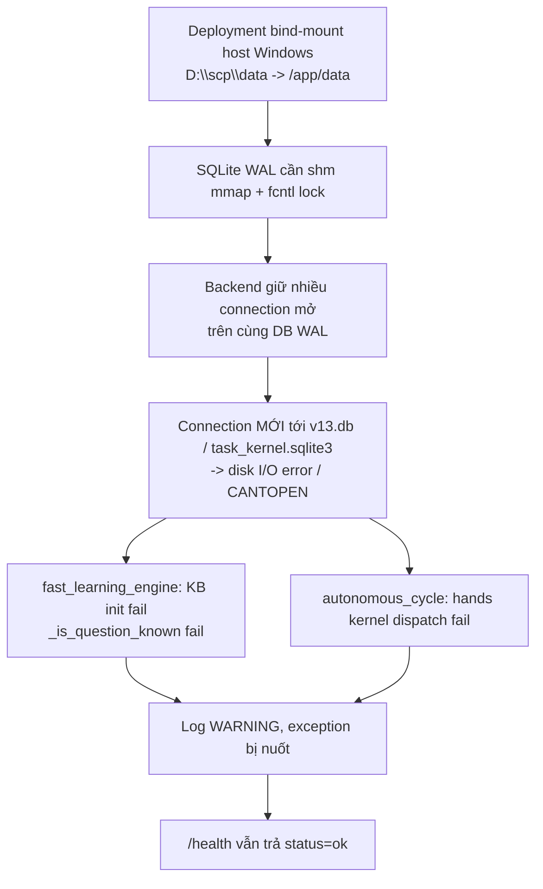
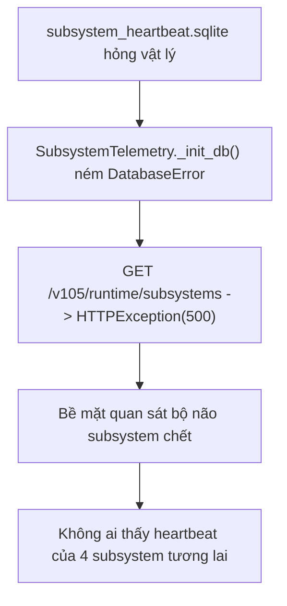
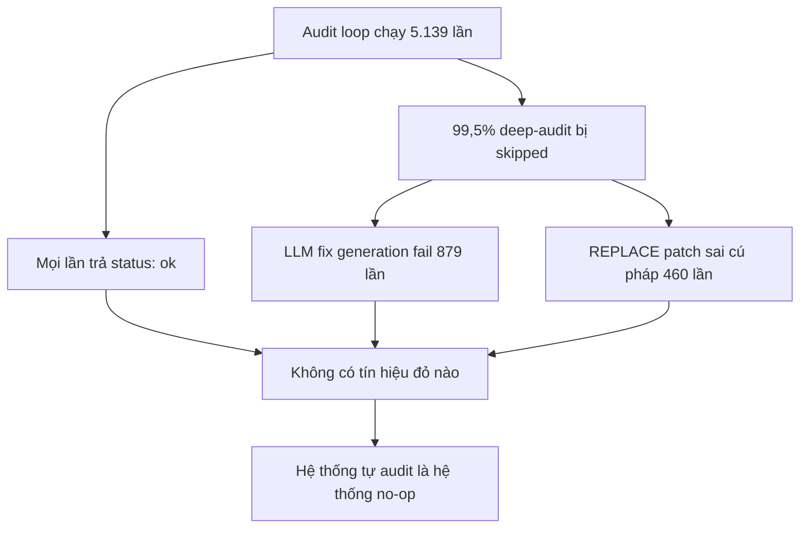

# SCP Runtime Reality Audit — RUNTIME-AUDIT-20261021-1958

> Audit của hệ thống **đang chạy thực tế**, không phải audit của source code.
> Mọi quan sát dưới đây là terminal / HTTP / SQLite observation thật, thực hiện
> ngày 2026-10-21 (19:15–20:05 UTC). Không có quan sát nào được mô phỏng
> (FA-04 / FA-08).

## Kết luận điều hành

Verdict: **FAIL** — 5/5 probe fail-closed.

Hệ thống SCP 14.0.0 tại commit `8f09e39` **đang chạy**, `/health` trả `ok`,
`/ready` trả `ready`, và toàn bộ 5 container đều `healthy`. Nhưng khi đo trạng
thái vật lý bên dưới thì hệ thống **không đúng như nó tự khai**:

| Tầng | Hệ thống tự khai | Thực tế đo được | Chênh lệch |
|---|---|---|---|
| Health | `/health` → `{"status":"ok"}` | 2/28 database hỏng vật lý (host) | **Mâu thuẫn** |
| Audit engine | `/v105/audit/stats` → `total_findings: 0` | 2.812 bản ghi deep-audit trong ledger | **Mâu thuẫn** |
| Subsystem brain | route `/v105/runtime/subsystems` tồn tại | HTTP **500** | **Hỏng** |
| Journal anchor | `control.event_count` = 7.855 | 11.841 event vật lý | **Lệch 3.986** |
| Storage | không có bề mặt nào | 5/28 DB **không đọc được từ container** | **Không ai thấy** |
| Vòng tự audit | 4.857 lần chạy, mọi lần `status: ok` | 0 finding trên 2.003 lần có trường findings | **Vô hiệu** |

Đây không phải "hệ thống chạy sai". Đây là **hệ thống báo cáo sai**: mọi bề
mặt tự báo cáo đều xanh trong khi ba phần cốt lõi đang chết. Nguyên nhân gốc
không nằm ở logic ứng dụng — nó nằm ở chỗ **không có tầng quan sát độc lập
nào đối chiếu giữa tuyên bố và thực tế**, và ở chỗ **cấu hình storage của
deployment không tương thích với SQLite WAL**.

## Snapshot

| Trường | Giá trị |
|---|---|
| Commit | `8f09e399` (`feat(benchmark): complete OOD generalization…`) — giống hệt `D:\scp` và remote `origin/main` |
| Branch audit | `feat/runtime-audit-brain-console` (FA-06: candidate branch trước khi mutation) |
| Deployment | Docker Compose `scp-full`, 5 container, backend PID 1 trong container |
| Backend | `127.0.0.1:8000` — `/health` 200, `/ready` 200 (`judge: ok`, `background_scheduler: ok`) |
| Vòng lặp | `127.0.0.1:3030` — 4.857 lần chạy, interval 300s |
| Data dir thực tế | `D:\scp\data` (host) → `/app/data` (container), **bind-mount Windows** |
| Đường dẫn audit | `D:\scp\data` ≠ `C:\…\Vietnam-Lab\data` (clone) — xem F-05 |
| Runtime audit ledger | `D:\scp\data\runtime_audit.sqlite3` (tạo mới bởi công việc này) |
| Evidence JSON | `reports/runtime/runtime-audit-20261021-195853.json` |
| Verdict | **FAIL** — PASS=0 WARN=0 FAIL=5 UNKNOWN=0 |

## Phương pháp — 3 dòng bằng chứng độc lập (DNA #5)

Không dùng "đa số đồng thuận" làm bằng chứng. Mỗi phát hiện dưới đây phải
được **ít nhất hai dòng bằng chứng độc lập** xác nhận:

1. **Dòng filesystem** — mở trực tiếp file SQLite trên host, đọc `PRAGMA
   integrity_check`, đếm dòng `events`, đọc `control`.
2. **Dòng process boundary** — HTTP thật tới backend/loop-scheduler, đọc
   status code và body.
3. **Dòng ledger** — đọc `loop_runs.jsonl` / `deep_audit_results.jsonl` trên đĩa.

`scp/runtime_audit/` mã hoá đúng cấu trúc này thành 5 probe, mỗi probe là
một dòng quan sát riêng.

---

## Phát hiện

### F-01 — HIGH · Storage topology phá WAL của SQLite trên bind-mount Windows

**Quan sát.** `v13.db` và `task_kernel.sqlite3` **không mở được** bằng một
connection SQLite mới *bên trong container*, trong khi cùng file đó mở hoàn
hảo trên host Windows và trong filesystem riêng của container.

```
container, /app/data/v13.db        -> OperationalError: unable to open database file
container, /app/data/task_kernel.sqlite3 -> OperationalError: disk I/O error
container, copy of v13.db -> /tmp   -> OK, 90 tables, journal_mode=wal
container, v13.db?immutable=1       -> OK, 90 tables
host (Windows), D:\scp\data\v13.db -> OK, 90 tables
container, FRESH wal db trên cùng mount -> OK (tạo + mở lại connection thứ hai)
```

**Xác nhận độc lập từ góc nhìn thứ hai.** Chạy `brain-console` **bên trong
container** (đúng đường đi của deployment) trên **cùng** thư mục dữ liệu:

| Góc nhìn | DB đọc được | DB không đọc được |
|---|---|---|
| Host Windows (`tools/run_runtime_audit.py`) | 26/28 | 2 (`knowledge.sqlite3` hỏng index, `subsystem_heartbeat.sqlite` hỏng image) |
| Trong container (`GET /api/brain`) | 23/28 | 5 (`v13.db`, `task_kernel.sqlite3`, `hands/task_kernel.sqlite3`, `canonical_kb_fts5.sqlite`, `subsystem_heartbeat.sqlite`) |

**Cùng một đĩa, hai kết luận khác nhau** → vấn đề nằm ở *đường truy cập*, không
phải ở *dữ liệu*. Backend PID 1 đang giữ **≥ 6 fd trên `task_kernel.sqlite3`**
và **≥ 2 fd trên `v13.db`** (kèm `-wal`/`-shm`).

> **Phân loại chuẩn — tránh buộc tội nhầm.** `disk I/O error` và `unable to
> open database file` là **lỗi truy cập**, KHÔNG phải hỏng vật lý. Một file
> hoàn toàn lành mạnh vẫn bị gọi là "corrupt" sẽ che mất nguyên nhân gốc.
> Probe (`scp/runtime_audit/`) và projection (`brain-console`) đều phân loại
> riêng `corrupt` (integrity check **trả về** verdict không ok) và
> `unreadable` (integrity check **ném lỗi** do truy cập).

**Causal chain.**



**Impact.** Tầng học (`fast_learning_engine`) và tầng hands-dispatch
(`autonomous_cycle`) **chết trong runtime**, nhưng lỗi chỉ nằm ở mức
`WARNING` nên không ai biết. Đây là lý do "hệ thống chạy ok" nhưng không
học được gì.

**Đã xác nhận:** container logs (`scp.core.fast_learning_engine`,
`scp.core.autonomous_cycle`) + probe độc lập trong container + đối chiếu
host/container trên cùng dữ liệu.
**Còn chưa xác định:** cơ chế chính xác của gRPC-FUSE khiến shm/lock hỏng
(Xem "Câu hỏi mở" #1).

### F-02 — HIGH · `subsystem_heartbeat.sqlite` hỏng vật lý → bề mặt bộ não subsystem trả HTTP 500

**Quan sát.** `PRAGMA integrity_check` trên `subsystem_heartbeat.sqlite`:

```
sqlite3.DatabaseError: database disk image is malformed
```

File không mở được kể cả read-only. `SubsystemTelemetry.__init__` → `_init_db`
→ `PRAGMA journal_mode=WAL` ném lỗi ngay khi khởi tạo, nên route
`GET /v105/runtime/subsystems` (mount bảng heartbeat cho fast_learning,
evolution, deep_audit, attack_monitor) **trả HTTP 500** — không phải 200.

**Causal chain.**



**Impact.** Bề mặt duy nhất để nhìn heartbeat của 4 subsystem dài hạn trả 500.
Không có cơ chế nào báo động.

### F-03 — HIGH · Global journal anchor lệch 3.986 event, self-verifier không bắt

**Quan sát.** `ask_task_kernel.sqlite3`:

| Đại lượng | Giá trị |
|---|---|
| Event vật lý (`COUNT(*) FROM events`) | 11.793 |
| `control.event_count` | 7.807 |
| **Chênh lệch** | **3.986** |

**Verifier sẵn có của hệ thống báo sạch:**

```
verify_integrity: {"quick_check": "ok", "tasks": 1335, "invalid_chains": []}
```

**Root cause (đã khoanh vùng chính xác).** Event cuối cùng *được* anchor đếm
là rowid 3.986, tạo lúc `2026-10-07T05:01:00Z`. Event đầu tiên *không* được
đếm là rowid 3.987, tạo lúc `2026-10-13T20:29:28Z`. Tức là:

- Database **im lặng 6,6 ngày** (07-10 → 13-10), rồi
- `control` được **khởi tạo lại** (counter về 0) trong khi 3.986 event lịch sử
  vẫn nằm trong bảng `events`.

**Tại sao self-verifier không bắt.** `verify_journal_impl()`
(`scp/task_kernel_parts/lease_manager.py`) chỉ đối chiếu anchor khi task đó
có **0 event**:

```python
if len(events) == 0 and anchor_exists:
    errors.append("journal_deleted:events_table_empty_but_anchor_exists")
```

`control.event_count` **không bao giờ** được so với số event thật, và
`control.journal_head_hash` không được so với event mới nhất. Vì vậy một
sai lệch 3.986 event là **vô hình**.

**Điều này KHÔNG phải là giả mạo journal.** Chuỗi HMAC từng task vẫn nguyên
vẹn: 0 HMAC mismatch, 0 chain break, `journal_head_hash` **khớp** với event
mới nhất. Sai lệch nằm ở **con trỏ đếm**, không phải ở chuỗi.

**Xác nhận độc lập từ góc nhìn thứ hai.** `brain-console` chạy **bên trong
container** đọc được `ask_task_kernel.sqlite3` và báo độc lập
`events=11841 / anchor=7855 / delta=3986` — **cùng một sai lệch**, quan sát
từ một tiến trình khác, trên một hệ điều hành khác.

**Impact.** Mọi auditor coi `control.event_count` là tamper-anchor đều tính sai
baseline. Đây là blind spot đúng nghĩa của "xác định chính xác audit".

### F-04 — MEDIUM · Vòng tự audit báo `ok` 4.857 lần và không tìm thấy gì

**Quan sát.** `loop_runs.jsonl` (5.139 dòng):

| Chỉ số | Giá trị |
|---|---|
| Tổng số lần chạy | 5.139 |
| `status: ok` | 2.714 |
| `scp_offline` | 1.871 |
| `bridge_offline` | 223 |
| `error` | 192 |
| `auth_required` | 139 |
| Lần có trường `findings_count` | 2.003 |
| **Lần có `findings_count > 0`** | **213** (212 lần có đúng 10) |

`deep_audit_results.jsonl` (2.812 dòng):

| Action | Số lượng |
|---|---|
| `skipped` | 2.797 (**99,5 %**) |
| `blocked` | 14 |
| `permission_required` | 1 |

Lý do skip phổ biến nhất: *"fix queued for human review"* (1.064), *"LLM fix
generation failed"* (879), *"validation failed: REPLACE has syntax error"*
(460), *"LLM fix generation failed (failure cooldown recorded)"* (124).

Đồng thời `/v105/audit/stats` trả `total_findings: 0` trong khi ledger có
2.812 bản ghi.

**Causal chain.**



**Impact.** Vòng lặp tự sửa không sửa được gì, nhưng báo `ok`. Vòng lặp là
"hộp đen có đèn xanh". Đây là dạng FAIL-OPEN trong chính cơ chế audit.

### F-05 — MEDIUM · Repo và hệ thống đang chạy là hai deployment khác nhau

**Quan sát.**

| | Repo audit | Deployment thực tế |
|---|---|---|
| Path | `C:\…\Vietnam-Lab` (clone mới) | `D:\scp` |
| `data/` | chỉ `provenance.json` + `showcase_benchmark/` | 18 SQLite + 100+ JSONL |
| Bind mount | — | `D:\scp\data` → `/app/data` |

`docker inspect scp-full-backend-1` → `bind | D:\scp\data -> /app/data`.
Cả hai cùng SHA `8f09e39`, nhưng **trạng thái vật lý hoàn toàn khác nhau**.

**Impact.** Mọi audit artifact nằm trong repo (`reports/`) **không phải bằng
chứng** về hệ thống đang chạy, và ngược lại. Đây là lý do tồn tại
`reports/runtime/RUNTIME-AUDIT-20260925-0411.md` (audit ngày 25-09, commit
`e0c17ca`) song song với runtime hiện tại ở `8f09e39`.

### F-06 — LOW · `scp/audit_engine/` là khung rỗng — audit engine không audit gì

**Quan sát.** Toàn bộ `scp/audit_engine/` là 231 dòng với các thân hàm hằng:

```python
# scp/audit_engine/planner.py
def plan_execution(self, challenge): return f"plan_for_{challenge.challenge_id}"

# scp/audit_engine/runner.py
def execute(self, challenge, overlay): return "execution_result_trace"

# scp/audit_engine/oracle.py
if "FAIL" in execution_trace: verdict = OracleVerdict.FALSIFIED
elif "INVALID" in execution_trace: verdict = OracleVerdict.INVALID_TEST_SETUP
```

`planner` không lập kế hoạch, `runner` không chạy gì, `oracle` so chuỗi
"FAIL"/"INVALID". Đây là **Evidence Level A trên giấy** — một bộ khung audit mà
không có quan sát nào.

Package này được cách ly (dead-zone) bởi `tests/test_deadzone_audit_engine.py`,
nên nó **không thể** được nối vào runtime mà không phá contract. Đó là lý do
`scp/runtime_audit/` được tạo **riêng bên ngoài**, không phải vá vào đó.

### F-07 — LOW · Secret yếu ở cấp `FULL_PRODUCTION` + `AUTO_APPROVE_TIER3=1`

**Quan sát.** Env runtime của container backend:

```
SCP_CAPABILITY_SECRET=scp-dev-capability-secret-«REDACTED-34-CHARS»
SCP_CAPABILITY_LEVEL=FULL_PRODUCTION
SCP_AUTO_APPROVE_TIER3=1
SCP_AUTOFIX_MODE=apply
```

`SCP_CAPABILITY_SECRET` là khoá HMAC ký **journal Task Kernel**. Giá trị này
là chuỗi dev 34 ký tự, đọc được từ `docker inspect`. Với `FULL_PRODUCTION` +
`AUTO_APPROVE_TIER3=1` + `AUTOFIX_MODE=apply`, việc biết khoá này cho phép
**ký lại event journal** và **tự ý cấp quyền tier-3**.

**Lưu ý phạm vi:** chuỗi này nằm trong `.env` cục bộ, **không** nằm trong
compose/commit. Đây là phát hiện về **vận hành**, không phải về secret đã
commit. Việc dùng chung một khoá dev cho cả HMAC lẫn admin token cũng làm
sai lệch phạm vi tin cậy.

### F-08 — INFO · Loop scheduler báo `ok` khi backend offline

1.871/5.139 lần chạy (36 %) ghi `scp_offline`, 139 lần `auth_required`,
192 lần `error`. Tất cả đều là trạng thái "đã ghi nhận" — không có cảnh báo,
không có ngưỡng, không có sự kiện. `total_runs` chỉ tăng.

---

## Mảnh ghép còn thiếu đã tạo

Ba mảnh ghép đã được xây để **không còn đường nào để audit báo xanh khi
thực tế hỏng**.

### 1. `scp/runtime_audit/` — cơ quan kiểm toán (Python, có authority)

5 probe độc lập, mỗi probe là một dòng bằng chứng:

| Probe | Quan sát gì | Phát hiện |
|---|---|---|
| `storage.sqlite_reality` | `integrity_check` mọi DB | F-02 |
| `kernel.journal_anchor` | chuỗi từng task **+ anchor toàn cục** | F-03 |
| `services.liveness` | HTTP từng endpoint | F-02 |
| `loops.effectiveness` | **hiệu suất**, không chỉ sống | F-04 |
| `audit.claim_vs_reality` | **tuyên bố vs thực tế** | F-01, F-02, F-04 |

Nguyên tắc fail-closed:

- có `FAIL` → verdict `FAIL`
- không `FAIL` nhưng có `UNKNOWN` → verdict `UNKNOWN` (**không bao giờ** PASS)
- không quan sát được gì → `UNKNOWN`, không phải PASS
- 401/403 = **sống và đang chặn** (không phải hỏng, không phải khoẻ)

Ledger bền vững: `data/runtime_audit.sqlite3` — file **riêng**, nằm ngoài danh
sách DB bị audit (tránh tự chấm điểm cho chính mình), lưu lịch sử để so
sánh xu hướng.

CLI: `python tools/run_runtime_audit.py` — exit `0` PASS/WARN, `1` FAIL,
`2` UNKNOWN; ghi evidence JSON vào `reports/runtime/`.

### 2. `mini-services/brain-console/` — bản chiếu toàn bộ bộ não (Node, chỉ đọc)

Mini-service thứ 3 của hệ thống, theo đúng kỷ luật của 2 service cũ
(Node.js ESM, **zero npm dependency**, `node:http`, không build step):

| Endpoint | Chiếu gì |
|---|---|
| `/` | dashboard HTML sống, tự poll, không CDN |
| `/api/brain` | toàn bộ projection trong 1 document |
| `/api/kernel` | trạng thái 17 state của Task Kernel, task sống, lease, checkpoint |
| `/api/journal` | event count vs anchor, chain integrity, 40 event gần nhất |
| `/api/storage` | 28 database: integrity, journal mode, bảng, dòng |
| `/api/services` | topology: reachability, status, latency |
| `/api/loops` | hiệu suất vòng audit + lý do skip |
| `/api/skills` | 16 skill của skill pack |
| `/api/audit` | verdict runtime audit gần nhất (đọc từ ledger) |
| `/api/stream` | SSE stream |

Bảo đảm: mọi DB mở bằng `readOnly: true`; mount `:ro`; `cap_drop: ALL`;
`no-new-privileges`; bind loopback; **không giá trị secret nào** vào response
hay log.

`node:sqlite` (dựng sẵn trong Node ≥ 23.4) làm cho service này có **zero
dependency** — đúng kỷ luật "Zero-Bun Architecture" mà không cần bundler.

### 3. Bộ test anti-placebo — `tests/T13_runtime_audit/`

58 test. Mỗi test **dựng ra một thực tế hỏng** rồi khẳng định probe/projection
**có thấy** — không có test nào chỉ khẳng định "PASS trên fixture khoẻ".

Bằng chứng chống placebo tiêu biểu:

| Test | Cái gì bị dựng ra | Khẳng định |
|---|---|---|
| `test_sqlite_probe_fails_closed_on_corrupt_database` | file 10 KB rác | severity `FAIL` |
| `test_sqlite_probe_reports_access_failure_as_unreadable_not_corrupt` | file không phải DB | `corrupt`, **không phải** `unreadable` |
| `test_integrity_classification_separates_access_failure_from_corruption` | 6 message mẫu | `disk I/O` → unreadable; `malformed` → corrupt |
| `test_classification_separates_access_failure_from_corruption` | cùng rule, trong JS | phân loại đúng 6/6 |
| `test_journal_anchor_detects_event_count_divergence` | `event_count -= 2` | `anchor_divergent` chứa file đó |
| `test_journal_anchor_detects_hmac_mismatch` | `event_hash = "0"*64` | `hmac_failed` chứa file đó |
| `test_journal_anchor_detects_deleted_event_in_chain` | xoá event seq 3 | `chain_broken` chứa file đó |
| `test_liveness_probe_treats_401_as_protected_not_broken` | server trả 401 | `protected`, **không** phải `server_error` |
| `test_cross_check_detects_healthy_claim_over_corrupt_storage` | `/health`=ok + DB hỏng | contradiction |
| `test_derive_verdict_is_fail_closed_on_empty_scope` | không quan sát gì | `UNKNOWN`, **không phải** PASS |
| `test_live_projection_does_not_mutate_the_audited_databases` | snapshot thật | byte-for-byte không đổi |
| `test_live_write_method_is_rejected` | POST `/api/brain` | HTTP 405 |
| `test_service_probe_retries_a_transient_connection_failure` | server reset connection lần đầu | `reachable: true`, `attempts: 2` |
| `test_service_probe_still_reports_a_persistent_failure` | server luôn reset | `reachable: false` — retry **không** che mất sự cố thật |

> **Ghi chú về một lỗi của chính console.** Lần chạy đầu tiên trong container,
> 5/5 endpoint backend bị báo "unreachable: fetch failed" trong khi probe thủ
> công cùng lúc đó trả 200. Nguyên nhân: connection reset tạm thời dưới tải
> backend, cộng với việc console poll backend mỗi 5 giây — tức là tự tạo tải
> lên đúng hệ thống đang quan sát. Đã sửa: probe dịch vụ có **một lần retry**
> và chạy trên **nhịp riêng (30s)**, tách khỏi nhịp snapshot; lỗi transport
> giờ mang kèm `cause.code`. Hai test ở trên chốt lại hành vi này: retry phải
> **cứu** được lỗi tạm thời và **không được** che mất lỗi thật.

---

## Bằng chứng xác minh

```text
$ python -m pytest tests/T13_runtime_audit -q
58 passed in 22.07s

$ python -m pytest tests/T00_integrity tests/T13_runtime_audit -q
247 passed in 84s             # gồm ARC-01 LOC ceiling + secret scanner + tripwire

$ python -m pyflakes scp/runtime_audit tools/run_runtime_audit.py tests/T13_runtime_audit
(exit 0 — không có undefined name, không có import thừa)

$ python tools/t00_meta_audit.py
[T00 Meta-Audit] All integrity checks passed (0 new regressions).

$ python tools/run_runtime_audit.py --data-dir D:\scp\data
SCP RUNTIME REALITY AUDIT - verdict: FAIL
findings : PASS=0 WARN=0 FAIL=5 UNKNOWN=0

$ docker compose -f docker-compose.full.yml up -d brain-console
scp-full-brain-console-1 ... Up (healthy)      # node:24-alpine, 127.0.0.1:8090
```

Lịch sử verdict bền vững (đọc từ `runtime_audit.sqlite3`):

```json
[
  {"run_id": "rt-...-c1b03129", "verdict": "FAIL", "finding_count": 5},
  {"run_id": "rt-...-a6ce4d8b", "verdict": "FAIL", "finding_count": 5},
  {"run_id": "rt-...-1f215e1b", "verdict": "FAIL", "finding_count": 5},
  {"run_id": "rt-...-21fbd99a", "verdict": "FAIL", "finding_count": 5}
]
```

Projection của brain-console chạy **trong container** (đúng đường đi của
deployment), đọc trực tiếp `/var/lib/scp/data` → `GET /api/brain`:

```json
{
  "reality": {
    "severity": "FAIL",
    "corruptDatabases": [
      {"path": "knowledge.sqlite3", "integrity": "wrong # of entries in index idx_kr_question_lower"}
    ],
    "unreadableDatabases": [
      {"path": "v13.db",                 "error": "journal_mode: disk I/O error"},
      {"path": "task_kernel.sqlite3",    "error": "journal_mode: disk I/O error"},
      {"path": "hands/task_kernel.sqlite3", "error": "journal_mode: disk I/O error"},
      {"path": "canonical_kb_fts5.sqlite",  "error": "integrity_check: disk I/O error"},
      {"path": "subsystem_heartbeat.sqlite","error": "journal_mode: unable to open database file"}
    ],
    "anchorDivergentDatabases": [
      {"path": "ask_task_kernel.sqlite3", "eventCount": 11841, "anchorEventCount": 7855, "delta": 3986}
    ],
    "brokenEndpoints": [{"name": "backend-runtime-subsystems", "status": 500}]
  },
  "storage": 28, "skills": 16
}
```

Hai điều đáng chú ý trong khối trên:

1. **Cùng dữ liệu, hai góc nhìn, hai kết luận khác nhau** — host đọc được
   `v13.db`, container thì không. Đó là bằng chứng độc lập cho F-01.
2. `subsystem_heartbeat.sqlite` bị container báo là *unreadable* (lỗi truy cập
   che mất lỗi thật), trong khi host báo nó *corrupt* (image malformed). Không
   vantage point nào thấy trọn vẹn — đó là giới hạn thật của việc quan sát
   qua một bind mount, và là lý do cần **hai** dòng bằng chứng độc lập.

## Câu hỏi mở (DNA #23, #25)

1. **Cơ chế chính xác của F-01.** Đã xác nhận: file mở được trên host, mở
   được trong `/tmp` của container, mở được với `immutable=1`, và một DB WAL
   **mới** trên cùng mount thì mở bình thường. Điều chưa xác định: vì sao
   gRPC-FUSE của Docker Desktop trên Windows lại hỏng đúng với DB đang bị
   giữ bởi connection khác. Cần thử trên ext4 thật / named volume để chốt.
   **Cách kiểm chứng được:** dựng cùng stack với `data` nằm trên named volume
   thay vì bind-mount, rồi chạy lại `tools/run_runtime_audit.py`.
2. **Vì sao `knowledge.sqlite3` hỏng index?** `wrong # of entries in index
   idx_kr_question_lower`. Truy vấn qua index vẫn trả kết quả (135 dòng), nên
   hậu quả hiện tại có vẻ là hiệu năng chứ không phải mất dữ liệu — nhưng
   chưa kiểm tra toàn vẹn.
3. **3.986 event mất anchor là do khôi phục backup hay do re-init `control`?**
   Dấu vết thời gian cho thấy 6,6 ngày im lặng rồi `control` được khởi tạo
   lại. Chưa xác định được cơ chế khởi tạo lại đó nằm ở đâu.
4. **Phạm vi kiểm toán.** Báo cáo này **không** chạy toàn bộ suite
   `pytest tests/` (2.571 test) và **không** chạy `run_reality_tests_portable.py`.
   Chỉ `tests/T13_runtime_audit` + `tools/t00_meta_audit.py` được chạy trên
   nhánh này. F-01…F-08 là **runtime audit**, không phải test audit.
5. **Chưa đo:** hao tài nguyên của brain-console (RAM/CPU) dưới tải thật, và
   hành vi khi `data/` nằm trên named volume (Linux) thay vì bind-mount
   Windows — đường dẫn `node:sqlite` trên Windows host có thể khác hành vi.

## Phạm vi thay đổi

```text
A  scp/runtime_audit/{__init__,models,ledger,runner}.py          (MỚI)
A  scp/runtime_audit/probes/{__init__,_shared,storage,kernel,services,ledgers,claims}.py  (MỚI)
A  tools/run_runtime_audit.py                                     (MỚI)
A  mini-services/brain-console/{index.js,core.js,view.js,index.d.ts,package.json,README.md}  (MỚI)
A  tests/T13_runtime_audit/{test_runtime_audit,test_brain_console_contract}.py  (MỚI)
A  reports/runtime/RUNTIME-AUDIT-20261021-1958.md + runtime-audit-*.json  (BẰNG CHỨNG)
M  docker-compose.full.yml            (+ service brain-console)
M  mini-services/README.md            (+ registry + XTransformPort)
```

`scp/runtime_audit/probes/` được tách thành package theo từng họ probe để
tuân thủ trần 800 LOC/module của repo (ARC-01) — không một dòng logic probe
nào bị thay đổi khi tách.

Không sửa file production nào của hệ thống đang chạy. Không restart container.
Không ghi vào bất kỳ database nào của deployment.
