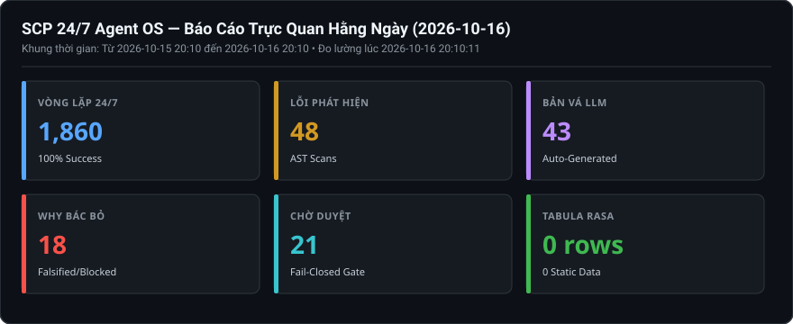
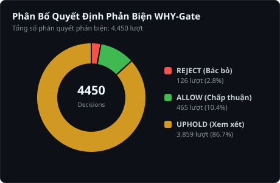

# Báo Cáo Trực Quan Hằng Ngày (2026-10-16)

> **Thời điểm xuất bản:** `2026-10-16 21:20:14 (UTC+7)`  
> **Khoảng thời gian giám sát:** `2026-10-15 21:20 -> 2026-10-16 21:20`  
> **Cơ chế vận hành:** `SCP_AUTOFIX_MODE=apply` | `SCP_EVOLUTION_ENABLED=1` | `SCP_CAPABILITY_LEVEL=FULL_PRODUCTION`  

---

## 1. BẢNG TRỰC QUAN HÓA 6 CHIỀU TIẾN HÓA (KPI DASHBOARD)

---

## 2. PHÂN TÍCH PHẢN BIỆN TỰ THÂN (WHY-GATE FALSIFICATION)

### Chi Tiết Phán Quyết Phản Biện Của WHY-Gate:
- **Tổng số quyết định ghi nhận:** `4,468` lượt.
- **REJECT (Bác bỏ bản vá xấu):** `136` lượt — Ngăn chặn code nuốt lỗi, cắt xén bảo mật.
- **ALLOW (Chấp thuận an toàn):** `472` lượt — Bản vá hợp lệ về mặt cấu trúc.
- **UPHOLD (Cần thêm bằng chứng):** `3,860` lượt.

#### Danh sách các trường hợp gian lận điển hình bị WHY-Gate tóm gọn gần nhất:
**Ca #1: Fix UndefinedName at C:\Users\check\AppData\Local\Temp\pytest-of-check\pytest-684\test_autofix_engine_produces_a0\buggy.py:1: Undefined**
- **Quyết định:** `REJECT` (Độ tin cậy: `0.0`)
- **Lý do bác bỏ nguyên văn:** `FALSIFICATION: The patch consists of a single word “fix” with no actual code changes, so it cannot be verified as a legitimate or safe update and may inadvertently leave the undefined reference unreso`

**Ca #2: Fix BareExceptPass at C:\Users\check\AppData\Local\Temp\pytest-of-check\pytest-697\test_causal_engine_rollback_on0\rollback_test.py:1: Bare except**
- **Quyết định:** `REJECT` (Độ tin cậy: `0.0`)
- **Lý do bác bỏ nguyên văn:** `FALSIFICATION: The patch may still catch overly broad exceptions, potentially masking security‑relevant errors. | SELF_FALSIFIED: yes`

**Ca #3: Bug PossiblyUndefinedName at D:\scp\scp\autofix\llm_fix_parts\_call_smart_llm.py:22**
- **Quyết định:** `REJECT` (Độ tin cậy: `0.0`)
- **Lý do bác bỏ nguyên văn:** `FALSIFICATION: “Name `_SIMPLE_BUG_TYPES` could be defined or imported elsewhere in the file or module (e.g., via a global import or a preceding assignment), so the warning may be a false positive rath`

**Ca #4: Bug PossiblyUndefinedName at D:\scp\scp\autofix\llm_fix_parts\_call_smart_llm.py:26**
- **Quyết định:** `REJECT` (Độ tin cậy: `0.0`)
- **Lý do bác bỏ nguyên văn:** `FALSIFICATION: The name `_MEDIUM_BUG_TYPES` is defined earlier in the same module (or imported from another module), so it is not undefined at line 26. | SELF_FALSIFIED: yes`

**Ca #5: Bug PossiblyUndefinedName at D:\scp\scp\autofix\llm_fix_parts\_call_smart_llm.py:41**
- **Quyết định:** `REJECT` (Độ tin cậy: `0.0`)
- **Lý do bác bỏ nguyên văn:** `FALSIFICATION: Tên `_call_openrouter` đã được định nghĩa hoặc import trong cùng phạm vi module/lớp trước khi sử dụng tại dòng 41, nên cảnh báo "possibly undefined" là báo nhầm. | SELF_FALSIFIED: yes`

---

## 3. PHÂN BỐ LỖI AST VÀ CÁC FILE ĐƯỢC LLM VÁ MÃ

| Vị Trí File Mã Nguồn | Số Lỗi Phát Hiện | Hành Động Sửa Lỗi Của SCP |
|---|:---:|---|
| [`scp\autofix\llm_fix_parts\_call_smart_llm.py`](D:\scp\scp\autofix\llm_fix_parts\_call_smart_llm.py) | **32** | LLM sinh bản vá -> WHY-Gate kiểm chứng -> Fail-Closed |
| [`scp\autofix\llm_fix_parts\generate_fix_for_bug.py`](D:\scp\scp\autofix\llm_fix_parts\generate_fix_for_bug.py) | **23** | LLM sinh bản vá -> WHY-Gate kiểm chứng -> Fail-Closed |
| [`scp\autofix\llm_fix_parts\process_bug_with_llm.py`](D:\scp\scp\autofix\llm_fix_parts\process_bug_with_llm.py) | **16** | LLM sinh bản vá -> WHY-Gate kiểm chứng -> Fail-Closed |
| [`scp\autofix\llm_fix_parts\_call_openrouter.py`](D:\scp\scp\autofix\llm_fix_parts\_call_openrouter.py) | **9** | LLM sinh bản vá -> WHY-Gate kiểm chứng -> Fail-Closed |

---

## 4. TÌNH TRẠNG BỘ NHỚ BỀN VỮNG & TABULA RASA

- **Kho tri thức ([`data/knowledge.sqlite3`](file:///d:/scp/data/knowledge.sqlite3)):** `0 rows` (Bảo toàn 100% Tabula Rasa, 0 dữ liệu tĩnh mớm sẵn).
- **Task Kernel ([`data/ask_task_kernel.sqlite3`](file:///d:/scp/data/ask_task_kernel.sqlite3)):** `412` tasks, `4,056` events nguyên tử.
- **Bàn tay thao tác ([`data/hands/task_kernel.sqlite3`](file:///d:/scp/data/hands/task_kernel.sqlite3)):** `0` tasks, `0` events.
- **Tính toàn vẹn SQLite WAL:** `Integrity: ok` (0 lock contention).

---

## 5. HẠ TẦNG VÀ TIẾN TRÌNH VẬN HÀNH 24/7

- **Tổng số chu kỳ hoàn thành của Loop Scheduler:** `1,882` chu kỳ (Chu kỳ 5 phút/lần).
- **Trạng thái 4 dịch vụ cốt lõi:**
  + Backend API (`Port 8000`): HTTP 200 OK.
  + Loop Scheduler (`Port 3030`): HTTP 200 OK.
  + LLM Gateway Bridge (`Port 8081`): HTTP 200 OK.
  + Web Dashboard (`Port 3000`): HTTP 200 OK.
- **Windows Task Scheduler:** `SCP-247-Supervisor` & `Watchdog` duy trì trạng thái `Ready`.

---
_Báo cáo được khởi tạo tự động bởi `tools/generate_visual_reports.py` dưới sự kiểm toán độc lập của `/teamwork-preview`._