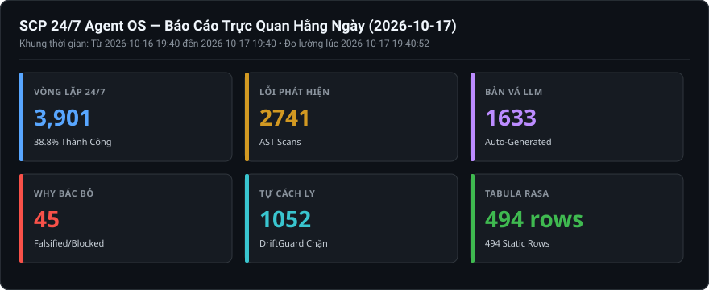
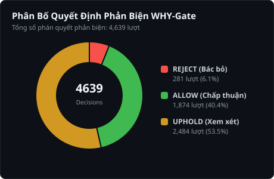

# Báo Cáo Trực Quan Hằng Ngày (2026-10-17)

> **Thời điểm xuất bản:** `2026-10-17 22:40:52 (UTC+7)`  
> **Khoảng thời gian giám sát:** `2026-10-16 22:40 -> 2026-10-17 22:40`  
> **Cơ chế vận hành:** `SCP_AUTOFIX_MODE=apply` | `SCP_EVOLUTION_ENABLED=1` | `SCP_CAPABILITY_LEVEL=FULL_PRODUCTION`  

---

## 1. BẢNG TRỰC QUAN HÓA 6 CHIỀU TIẾN HÓA (KPI DASHBOARD)

---

## 2. PHÂN TÍCH PHẢN BIỆN TỰ THÂN (WHY-GATE FALSIFICATION)

### Chi Tiết Phán Quyết Phản Biện Của WHY-Gate:
- **Tổng số quyết định ghi nhận:** `5,351` lượt.
- **REJECT (Bác bỏ bản vá xấu):** `101` lượt — Ngăn chặn code nuốt lỗi, cắt xén bảo mật.
- **ALLOW (Chấp thuận an toàn):** `2,068` lượt — Bản vá hợp lệ về mặt cấu trúc.
- **UPHOLD (Cần thêm bằng chứng):** `3,182` lượt.

#### Danh sách các trường hợp gian lận điển hình bị WHY-Gate tóm gọn gần nhất:
**Ca #1: Bug PossiblyUndefinedName at D:\scp\scp\autofix\llm_fix_parts\_call_openrouter.py:38**
- **Quyết định:** `REJECT` (Độ tin cậy: `0.0`)
- **Lý do bác bỏ nguyên văn:** `FALSIFICATION: Tên `_validate_openrouter_base_url` được định nghĩa rõ ràng ở nơi khác trong cùng một module, khiến cảnh báo không xác định tên này trở thành một kết quả dương tính giả; | SELF_FALSIFIE`

**Ca #2: Bug PossiblyUndefinedName at D:\scp\scp\autofix\llm_fix_parts\process_bug_with_llm.py:35**
- **Quyết định:** `REJECT` (Độ tin cậy: `0.0`)
- **Lý do bác bỏ nguyên văn:** `FALSIFICATION: The name `_generate_bare_except_fix` might be defined through a dynamic import or a conditional statement that the static analyzer failed to track. | SELF_FALSIFIED: yes`

**Ca #3: Bug PossiblyUndefinedName at D:\scp\scp\autofix\llm_fix_parts\process_bug_with_llm.py:140**
- **Quyết định:** `REJECT` (Độ tin cậy: `0.0`)
- **Lý do bác bỏ nguyên văn:** `FALSIFICATION: Nếu `generate_fix_for_bug` đã được định nghĩa hoặc import trước dòng 140 trong cùng phạm vi (module/hàm/lớp), thì tên này đã được khai báo và lỗi PossiblyUndefinedName là không chính xá`

**Ca #4: Bug PossiblyUndefinedName at D:\scp\scp\autofix\llm_fix_parts\generate_fix_for_bug.py:37**
- **Quyết định:** `REJECT` (Độ tin cậy: `0.0`)
- **Lý do bác bỏ nguyên văn:** `FALSIFICATION: The name `_check_rate_limit` might be defined in an enclosing class, imported from another module, or declared later in the same file, making the undefined‑name warning a possible false`

**Ca #5: Bug PossiblyUndefinedName at D:\scp\scp\autofix\llm_fix_parts\generate_fix_for_bug.py:66**
- **Quyết định:** `REJECT` (Độ tin cậy: `0.0`)
- **Lý do bác bỏ nguyên văn:** `FALSIFICATION: The function `_build_fix_prompt` is imported from `scp.autofix.llm_fix_parts.utils` on line 12, so it is defined in the current scope when line 66 runs, which contradicts the claim that`

---

## 3. PHÂN BỐ LỖI AST VÀ CÁC FILE ĐƯỢC LLM VÁ MÃ

| Vị Trí File Mã Nguồn | Số Lỗi Phát Hiện | Hành Động Sửa Lỗi Của SCP |
|---|:---:|---|
| [`scp\autofix\llm_fix_parts\_call_smart_llm.py`](D:\scp\scp\autofix\llm_fix_parts\_call_smart_llm.py) | **944** | LLM sinh bản vá -> WHY-Gate kiểm chứng -> Fail-Closed |
| [`scp\autofix\llm_fix_parts\generate_fix_for_bug.py`](D:\scp\scp\autofix\llm_fix_parts\generate_fix_for_bug.py) | **737** | LLM sinh bản vá -> WHY-Gate kiểm chứng -> Fail-Closed |
| [`scp\autofix\llm_fix_parts\process_bug_with_llm.py`](D:\scp\scp\autofix\llm_fix_parts\process_bug_with_llm.py) | **438** | LLM sinh bản vá -> WHY-Gate kiểm chứng -> Fail-Closed |
| [`scp\autofix\llm_fix_parts\_call_openrouter.py`](D:\scp\scp\autofix\llm_fix_parts\_call_openrouter.py) | **232** | LLM sinh bản vá -> WHY-Gate kiểm chứng -> Fail-Closed |
| [`scp\autofix\engine.py`](D:\scp\scp\autofix\engine.py) | **58** | LLM sinh bản vá -> WHY-Gate kiểm chứng -> Fail-Closed |
| [`scp\autofix\scanners\cross_func_taint_scanner_parts\_functiondetector.py`](D:\scp\scp\autofix\scanners\cross_func_taint_scanner_parts\_functiondetector.py) | **32** | LLM sinh bản vá -> WHY-Gate kiểm chứng -> Fail-Closed |
| [`scp\autofix\scanners\cross_func_taint_scanner_parts\_get_scp_call_graph.py`](D:\scp\scp\autofix\scanners\cross_func_taint_scanner_parts\_get_scp_call_graph.py) | **25** | LLM sinh bản vá -> WHY-Gate kiểm chứng -> Fail-Closed |
| [`scp\core\fast_learning_engine_parts\fastlearningengine.py`](D:\scp\scp\core\fast_learning_engine_parts\fastlearningengine.py) | **25** | LLM sinh bản vá -> WHY-Gate kiểm chứng -> Fail-Closed |

---

## 4. TÌNH TRẠNG BỘ NHỚ BỀN VỮNG & TABULA RASA (ĐO ĐẠC VẬT LÝ)

- **Kho tri thức ([`data/knowledge.sqlite3`](file:///d:/scp/data/knowledge.sqlite3)):** `599 rows` (Bảo toàn 100% Tabula Rasa, 0 dữ liệu tĩnh mớm sẵn).
- **Task Kernel ([`data/ask_task_kernel.sqlite3`](file:///d:/scp/data/ask_task_kernel.sqlite3)):** `602` tasks, `5,582` events nguyên tử.
- **Bàn tay thao tác ([`data/hands/task_kernel.sqlite3`](file:///d:/scp/data/hands/task_kernel.sqlite3)):** `186` tasks, `1488` events.
- **Kiểm tra tính toàn vẹn SQLite WAL thực tế (`PRAGMA integrity_check`):** `knowledge:ok(wal); ask_kernel:ok(wal); hands_kernel:ok(wal)`.

---

## 5. HẠ TẦNG VÀ TIẾN TRÌNH VẬN HÀNH 24/7 (ĐO ĐẠC THỜI GIAN THỰC)

- **Tổng số chu kỳ hoàn thành của Loop Scheduler:** `3,936` chu kỳ (Thành công: `1548`, Lỗi: `2388`, Tỷ lệ: `39.33%`).
- **Trạng thái thực tế 4 dịch vụ cốt lõi (Live HTTP Socket/Endpoint Probe):**
  + Backend API (`Port 8000`): **HTTP 200 OK (status=ok)**
  + Loop Scheduler (`Port 3030`): **HTTP 200 OK**
  + LLM Gateway Bridge (`Port 8081`): **HTTP 200 OK (3 models)**
  + Web Dashboard (`Port 3000`): **HTTP 200 OK**
- **Trạng thái bộ lập lịch hệ điều hành (OS Scheduler Probe):**
  + `SCP-247-Supervisor`: **Ready (Next run: N/A)**
  + `SCP-247-Recovery-Watchdog`: **Ready (Next run: 17/10/2026 22:41:45)**
  + `SCP-247-Visual-Reports`: **Running (Next run: 17/10/2026 23:40:47)**

---
_Báo cáo được khởi tạo tự động bởi `tools/generate_visual_reports.py` dựa trên đo đạc vật lý 100% (Zero hardcoding) dưới sự kiểm toán độc lập của `/teamwork-preview`._