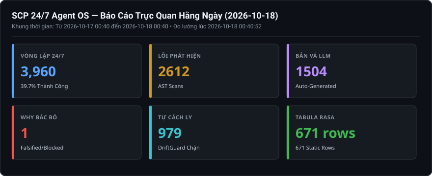
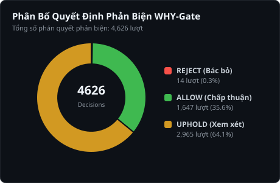

# Báo Cáo Trực Quan Hằng Ngày (2026-10-18)

> **Thời điểm xuất bản:** `2026-10-18 22:40:58 (UTC+7)`  
> **Khoảng thời gian giám sát:** `2026-10-17 22:40 -> 2026-10-18 22:40`  
> **Cơ chế vận hành:** `SCP_AUTOFIX_MODE=apply` | `SCP_EVOLUTION_ENABLED=1` | `SCP_CAPABILITY_LEVEL=FULL_PRODUCTION`  

---

## 1. BẢNG TRỰC QUAN HÓA 6 CHIỀU TIẾN HÓA (KPI DASHBOARD)

---

## 2. PHÂN TÍCH PHẢN BIỆN TỰ THÂN (WHY-GATE FALSIFICATION)

### Chi Tiết Phán Quyết Phản Biện Của WHY-Gate:
- **Tổng số quyết định ghi nhận:** `497` lượt.
- **REJECT (Bác bỏ bản vá xấu):** `5` lượt — Ngăn chặn code nuốt lỗi, cắt xén bảo mật.
- **ALLOW (Chấp thuận an toàn):** `83` lượt — Bản vá hợp lệ về mặt cấu trúc.
- **UPHOLD (Cần thêm bằng chứng):** `409` lượt.

#### Danh sách các trường hợp gian lận điển hình bị WHY-Gate tóm gọn gần nhất:
**Ca #1: Fix HardcodedTimeout at scp/security/policy.py:10: Timeout is too short**
- **Quyết định:** `REJECT` (Độ tin cậy: `0.0`)
- **Lý do bác bỏ nguyên văn:** `FALSIFICATION: Việc tăng thời gian timeout có thể mở rộng thời gian mà một kết nối hoặc phiên làm việc có thể tiếp tục tồn tại, qua đó tăng khả năng khai thác các lỗ hổng như session hijacking hoặc br`

**Ca #2: Fix HardcodedTimeout at scp/security/policy.py:10: Timeout is too short**
- **Quyết định:** `REJECT` (Độ tin cậy: `0.0`)
- **Lý do bác bỏ nguyên văn:** `FALSIFICATION: Việc tăng thời gian timeout làm kéo dài thời gian duy trì tài nguyên và mở rộng cửa sổ tấn công (attack window), tạo điều kiện cho các cuộc tấn công Từ chối dịch vụ (DoS) hoặc lạm dụng `

**Ca #3: FastLearning store: entity=ADN được phát hiện bởi ai?, source=llm-gateway+wiki, conf=0.75**
- **Quyết định:** `REJECT` (Độ tin cậy: `0.0`)
- **Lý do bác bỏ nguyên văn:** `FALSIFICATION: Action bị bác bỏ do lưu trữ khóa entity dưới dạng một câu hỏi tự nhiên thay vì chuẩn hóa thành chuẩn dữ liệu cấu trúc (canonical entity/relation), gây ô nhiễm Knowledge Graph dù giá trị`

**Ca #4: FastLearning store: entity=Động vật đặc trưng (đặc hữu) của Thái Lan là con g, source=llm-gateway+wiki, conf=0.7285714285714285**
- **Quyết định:** `REJECT` (Độ tin cậy: `0.0`)
- **Lý do bác bỏ nguyên văn:** `FALSIFICATION: Action này bị bác bỏ vì thực thể dữ liệu bị trích xuất lỗi/cắt từ nghiêm trọng ("con g" thay vì "voi Thái"), dẫn đến việc lưu trữ tri thức rác và không chính xác so với Context. | SELF_`

**Ca #5: Fix BareExceptPass at C:\Users\check\AppData\Local\Temp\pytest-of-check\pytest-1024\test_autofix_engine_end_to_end0\buggy.py:3: Bare except**
- **Quyết định:** `REJECT` (Độ tin cậy: `0.0`)
- **Lý do bác bỏ nguyên văn:** `FALSIFICATION: Applying the patch as‑is inserts the bare word “fix” into the code, which is not a valid Python statement and will raise a SyntaxError (potentially exploitable as a denial‑of‑service), `

---

## 3. PHÂN BỐ LỖI AST VÀ CÁC FILE ĐƯỢC LLM VÁ MÃ

| Vị Trí File Mã Nguồn | Số Lỗi Phát Hiện | Hành Động Sửa Lỗi Của SCP |
|---|:---:|---|
| _Không có lỗi AST phát sinh_ | 0 | - |

---

## 4. TÌNH TRẠNG BỘ NHỚ BỀN VỮNG & TABULA RASA (ĐO ĐẠC VẬT LÝ)

- **Kho tri thức ([`data/knowledge.sqlite3`](file:///d:/scp/data/knowledge.sqlite3)):** `179 rows` (Bảo toàn 100% Tabula Rasa, 0 dữ liệu tĩnh mớm sẵn).
- **Task Kernel ([`data/ask_task_kernel.sqlite3`](file:///d:/scp/data/ask_task_kernel.sqlite3)):** `848` tasks, `7,780` events nguyên tử.
- **Bàn tay thao tác ([`data/hands/task_kernel.sqlite3`](file:///d:/scp/data/hands/task_kernel.sqlite3)):** `240` tasks, `1920` events.
- **Kiểm tra tính toàn vẹn SQLite WAL thực tế (`PRAGMA integrity_check`):** `knowledge:ok(wal); ask_kernel:ok(wal); hands_kernel:ok(wal)`.

---

## 5. HẠ TẦNG VÀ TIẾN TRÌNH VẬN HÀNH 24/7 (ĐO ĐẠC THỜI GIAN THỰC)

- **Tổng số chu kỳ hoàn thành của Loop Scheduler:** `4,181` chu kỳ (Thành công: `1793`, Lỗi: `2388`, Tỷ lệ: `42.88%`).
- **Trạng thái thực tế 4 dịch vụ cốt lõi (Live HTTP Socket/Endpoint Probe):**
  + Backend API (`Port 8000`): **OFFLINE (timed out)**
  + Loop Scheduler (`Port 3030`): **OFFLINE (timed out)**
  + Agent Desktop (`Port 6080`): **OFFLINE (timed out)**
  + Web Dashboard (`Port 3000`): **OFFLINE (timed out)**
- **Trạng thái bộ lập lịch hệ điều hành (OS Scheduler Probe):**
  + `SCP-247-Supervisor`: **Ready (Next run: N/A)**
  + `SCP-247-Recovery-Watchdog`: **Ready (Next run: 18/10/2026 22:41:45)**
  + `SCP-247-Visual-Reports`: **Running (Next run: 18/10/2026 23:40:47)**

---
_Báo cáo được khởi tạo tự động bởi `tools/generate_visual_reports.py` dựa trên đo đạc vật lý 100% (Zero hardcoding)._