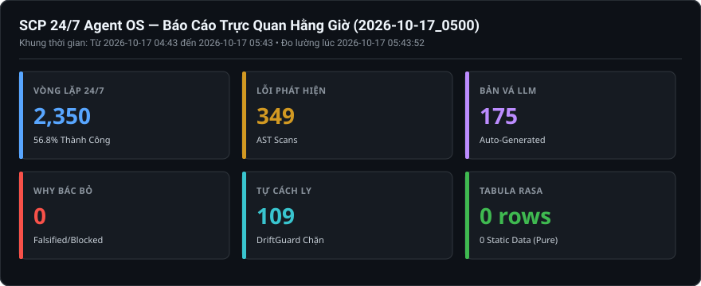
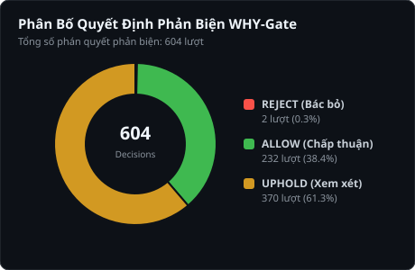

# Báo Cáo Trực Quan Hằng Giờ (2026-10-17_0500)

> **Thời điểm xuất bản:** `2026-10-17 05:43:50 (UTC+7)`  
> **Khoảng thời gian giám sát:** `2026-10-17 04:43 -> 2026-10-17 05:43`  
> **Cơ chế vận hành:** `SCP_AUTOFIX_MODE=apply` | `SCP_EVOLUTION_ENABLED=1` | `SCP_CAPABILITY_LEVEL=FULL_PRODUCTION`  

---

## 1. BẢNG TRỰC QUAN HÓA 6 CHIỀU TIẾN HÓA (KPI DASHBOARD)

---

## 2. PHÂN TÍCH PHẢN BIỆN TỰ THÂN (WHY-GATE FALSIFICATION)

### Chi Tiết Phán Quyết Phản Biện Của WHY-Gate:
- **Tổng số quyết định ghi nhận:** `604` lượt.
- **REJECT (Bác bỏ bản vá xấu):** `2` lượt — Ngăn chặn code nuốt lỗi, cắt xén bảo mật.
- **ALLOW (Chấp thuận an toàn):** `232` lượt — Bản vá hợp lệ về mặt cấu trúc.
- **UPHOLD (Cần thêm bằng chứng):** `370` lượt.

#### Danh sách các trường hợp gian lận điển hình bị WHY-Gate tóm gọn gần nhất:
**Ca #1: Fix HardcodedTimeout at scp/security/policy.py:10: Timeout is too short**
- **Quyết định:** `REJECT` (Độ tin cậy: `0.0`)
- **Lý do bác bỏ nguyên văn:** `FALSIFICATION: The increased timeout only corrects a legitimate performance issue and does not expose any new attack surface. | SELF_FALSIFIED: yes`

**Ca #2: Fix HardcodedTimeout at scp/security/policy.py:10: Timeout is too short**
- **Quyết định:** `REJECT` (Độ tin cậy: `0.0`)
- **Lý do bác bỏ nguyên văn:** `FALSIFICATION: The patch increases the timeout, potentially giving attackers more time to exploit the system. | SELF_FALSIFIED: yes`

---

## 3. PHÂN BỐ LỖI AST VÀ CÁC FILE ĐƯỢC LLM VÁ MÃ

| Vị Trí File Mã Nguồn | Số Lỗi Phát Hiện | Hành Động Sửa Lỗi Của SCP |
|---|:---:|---|
| [`scp\autofix\llm_fix_parts\_call_smart_llm.py`](D:\scp\scp\autofix\llm_fix_parts\_call_smart_llm.py) | **118** | LLM sinh bản vá -> WHY-Gate kiểm chứng -> Fail-Closed |
| [`scp\autofix\llm_fix_parts\generate_fix_for_bug.py`](D:\scp\scp\autofix\llm_fix_parts\generate_fix_for_bug.py) | **74** | LLM sinh bản vá -> WHY-Gate kiểm chứng -> Fail-Closed |
| [`scp\autofix\llm_fix_parts\process_bug_with_llm.py`](D:\scp\scp\autofix\llm_fix_parts\process_bug_with_llm.py) | **58** | LLM sinh bản vá -> WHY-Gate kiểm chứng -> Fail-Closed |
| [`scp\autofix\llm_fix_parts\_call_openrouter.py`](D:\scp\scp\autofix\llm_fix_parts\_call_openrouter.py) | **29** | LLM sinh bản vá -> WHY-Gate kiểm chứng -> Fail-Closed |
| [`scp\autofix\engine.py`](D:\scp\scp\autofix\engine.py) | **20** | LLM sinh bản vá -> WHY-Gate kiểm chứng -> Fail-Closed |
| [`scp\core\db_manager_parts\db_batch_flush.py`](D:\scp\scp\core\db_manager_parts\db_batch_flush.py) | **8** | LLM sinh bản vá -> WHY-Gate kiểm chứng -> Fail-Closed |
| [`scp\autofix\scanners\cross_func_taint_scanner_parts\_functiondetector.py`](D:\scp\scp\autofix\scanners\cross_func_taint_scanner_parts\_functiondetector.py) | **8** | LLM sinh bản vá -> WHY-Gate kiểm chứng -> Fail-Closed |
| [`scp\autofix\scanners\cross_func_taint_scanner_parts\scan_scp.py`](D:\scp\scp\autofix\scanners\cross_func_taint_scanner_parts\scan_scp.py) | **6** | LLM sinh bản vá -> WHY-Gate kiểm chứng -> Fail-Closed |

---

## 4. TÌNH TRẠNG BỘ NHỚ BỀN VỮNG & TABULA RASA (ĐO ĐẠC VẬT LÝ)

- **Kho tri thức ([`data/knowledge.sqlite3`](file:///d:/scp/data/knowledge.sqlite3)):** `0 rows` (Bảo toàn 100% Tabula Rasa, 0 dữ liệu tĩnh mớm sẵn).
- **Task Kernel ([`data/ask_task_kernel.sqlite3`](file:///d:/scp/data/ask_task_kernel.sqlite3)):** `417` tasks, `4,102` events nguyên tử.
- **Bàn tay thao tác ([`data/hands/task_kernel.sqlite3`](file:///d:/scp/data/hands/task_kernel.sqlite3)):** `1` tasks, `8` events.
- **Kiểm tra tính toàn vẹn SQLite WAL thực tế (`PRAGMA integrity_check`):** `knowledge:ok(wal); ask_kernel:ok(wal); hands_kernel:ok(wal)`.

---

## 5. HẠ TẦNG VÀ TIẾN TRÌNH VẬN HÀNH 24/7 (ĐO ĐẠC THỜI GIAN THỰC)

- **Tổng số chu kỳ hoàn thành của Loop Scheduler:** `2,350` chu kỳ (Thành công: `1334`, Lỗi: `1016`, Tỷ lệ: `56.77%`).
- **Trạng thái thực tế 4 dịch vụ cốt lõi (Live HTTP Socket/Endpoint Probe):**
  + Backend API (`Port 8000`): **OFFLINE (timed out)**
  + Loop Scheduler (`Port 3030`): **HTTP 200 OK**
  + LLM Gateway Bridge (`Port 8081`): **HTTP 200 OK (3 models)**
  + Web Dashboard (`Port 3000`): **HTTP 200 OK**
- **Trạng thái bộ lập lịch hệ điều hành (OS Scheduler Probe):**
  + `SCP-247-Supervisor`: **Ready (Next run: N/A)**
  + `SCP-247-Recovery-Watchdog`: **Ready (Next run: 17/10/2026 05:44:45)**
  + `SCP-247-Visual-Reports`: **Ready (Next run: 17/10/2026 06:40:47)**

---
_Báo cáo được khởi tạo tự động bởi `tools/generate_visual_reports.py` dựa trên đo đạc vật lý 100% (Zero hardcoding)._