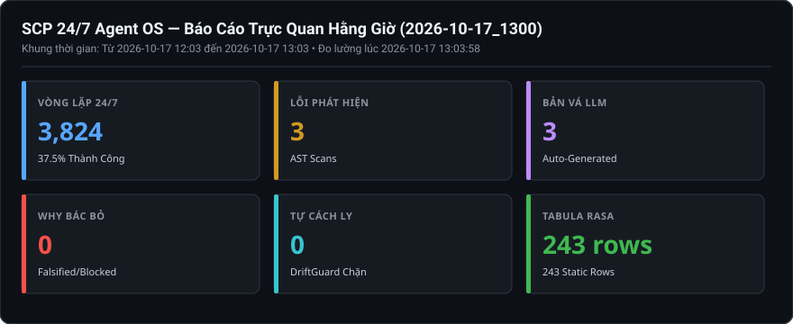
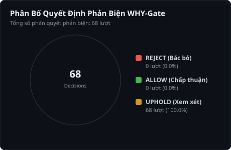

# Báo Cáo Trực Quan Hằng Giờ (2026-10-17_1300)

> **Thời điểm xuất bản:** `2026-10-17 13:03:57 (UTC+7)`  
> **Khoảng thời gian giám sát:** `2026-10-17 12:03 -> 2026-10-17 13:03`  
> **Cơ chế vận hành:** `SCP_AUTOFIX_MODE=apply` | `SCP_EVOLUTION_ENABLED=1` | `SCP_CAPABILITY_LEVEL=FULL_PRODUCTION`  

---

## 1. BẢNG TRỰC QUAN HÓA 6 CHIỀU TIẾN HÓA (KPI DASHBOARD)

---

## 2. PHÂN TÍCH PHẢN BIỆN TỰ THÂN (WHY-GATE FALSIFICATION)

### Chi Tiết Phán Quyết Phản Biện Của WHY-Gate:
- **Tổng số quyết định ghi nhận:** `68` lượt.
- **REJECT (Bác bỏ bản vá xấu):** `0` lượt — Ngăn chặn code nuốt lỗi, cắt xén bảo mật.
- **ALLOW (Chấp thuận an toàn):** `0` lượt — Bản vá hợp lệ về mặt cấu trúc.
- **UPHOLD (Cần thêm bằng chứng):** `68` lượt.

#### Danh sách các trường hợp gian lận điển hình bị WHY-Gate tóm gọn gần nhất:
_Không có vụ việc bác bỏ nào trong khung thời gian này._

---

## 3. PHÂN BỐ LỖI AST VÀ CÁC FILE ĐƯỢC LLM VÁ MÃ

| Vị Trí File Mã Nguồn | Số Lỗi Phát Hiện | Hành Động Sửa Lỗi Của SCP |
|---|:---:|---|
| [`scp\autofix\engine.py`](D:\scp\scp\autofix\engine.py) | **3** | LLM sinh bản vá -> WHY-Gate kiểm chứng -> Fail-Closed |

---

## 4. TÌNH TRẠNG BỘ NHỚ BỀN VỮNG & TABULA RASA (ĐO ĐẠC VẬT LÝ)

- **Kho tri thức ([`data/knowledge.sqlite3`](file:///d:/scp/data/knowledge.sqlite3)):** `243 rows` (Bảo toàn 100% Tabula Rasa, 0 dữ liệu tĩnh mớm sẵn).
- **Task Kernel ([`data/ask_task_kernel.sqlite3`](file:///d:/scp/data/ask_task_kernel.sqlite3)):** `490` tasks, `4,686` events nguyên tử.
- **Bàn tay thao tác ([`data/hands/task_kernel.sqlite3`](file:///d:/scp/data/hands/task_kernel.sqlite3)):** `74` tasks, `592` events.
- **Kiểm tra tính toàn vẹn SQLite WAL thực tế (`PRAGMA integrity_check`):** `knowledge:ok(wal); ask_kernel:ok(wal); hands_kernel:ok(wal)`.

---

## 5. HẠ TẦNG VÀ TIẾN TRÌNH VẬN HÀNH 24/7 (ĐO ĐẠC THỜI GIAN THỰC)

- **Tổng số chu kỳ hoàn thành của Loop Scheduler:** `3,824` chu kỳ (Thành công: `1436`, Lỗi: `2388`, Tỷ lệ: `37.55%`).
- **Trạng thái thực tế 4 dịch vụ cốt lõi (Live HTTP Socket/Endpoint Probe):**
  + Backend API (`Port 8000`): **HTTP 200 OK (status=ok)**
  + Loop Scheduler (`Port 3030`): **HTTP 200 OK**
  + LLM Gateway Bridge (`Port 8081`): **HTTP 200 OK (3 models)**
  + Web Dashboard (`Port 3000`): **HTTP 200 OK**
- **Trạng thái bộ lập lịch hệ điều hành (OS Scheduler Probe):**
  + `SCP-247-Supervisor`: **Ready (Next run: N/A)**
  + `SCP-247-Recovery-Watchdog`: **Ready (Next run: 17/10/2026 13:04:45)**
  + `SCP-247-Visual-Reports`: **Ready (Next run: 17/10/2026 13:40:47)**

---
_Báo cáo được khởi tạo tự động bởi `tools/generate_visual_reports.py` dựa trên đo đạc vật lý 100% (Zero hardcoding)._