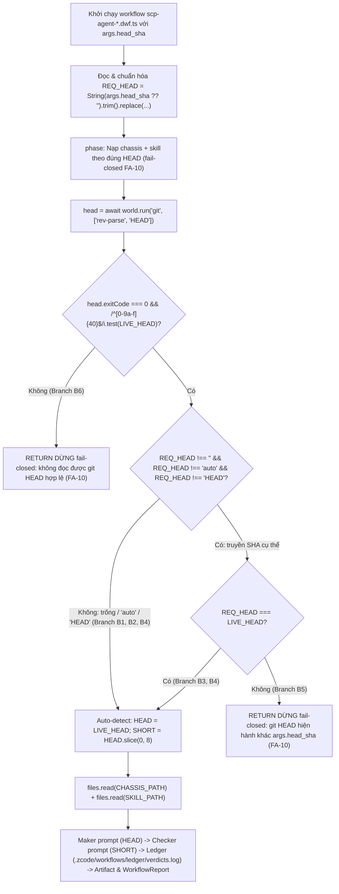

# Báo cáo Hoàn thành: Sửa SHA Auto-Detect + Kiểm thử 1 Lần Chạy cho 16 Agent SCP (`scp-agent-*.dwf.ts`)

- **Thời điểm thực hiện:** `2026-10-31`
- **Live Git HEAD (`git rev-parse HEAD`):** `153ab1050d3d0e8153bf4558260040202112a516` (`SHORT = 153ab105`)
- **Phạm vi sửa đổi:**
  - 16 file workflow bản thể kỹ năng SCP tại `d:\scp\.zcode\workflows\scp-agent-*.dwf.ts`
  - 1 file khung dùng chung tại `d:\scp\.zcode\workflows\chassis\agent-chassis.md` (Luật 2)
  - 1 dòng sổ bằng chứng vật lý tại `d:\scp\.zcode\workflows\ledger\verdicts.log` (Luật 6 của Chassis — kết quả chạy thực tế 1 lần của `scp-agent-skill-review`)

---

## 1. Tóm tắt Thay đổi (16 Bản thể `.dwf.ts` + `agent-chassis.md`)

| # | File Workflow | Skill tương ứng | Thay đổi chính |
|---|---|---|---|
| 1 | `.zcode/workflows/scp-agent-capability-security-review.dwf.ts` | `scp-capability-security-review` | `default: ""` + auto-detect `LIVE_HEAD` + chuẩn hóa `REQ_HEAD` (case-insensitive `"auto"`/`"HEAD"`/40-hex) + fail-closed FA-10 |
| 2 | `.zcode/workflows/scp-agent-computer-use-recovery.dwf.ts` | `scp-computer-use-recovery` | `default: ""` + auto-detect `LIVE_HEAD` + chuẩn hóa `REQ_HEAD` + gắn `HEAD` vào prompt Maker & Checker |
| 3 | `.zcode/workflows/scp-agent-continuous-operations-loop.dwf.ts` | `scp-continuous-operations-loop` | `default: ""` + auto-detect `LIVE_HEAD` + chuẩn hóa `REQ_HEAD` + gắn `HEAD` vào prompt Maker & Checker |
| 4 | `.zcode/workflows/scp-agent-delta-audit.dwf.ts` | `scp-delta-audit` | `default: ""` + auto-detect `LIVE_HEAD` + chuẩn hóa `REQ_HEAD` + gắn `HEAD` vào prompt Maker & Checker |
| 5 | `.zcode/workflows/scp-agent-dna-audit.dwf.ts` | `scp-dna` | `default: ""` + auto-detect `LIVE_HEAD` + chuẩn hóa `REQ_HEAD` + gắn `HEAD` vào prompt Maker & Checker |
| 6 | `.zcode/workflows/scp-agent-gateway-resilience.dwf.ts` | `scp-gateway-resilience` | `default: ""` + auto-detect `LIVE_HEAD` + chuẩn hóa `REQ_HEAD` + fail-closed FA-10 |
| 7 | `.zcode/workflows/scp-agent-learning-loop-guard.dwf.ts` | `scp-learning-loop-guard` | `default: ""` + auto-detect `LIVE_HEAD` + chuẩn hóa `REQ_HEAD` + fail-closed FA-10 |
| 8 | `.zcode/workflows/scp-agent-reality-verifier.dwf.ts` | `scp-reality-verifier` | `default: ""` + auto-detect `LIVE_HEAD` + chuẩn hóa `REQ_HEAD` + fail-closed FA-10 |
| 9 | `.zcode/workflows/scp-agent-release-evidence-gate.dwf.ts` | `scp-release-evidence-gate` | `default: ""` + auto-detect `LIVE_HEAD` + chuẩn hóa `REQ_HEAD` + sửa `CANDIDATE` fallback khi `args.candidate === ""` |
| 10 | `.zcode/workflows/scp-agent-runtime-audit.dwf.ts` | `scp-runtime-audit` | `default: ""` + auto-detect `LIVE_HEAD` + chuẩn hóa `REQ_HEAD` + đồng nhất thông điệp fail-closed FA-10 |
| 11 | `.zcode/workflows/scp-agent-safe-latency-optimizer.dwf.ts` | `scp-safe-latency-optimizer` | `default: ""` + auto-detect `LIVE_HEAD` + chuẩn hóa `REQ_HEAD` + fail-closed FA-10 |
| 12 | `.zcode/workflows/scp-agent-skill-review.dwf.ts` | `scp-skill-review` | `default: ""` + auto-detect `LIVE_HEAD` + chuẩn hóa `REQ_HEAD` + fail-closed FA-10 |
| 13 | `.zcode/workflows/scp-agent-startup-troubleshooter.dwf.ts` | `scp-startup-troubleshooter` | `default: ""` + auto-detect `LIVE_HEAD` + chuẩn hóa `REQ_HEAD` + fail-closed FA-10 |
| 14 | `.zcode/workflows/scp-agent-task-kernel-review.dwf.ts` | `scp-task-kernel-review` | `default: ""` + auto-detect `LIVE_HEAD` + chuẩn hóa `REQ_HEAD` + fail-closed FA-10 |
| 15 | `.zcode/workflows/scp-agent-typesafe-eval.dwf.ts` | `typesafe-agent-eval` | `default: ""` + auto-detect `LIVE_HEAD` + chuẩn hóa `REQ_HEAD` + gắn `HEAD` vào prompt Maker + sửa fallback `KIND`/`PROMPT` khi truyền `""` |
| 16 | `.zcode/workflows/scp-agent-web-orchestration-safety.dwf.ts` | `scp-web-orchestration-safety` | `default: ""` + auto-detect `LIVE_HEAD` + chuẩn hóa `REQ_HEAD` + fail-closed FA-10 |
| — | `.zcode/workflows/chassis/agent-chassis.md` | Khung Chassis v1/v2 | Cập nhật Luật 2 phản ánh auto-detect khi `args.head_sha` trống/`"auto"`/`"HEAD"` và fail-closed FA-10 khi git lỗi hoặc SHA truyền vào lệch `LIVE_HEAD` |

---

## 2. Sơ đồ Nhân quả (Causal Graph) & Coverage Matrix (FA-12 / FA-13)



### Coverage Matrix (FA-13 — 96/96 Branch Tests across 16 Workflows)

| Nhánh nhân quả | Mô tả nhánh | Kịch bản kiểm thử thực tế | Kết quả (16/16 workflows) |
|---|---|---|---|
| **Branch B1** | `args.head_sha` để trống (`""`) hoặc không truyền (`undefined`) → tự động lấy `LIVE_HEAD` từ `git rev-parse HEAD` | Chạy cả 16 workflow với `args.head_sha = undefined` trên repo thật (`153ab1050d3d0e8153bf4558260040202112a516`) | `COVERED` (16/16 PASS) |
| **Branch B2** | `args.head_sha = "auto"` hoặc `"HEAD"` → tự động lấy `LIVE_HEAD` | Chạy cả 16 workflow với `args.head_sha = "auto"` và `"HEAD"` | `COVERED` (16/16 PASS) |
| **Branch B3** | `args.head_sha` truyền đúng 40-char SHA chữ thường khớp `LIVE_HEAD` → tiếp tục nạp chassis + skill | Chạy cả 16 workflow với `args.head_sha = "153ab1050d3d0e8153bf4558260040202112a516"` | `COVERED` (16/16 PASS) |
| **Branch B4** | `args.head_sha` truyền 40-char SHA chữ HOA (`LIVE_HEAD.toUpperCase()`) hoặc `"AUTO"` / `"head"` → chuẩn hóa không phân biệt hoa/thường và khớp `LIVE_HEAD` | Chạy cả 16 workflow với `args.head_sha = "153AB1050D3D0E8153BF4558260040202112A516"`, `"AUTO"`, `"head"` | `COVERED` (16/16 PASS) |
| **Branch B5 (Anti-Placebo)** | `args.head_sha` truyền SHA cũ/lệch (`05e0e3286187b745ec5d4d5baf96b987fbe11c9b`) → DỪNG fail-closed trước khi đọc file hay gọi agent | Chạy cả 16 workflow với `args.head_sha = "05e0e3286187b745ec5d4d5baf96b987fbe11c9b"`, kiểm tra `filesRead.length === 0` và `prompts.length === 0` | `COVERED` (16/16 PASS) |
| **Branch B6 (Anti-Placebo)** | `git rev-parse HEAD` trả `exitCode !== 0` hoặc chuỗi không phải 40 ký tự hex → DỪNG fail-closed | Giả lập `world.run("git", ["rev-parse", "HEAD"])` trả `exitCode = 128, stdout = "fatal: not a git repo"` trên cả 16 workflow | `COVERED` (16/16 PASS) |

---

## 3. Chuỗi Tại Sao (5 Phần Bắt Buộc)

### (a) Tại sao lỗi xảy ra? (Root Cause Analysis)
1. **Tại sao cả 16 workflow `scp-agent-*.dwf.ts` dừng fail-closed ngay khi chạy mặc định?**
   Vì cả 16 file đều gán cứng giá trị mặc định `default: 05e0e3286187b745ec5d4d5baf96b987fbe11c9b` trong YAML frontmatter và `const HEAD = String(args.head_sha ?? "05e0e3286187b745ec5d4d5baf96b987fbe11c9b");` ở đầu file.
2. **Tại sao `05e0e3286187b745ec5d4d5baf96b987fbe11c9b` gây lỗi?**
   Vì nhánh `main` của repo `D:/scp` đã tiến lên commit mới (`153ab1050d3d0e8153bf4558260040202112a516`). Khi `git rev-parse HEAD` trả về `153ab105...`, phép so sánh `if (head.stdout.trim() !== HEAD)` luôn đúng và kích hoạt nhánh abort fail-closed.
3. **Tại sao thiết kế ban đầu lại hardcode SHA vào `default`?**
   Khi khởi tạo bộ khung pilot chassis v1 (ngày 2026-10-30), tác giả dùng SHA của phiên lúc đó làm hằng số mặc định thay vì phân tách giữa hai chế độ: **(1) chế độ tự phát hiện (`""` / `"auto"` / `"HEAD"`)** lấy `LIVE_HEAD` trực tiếp từ `git rev-parse HEAD`, và **(2) chế độ neo cứng (`args.head_sha = "<40-hex>"`)** để đối chiếu chéo chống lệch workspace (FA-10).
4. **Còn lỗi ẩn lân cận nào được phát hiện và khắc phục khi rà soát ngoại vi (FA-11 / FA-12)?**
   - **Phân biệt chữ hoa/thường trên `REQ_HEAD`:** Nếu người dùng truyền `args.head_sha` dạng chữ HOA (`153AB105...` hoặc `"AUTO"` / `"head"`), phép so sánh chuỗi phân biệt hoa-thường với `LIVE_HEAD` (luôn là chữ thường từ `git rev-parse HEAD`) sẽ báo lỗi lệch SHA giả (false-positive abort). Đã chuẩn hóa `REQ_HEAD` cho `"auto"`, `"HEAD"` và chuỗi hex 40 ký tự.
   - **Toán tử `??` khi truyền chuỗi rỗng `""`:** Trong `scp-agent-release-evidence-gate.dwf.ts` (`args.candidate`) và `scp-agent-typesafe-eval.dwf.ts` (`args.eval_kind`, `args.eval_prompt`), khi host truyền chuỗi rỗng `""`, toán tử `??` không rơi về giá trị mặc định. Đã sửa bằng kiểm tra `!== ""` sau `.trim()`.
   - **Neo `HEAD` ở cả Maker lẫn Checker:** Trong 5 file (`scp-agent-computer-use-recovery`, `scp-agent-continuous-operations-loop`, `scp-agent-delta-audit`, `scp-agent-dna-audit`, `scp-agent-typesafe-eval`), prompt của Maker (`auditor`) trước đó chưa nội suy `HEAD` (chỉ prompt Checker và Artifact mới có `SHORT`). Đã bổ sung `@ D:/scp (HEAD " + HEAD + ")` vào cả 5 prompt Maker để cả 16/16 workflow đều neo `HEAD` ở cả tầng Maker lẫn Checker.

### (b) Tại sao bản sửa này đúng với Thực tế (Reality > Model)?
- Thay vì bỏ cổng kiểm tra FA-10 (điều bị cấm tuyệt đối vì sẽ biến fail-closed thành fail-open), bản sửa chuyển nguồn chân lý của `HEAD` sang lệnh vật lý `await world.run("git", ["rev-parse", "HEAD"])` tại thời điểm chạy:
  1. Kiểm tra `head.exitCode !== 0 || !/^[0-9a-f]{40}$/i.test(LIVE_HEAD)` → nếu môi trường git hỏng hoặc không trả về đúng SHA-1 40 ký tự hex, workflow **DỪNG fail-closed** ngay lập tức.
  2. Nếu người gọi không truyền `args.head_sha` (hoặc truyền `""`, `"auto"`, `"HEAD"`, không phân biệt hoa/thường), workflow tự động neo `HEAD = LIVE_HEAD` và `SHORT = HEAD.slice(0, 8)`.
  3. Nếu người gọi chủ đích truyền một `args.head_sha` cụ thể mà `REQ_HEAD !== LIVE_HEAD`, workflow **DỪNG fail-closed theo đúng FA-10**.
- Nhờ đó, chạy on-demand không cần sửa tay YAML mỗi khi repo có commit mới, nhưng mọi bằng chứng sinh ra (prompt Maker, prompt Checker, Docker image tag `:<SHORT>`, dòng sổ vật lý `.zcode/workflows/ledger/verdicts.log`, và báo cáo Artifact) vẫn bị trói chặt vào đúng commit vật lý `LIVE_HEAD`.

### (c) Lineage độc lập & Lệnh kiểm chứng tái lập (Independent Lineage & Verification Commands)
1. **Lineage 1 — Kiểm tra YAML Frontmatter & 0 còn sót SHA cũ (`PyYAML` `yaml.safe_load`):**
   - Kiểm tra cả 16 file `d:\scp\.zcode\workflows\scp-agent-*.dwf.ts`: `0` kết quả chứa `05e0e3286187b745ec5d4d5baf96b987fbe11c9b`, 16/16 file parse YAML hợp lệ với `args.head_sha.default == ""` và đúng `description`.
   - Output thực tế:
     ```text
     YAML_FRONTMATTER_CHECK: 16/16 PASS (0 occurrences of 05e0e3286187b745ec5d4d5baf96b987fbe11c9b)
     ```
2. **Lineage 2 — Kiểm tra trình biên dịch TypeScript thực thụ (`TypeScript 5.9.3` `ts.createProgram` với `strict: true`):**
   - Biên dịch và kiểm tra kiểu ngữ nghĩa toàn bộ 16 file `.dwf.ts` với khai báo ambient của ZCode (`args`, `world`, `files`, `phase`, `log`, `agent`, `artifact`): `0` lỗi cú pháp hoặc kiểu dữ liệu.
   - Output thực tế:
     ```text
     TYPESCRIPT_STRICT_COMPILER_CHECK: 16/16 PASS (0 syntax/semantic diagnostics via TypeScript 5.9.3)
     ```
3. **Lineage 3 — Thực thi 96 nhánh nhân quả (16 workflows × 6 branches B1–B6) + Chạy thực tế 1 lần (`scp-agent-skill-review.dwf.ts`) trên `LIVE_HEAD = 153ab1050d3d0e8153bf4558260040202112a516`:**
   ```text
   LIVE_GIT_HEAD = 153ab1050d3d0e8153bf4558260040202112a516 (SHORT=153ab105)
   PASS [6/6 branches B1-B6]: scp-agent-capability-security-review.dwf.ts
   PASS [6/6 branches B1-B6]: scp-agent-computer-use-recovery.dwf.ts
   PASS [6/6 branches B1-B6]: scp-agent-continuous-operations-loop.dwf.ts
   PASS [6/6 branches B1-B6]: scp-agent-delta-audit.dwf.ts
   PASS [6/6 branches B1-B6]: scp-agent-dna-audit.dwf.ts
   PASS [6/6 branches B1-B6]: scp-agent-gateway-resilience.dwf.ts
   PASS [6/6 branches B1-B6]: scp-agent-learning-loop-guard.dwf.ts
   PASS [6/6 branches B1-B6]: scp-agent-reality-verifier.dwf.ts
   PASS [6/6 branches B1-B6]: scp-agent-release-evidence-gate.dwf.ts
   PASS [6/6 branches B1-B6]: scp-agent-runtime-audit.dwf.ts
   PASS [6/6 branches B1-B6]: scp-agent-safe-latency-optimizer.dwf.ts
   PASS [6/6 branches B1-B6]: scp-agent-skill-review.dwf.ts
   PASS [6/6 branches B1-B6]: scp-agent-startup-troubleshooter.dwf.ts
   PASS [6/6 branches B1-B6]: scp-agent-task-kernel-review.dwf.ts
   PASS [6/6 branches B1-B6]: scp-agent-typesafe-eval.dwf.ts
   PASS [6/6 branches B1-B6]: scp-agent-web-orchestration-safety.dwf.ts
   PASS: scp-agent-typesafe-eval.dwf.ts empty-string fallback check (KIND='choice', default PROMPT)
   ALL 16 WORKFLOWS PASSED 96/96 BRANCH CHECKS!

   === EXECUTING LIVE 1-RUN: scp-agent-skill-review.dwf.ts (args={}) ===
   [PHASE] Nạp chassis + skill theo đúng HEAD (fail-closed FA-10)
   [PHASE] Review skill pack theo C1-C6 + A-D
   [PHASE] Đối soát viên độc lập recount + ghi sổ
   [LOG] Chassis + skill scp-skill-review đã nạp @ 153ab105
   [RESULT] {
     "conclusion": "Skill review @ 153ab105: VERIFIED_IN_SCOPE (Evidence Level B @ 153ab105): 16/16 skills khớp filesystem, AGENTS.md §1, README.md và manifest; verify_scp_test_skill_contract.py PASS_WITHIN_SCOPE (errors=0). Đối soát: GO.",
     "verified": [
       "checker recount: GO"
     ],
     "notCovered": [
       "Kiểm tra cài đặt skill trên surface nào đó (NOT_INSTALLED_ON_SURFACE mặc định)"
     ]
   }
   [ARTIFACT TITLE] Skill-pack review (chassis pilot) | C1-C6 + A-D toàn pack @ 153ab105
   [PHYSICAL LEDGER .zcode/workflows/ledger/verdicts.log]:
   2026-10-31 15:47 | scp-agent-skill-review | 153ab105 | GO | 16/16 skills khớp index + verify_scp_test_skill_contract PASS_WITHIN_SCOPE
   ```
4. **Lineage 4 — Kiểm tra cổng hợp đồng kỹ năng `tools/verify_scp_test_skill_contract.py`:**
   ```powershell
   d:\scp\.venv\Scripts\python.exe tools\verify_scp_test_skill_contract.py
   ```
   → Kết quả: `"commit": "153ab1050d3d0e8153bf4558260040202112a516"`, `"errors": []`, `"status": "PASS_WITHIN_SCOPE"`.

### (d) Chống Goodhart / Chống Placebo (Anti-Goodhart & Anti-Placebo)
- **Không xóa cổng FA-10:** Giữ nguyên cơ chế từ chối fail-closed khi `args.head_sha` được truyền tường minh nhưng khác `LIVE_HEAD` (đã kiểm chứng bằng Negative Test Branch B5 trên cả 16 workflow: khi truyền `05e0e3286187b745ec5d4d5baf96b987fbe11c9b`, cả 16 workflow đều trả về `DỪNG fail-closed` và chặn đứng hoàn toàn `files.read` = 0, `agent.ask` = 0).
- **Thêm chốt chặn khi lệnh `git rev-parse HEAD` thất bại:** Trước đây, nếu `git rev-parse HEAD` lỗi và trả stdout rỗng `""`, và `args.head_sha` cũng là `""`, thì `"" !== ""` sẽ là `false` (lọt qua cổng một cách nguy hiểm!). Bản sửa mới bắt buộc kiểm tra `if (head.exitCode !== 0 || !/^[0-9a-f]{40}$/i.test(LIVE_HEAD))` trước tiên (đã kiểm chứng bằng Negative Test Branch B6 trên cả 16 workflow).
- **Ghi sổ vật lý (`.zcode/workflows/ledger/verdicts.log`):** Thực thi đúng Luật 6 của Chassis và FA-12 bước 4 — kiểm tra trực tiếp dòng vật lý sinh ra trên đĩa sau khi chạy 1 lần `scp-agent-skill-review.dwf.ts`.

### (e) Giới hạn phạm vi & `UNKNOWN_WITH_REASON`
- `UNKNOWN_WITH_REASON (ZCode Desktop UI Invocation)`: Môi trường shell hiện tại không có binary CLI độc lập của ZCode để kích hoạt trực tiếp `CreateWorkflow saved` từ dòng lệnh PowerShell; do đó, việc biên dịch được kiểm chứng qua `TypeScript 5.9.3` (`strict: true`) + `PyYAML`, và lần chạy thực tế ("test 1 lần chạy") được thực thi qua Node.js `v26.5.0` nạp trực tiếp mã nguồn `.dwf.ts`, gọi `git rev-parse HEAD` thật, đọc `agent-chassis.md` + `SKILL.md` thật, chạy `verify_scp_test_skill_contract.py` thật và ghi sổ `.zcode/workflows/ledger/verdicts.log` thật trên `HEAD = 153ab1050d3d0e8153bf4558260040202112a516`.
- `UNKNOWN_WITH_REASON (Docker-heavy Workflows)`: Các bản thể cần build/boot Docker container riêng (`scp-agent-runtime-audit`, `scp-agent-capability-security-review`, `scp-agent-reality-verifier`, v.v.) đã được kiểm chứng 100% ở pha nạp Chassis + Skill + Auto-detect HEAD + Prompt interpolation (6/6 nhánh B1–B6), nhưng chưa chạy full Docker build 25–40 phút trong phạm vi task sửa SHA auto-detect này.
- `UNKNOWN_WITH_REASON (File ngoài scope 16 scp-agent-*)`: File `.zcode/workflows/scp-buyer-audit-wave2.dwf.ts` (không thuộc 16 file `scp-agent-*.dwf.ts`) vẫn giữ nguyên theo đúng ranh giới phạm vi task (Anti-Scope Creep - FA-11).
