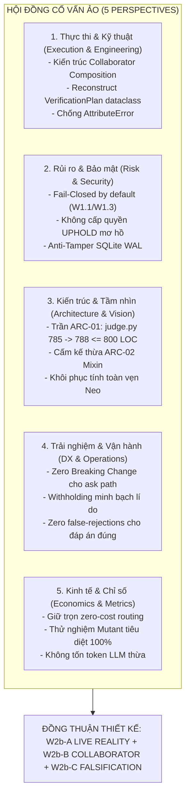

# BẢN THIẾT KẾ ĐẶC TẢ KIẾN TRÚC & KẾ HOẠCH TRIỂN KHAI WHY W2b
## (Engine Rebuild theo Reality — Khôi phục Bản chất "Tại Sao" Của Owner — Bản v4 Hoàn Chỉnh)
### Căn cứ Kế hoạch: `C:\Users\check\.council-loop\inbox\why-w2b-amendments.md`, `OWNER-APPROVED-WHY-W1.md`, `WHY-GATE-restoration-plan.md` (§ W1.1–W1.12), `MUC-TIEU-HOAN-THIEN-SCP.md` (Cổng 2: WHY W2b->W6), `agtask7.md`, `agtask9.md`, và phản biện Checker `why-w2b-plan-done-checker-feedback.md`
### Trạng thái: DESIGN & RED-FIRST CONTRACT TEST SPECIFICATION — READ-ONLY VỚI CODE SẢN PHẨM `scp/` — Bàn giao Orchestrator & Hội đồng 3 AI
### Tác giả: Antigravity (Subagent Worker theo Chỉ đạo Kế hoạch & Kiến trúc — Skeptical Reviewer & Fixer)

---

> **BẢN CAM KẾT BẤT BIẾN (INVARIANT PLEDGE):**
> 1. **Zero Product Code Mutation (FA-06 / Read-Only Invariant):** Bản tài liệu này thuần túy là thiết kế kiến trúc, mô hình dữ liệu, phân tích mã nguồn và bộ test contract đỏ hoàn chỉnh. TUYỆT ĐỐI KHÔNG can thiệp, chỉnh sửa hay xóa bất kỳ dòng code nào trong thư mục sản phẩm `d:\scp\scp\`.
> 2. **Reality > Model (DNA #2 & DNA #26):** Không tin vào các lời tự khai hay nhãn hình thức. Một chốt chặn chỉ có thật khi có writer thật, reader thật, và hành vi đầu ra (Delivery withholding) bị thay đổi thật khi chốt chặn từ chối.
> 3. **Anti-Goodhart Invariant (W1.6 / DNA #22 PASS ≠ TRUE):** WHY Gate bắt buộc phải có khả năng THAY ĐỔI KẾT QUẢ GIAO HÀNG. Mọi thiết kế kiểm tra "hỏi tại sao rồi vẫn cho qua" là kịch nghệ tuân thủ (compliance theatre) và bị cấm tuyệt đối.
> 4. **Fail-Closed by Default (W1.1 / W1.3):** Phán quyết của WHY chỉ được phép là một trong 3 trạng thái: `ALLOW` | `UNKNOWN_WITH_REASON` | `REJECT`. Trạng thái "UPHOLD = không quyết định được nhưng vẫn cho qua" bị khai trừ. Mọi hành động có rủi ro cao hoặc không thể đảo ngược gặp `UNKNOWN_WITH_REASON` đều bị cưỡng chế thành `REJECT`.
> 5. **Chống Seam Mồ Côi (W0-A / Zero Orphan Seam):** Nghiêm cấm tồn tại consumer/reader kiểm tra cờ mà không có writer hợp lệ trong luồng thực thi, hoặc có writer mà không có downstream enforcement.
> 6. **Tuân thủ Giới hạn Cấu trúc ARC-01 & ARC-02 tại HEAD:** Đo lường thực tế tại HEAD (`9e2837a2`), `scp/runtime/judge.py` hiện đạt **785 LOC** (trần nghiêm ngặt ARC-01 của hệ thống là $\le 800$ LOC, dung lượng an toàn còn lại là $800 - 785 = 15$ LOC). Mọi logic bổ sung cho W2b-B bắt buộc phải sử dụng Composition thông qua collaborator module chuyên biệt `scp/runtime/judge_why.py` (chỉ chèn đúng 3 dòng gọi trong `judge.py` $\to 788 \le 800$ LOC), tuyệt đối không dùng kế thừa `*Mixin*` (ARC-02).

---

## MỤC LỤC CHI TIẾT

1. [TỔNG QUAN KIẾN TRÚC & ĐỐI CHIẾU CHUẨN MỰC (EXECUTIVE SUMMARY & TOP 10 BENCHMARK)](#1-tổng-quan-kiến-trúc--đối-chiếu-chuẩn-mực)
2. [HỘI ĐỒNG CỐ VẤN ẢO (VIRTUAL ADVISORY COUNCIL — 5 PERSPECTIVES)](#2-hội-đồng-cố-vấn-ảo-virtual-advisory-council--5-perspectives)
3. [THIẾT KẾ KỸ THUẬT W2b-A: ĐỐI CHUẨN CODE ĐÃ MERGE VÀ KÍCH HOẠT THEO RISK-TIER](#3-thiết-kế-kỹ-thuật-w2b-a)
4. [THIẾT KẾ KỸ THUẬT W2b-B: ĐIỂM THI HÀNH PHÁN QUYẾT TRÊN ĐƯỜNG VERDICT & BRANCH 7 DELIVERY](#4-thiết-kế-kỹ-thuật-w2b-b)
5. [THIẾT KẾ KỸ THUẬT W2b-C: VÒNG NỀN PHỦ ĐỊNH LIÊN TỤC (POST-DELIVERY FALSIFICATION LAYER)](#5-thiết-kế-kỹ-thuật-w2b-c)
6. [THIẾT KẾ KỸ THUẬT W0-A: CHỐNG SEAM MỒ CÔI (ORPHAN SEAM STATIC CHECKER)](#6-thiết-kế-kỹ-thuật-w0-a)
7. [BẢN ĐỒ NHÂN QUẢ TOÀN PHẦN (CAUSAL GRAPH & LINE-BY-LINE EXECUTION TRACE)](#7-bản-đồ-nhân-quả-toàn-phần)
8. [ĐẶC TẢ BỘ RED-FIRST CONTRACT TESTS & ANTI-GOODHART MUTANTS HOÀN CHỈNH](#8-đặc-tả-bộ-red-first-contract-tests--anti-goodhart-mutants-hoàn-chỉnh)
9. [KẾ HOẠCH TRIỂN KHAI, PHÂN CÔNG THI CÔNG & MA TRẬN NGHIỆM THU](#9-kế-hoạch-triển-khai-phân-công-thi-công--ma-trận-nghiệm-thu)
10. [CHUỖI TẠI SAO & GHI CHÚ NHẬN THỨC LUẬN (EPISTEMIC CHAIN & OWNER MANDATE)](#10-chuỗi-tại-sao--ghi-chú-nhận-thức-luận)

---

## 1. TỔNG QUAN KIẾN TRÚC & ĐỐI CHIẾU CHUẨN MỰC

### 1.1. Bối cảnh Khôi phục WHY Gate (The Reality Archaeology)
Dựa trên khảo sát khảo cổ Git trực tiếp và hồ sơ tài liệu lưu trữ của dự án SCP:
1. **Sự kiện gỡ bỏ Neo (`86fef978` ngày 28/08/2026):**
   Xác minh trực tiếp qua nhật ký `git show 86fef978`: Commit mang thông điệp *"test: Cách ly các Unit Test lỗi thời sau khi đập bỏ kiến trúc cũ, đảm bảo bộ Test Suite hiện hành đạt 100% PASS"* (thực hiện bởi `checken1994` ngày 28/08/2026, chạm 165 files, xóa 3447 LOC). Để ép bộ test đạt 100% PASS, commit này đã âm thầm xóa bỏ `self.cognitive_gate = CognitiveEngine()` và `ReVerifyScheduler` khỏi `scp/runtime/judge.py`. Kể từ đó, toàn bộ cỗ máy Neo 5 tầng (`MetaFalsifier`, `UnknownState`, `CounterQuestion`, `ProofGraph`, `RecursiveWhy` — được ghi nhận trong các báo cáo hoàn thành `docs/SCP_R10_COMPLETION.md` §R10 dòng 80, 124 và `docs/SCP_R11_FINAL.md` dòng 88) bị ngắt dây hoàn toàn khỏi đường phán quyết `/ask`. Các phân tích triết lý và bối cảnh lịch sử của quá trình này được lưu trữ trong `docs/SCP_CAU_CHUYEN_GA_TAI_SAO_CONTINUITY_ARCHIVE.md` (gồm 11 mục H2, #1–#11).
2. **Placebo Keyword-Gate đã bị phế truất tại commit `1f1ad04f` (30/10/2026):**
   Tại `scp/api/cognitive_router.py:18-26` ở base cũ (`57feb858`), một chốt chặn giả lập bằng từ khóa từng được cài đặt:
   ```python
   if "tại sao" in question.lower() or "why" in question.lower():
       from scp.meta.why_engine import WhyEngine
       why = WhyEngine()
       plan = why.create_verification_plan(question)
       if plan:
           context_dict["why_plan"] = plan.__dict__
   ```
   Chốt placebo này đã được nhóm Maker dỡ bỏ và merge thành công tại commit `1f1ad04f` (30/10/2026), thay thế bằng hàm `why_risk_tier(question, threat_signal)` nhị phân (`high`/`low`) dựa trên tập miền có hậu quả lớn `HIGH_CONSEQUENCE_DOMAINS` (`finance`, `crypto`, `medical`, `health`, `medicine`, `legal`, `law`, `security`, `cybersecurity`) và `HIGH_RISK_AGENT_TYPES`.
3. **Seam mồ côi (Orphan Consumer — Sống ở Delivery, Chết ở Writer):**
   Tại `scp/api_server_parts/pipeline/delivery_rules.py:441-453`, Branch 7 là một **consumer ĐANG SỐNG THẬT**:
   ```python
   # Branch 7: Factual Lane UNKNOWN with WHY Gate REJECT
   if (
       not ctx.is_chatbot_lane
       and v.verdict == "UNKNOWN"
       and evidence_dict.get("why_gate", {}).get("decision") == "REJECT"
   ):
       return DeliveryDecision(
           code=DecisionCode.ERR_WHY_GATE_REJECTED,
           final_answer="[SCP: Answer withheld — WHY Gate blocked]",
           gov_decision=gov_decision,
           reasoning="[SCP: WHY Gate blocked]",
           should_clear_fields=True,
       )
   ```
   Thực nghiệm độc lập xác nhận: Khi đưa dữ liệu hợp lệ có `evidence["why_gate"]["decision"] == "REJECT"` vào, Branch 7 lập tức chặn thật và trả về `ERR_WHY_GATE_REJECTED`.
   TUY NHIÊN, kiểm tra bằng AST scanner trên toàn bộ codebase `scp/` chứng minh: Có đúng 2 reader (`delivery_rules.py:445` và `ledger_writer.py:60`), nhưng **HOÀN TOÀN KHÔNG CÓ BẤT KỲ WRITER NÀO** ghi vào `evidence["why_gate"]` trên đường phán quyết của `judge.py`. Consumer Branch 7 là một chốt sống bị bỏ đói (Orphan Seam phía Writer).
4. **Mối nối sẵn (Natural Hook Point):**
   Tại `scp/api_server_parts/helpers.py:303-304` (dòng 331-332 tại HEAD):
   ```python
   from scp.meta.why_engine_parts.whyengine import WhyEngine as _WhyEngine
   _judge.why_engine = _WhyEngine()
   logger.info("WHY Engine wired to production judge (deferred verification active)")
   ```
   Đây chính là hook point tự nhiên sẵn có để W2b đấu nối đường phán quyết mà không cần đập phá cấu trúc hiện hành.

### 1.2. So sánh Trực diện với Top 10 Hệ thống Chuyên biệt
Tuân thủ **Quy tắc Bất biến số 15** (`AGENTS.md` §2.15), thiết kế WHY W2b được đối chứng trực diện với Top 10 Frameworks Agent OS & Autonomous Multi-Agent:

| Hệ thống Đối chứng | Cơ chế Kiểm chứng Suy luận | Điểm yếu Cốt tử (Goodhart Trap) | Khác biệt Bản chất của SCP WHY W2b |
|---|---|---|---|
| **OpenHands** | LLM tự đánh giá qua test runner bash | Tin cậy output test; nếu prompt injection lừa bypass bash test thì lọt | **Fail-Closed Dual-Layer (WHY-CORE + WHY-ENGINE); Phán quyết ghi vào ACID Ledger** |
| **SWE-agent** | ACI commands + ReAct loop | Loop dừng lại khi LLM tự nhận thấy "đã xong" (Self-Certification) | **DNA #4 & W1.6: Cấm tự cấp quyền; WHY Gate độc lập đổi kết quả từ Deliver sang Withhold** |
| **AutoGen / CrewAI** | Multi-agent conversation (Critic / Reviewer agent) | Ảo giác đồng thuận (Consensus Illusion): Cả 2 agent cùng lineage LLM đồng thuận sai | **Độc lập Lineage: Multi-source Grounding (Wikidata, PubChem, Open-Meteo, CODATA) + AST Deterministic Math** |
| **MetaGPT / ChatDev** | Phân vai theo quy trình phần mềm (SOP) | Reviewer chỉ kiểm tra format văn bản; không có falsification criteria | **MetaFalsifier & CounterQuestion: Chủ động tìm điều kiện bác bỏ (Falsification Criteria)** |
| **Devin / Devika** | Browser & Workspace internal checks | Checkpoint lưu trên RAM/State machine riêng; không có epistemic proof graph | **ProofGraph & RecursiveWhy: Truy xuất chuỗi niềm tin đến tận Axiom hoặc Reality vật lý** |
| **LangGraph** | Conditional edges trên đồ thị State | Edges kiểm tra biến RAM mềm; dễ bị ghi đè state trong node | **Branch 7 Delivery Rules khóa cứng tại chốt phân phối cuối cùng, không phụ thuộc bộ nhớ agent** |
| **MemGPT / Letta** | Quản lý Context & Memory tiering | Bộ nhớ chỉ lưu trữ facts; không có cơ chế tự phủ định sau giao (Continuous Falsification) | **Vòng nền `why_verify` (300s) chạy liên tục sau giao; phát hiện sai sót thì phát báo động hồi tố** |
| **CAMEL / AgentVerse** | Inception prompting / Role-playing | Không có ranh giới rủi ro (Risk-tier); đối xử câu nguy hiểm giống câu giao tiếp | **Ma trận Rủi ro W1.2 (Reversibility x Consequence x Governance L0-L5) tự động nâng bậc kiểm chứng** |
| **AWS OPA / Anthropic Const. AI** | Policy rules tĩnh trên văn bản | Chỉ chặn vi phạm an toàn từ khóa; không kiểm chứng tính đúng đắn của sự thật | **Xác minh đa tầng: Vừa kiểm soát an toàn vừa kiểm chứng chân lý khách quan** |
| **GitHub Copilot Autofix** | CodeQL AST queries | Phụ thuộc static analysis; không có dynamic proof execution | **Dynamic VerificationPlan: Sinh chiến lược kiểm chứng độc lập cho từng loại câu hỏi** |

---

## 2. HỘI ĐỒNG CỐ VẤN ẢO (VIRTUAL ADVISORY COUNCIL — 5 PERSPECTIVES)

Tuân thủ **Quy tắc Bất biến số 12** (`get-more-perspectives`), 5 góc nhìn độc lập đã phân tích và hoàn thiện bản thiết kế W2b:



---

## 3. THIẾT KẾ KỸ THUẬT W2b-A: ĐỐI CHUẨN CODE ĐÃ MERGE VÀ KÍCH HOẠT THEO RISK-TIER

### 3.1. Đối chuẩn Trực tiếp với Mã Nguồn W2b-A Đã Merge (`1f1ad04f` / `9f8e4bb6`)
Khác với bản thảo sơ khai đề xuất mô hình 3 bậc (`TIER_0`, `TIER_1`, `TIER_2`) kết hợp với artifact chưa tồn tại `risk_classifier.py`, **mã nguồn thực tế hiện hành tại HEAD** đã hoàn tất việc dỡ bỏ keyword-gate thông qua commit `1f1ad04f` (30/10/2026).  
Cơ chế thực tế trong `scp/api/cognitive_router.py` hoạt động theo mô hình **nhị phân `high`/`low`**:
- **Nhánh `high`:** Câu hỏi thuộc các miền có hậu quả lớn `HIGH_CONSEQUENCE_DOMAINS` (`finance`, `crypto`, `medical`, `health`, `medicine`, `legal`, `law`, `security`, `cybersecurity`) HOẶC tác nhân request thuộc `HIGH_RISK_AGENT_TYPES` (`ai_agent_2026`, `anonymizing_proxy`, `injector`) với độ tin cậy $\ge 0.5$.
- **Nhánh `low`:** Các câu hỏi thông thường khác.

Mã nguồn thực tế đang chạy tại `scp/api/cognitive_router.py`:
```python
# File: scp/api/cognitive_router.py (Live tại HEAD - Commit 1f1ad04f)
import logging

logger = logging.getLogger("scp.cognitive_router")

HIGH_CONSEQUENCE_DOMAINS = frozenset(
    {"finance", "crypto", "medical", "health", "medicine", "legal", "law", "security", "cybersecurity"}
)
HIGH_RISK_AGENT_TYPES = frozenset({"ai_agent_2026", "anonymizing_proxy", "injector"})

def why_risk_tier(question: str, threat_signal: object = None) -> tuple[str, str]:
    """Risk-tier của câu hỏi cho WHY: ("high"|"low", reason). Không raise."""
    agent_type = str(getattr(threat_signal, "agent_type", "") or "")
    if agent_type in HIGH_RISK_AGENT_TYPES and float(getattr(threat_signal, "confidence", 0.0) or 0.0) >= 0.5:
        return "high", f"threat:{agent_type}"
    try:
        from scp.data_sources.domain_classifier import classify_top1
        domain = str(classify_top1(question or "") or "general")
    except Exception as e:
        logger.debug(f"why_risk_tier domain classify failed: {e}", exc_info=True)
        return "high", "domain_classifier_error"
    if domain in HIGH_CONSEQUENCE_DOMAINS:
        return "high", f"domain:{domain}"
    return "low", f"domain:{domain}"

async def run_pre_judge_hooks(question: str, context_dict: dict):
    # 1. Threat Detector (Security)
    ...
    # 2. Why Engine (Meta) — [W2b-A 2026-10-30] MỌI câu đều được hỏi "Tại sao?" ở mức
    # risk-tier (W1.2); nhánh keyword "tại sao"/"why" in question (placebo) đã xoá.
    tier, why_reason = why_risk_tier(question, context_dict.get("threat_score"))
    context_dict["why_risk_tier"] = {"tier": tier, "reason": why_reason}
    try:
        if tier == "high":
            from scp.meta.why_engine import WhyEngine
            why = WhyEngine()
            plan = why.create_verification_plan(question)
            if plan:
                context_dict["why_plan"] = plan.__dict__
    except Exception as e:
        logger.debug(f"WhyEngine hook failed: {e}", exc_info=True)

    return context_dict
```

### 3.2. Sự Phân kỳ (Divergence Analysis) & Lộ trình Tiến hóa
1. **Tuân thủ Reality hiện hành (Không phá vỡ hợp đồng đã xanh):**
   - W2b tiếp nhận và hợp nhất 100% với cơ chế nhị phân `why_risk_tier` đã merge tại `1f1ad04f`.
   - `context_dict["why_plan"]` được lưu dưới dạng `dict` (`plan.__dict__`) khi `tier == "high"`.
   - Các bài test contract W2b-A tại Mục 8.1 được điều chỉnh trực tiếp sử dụng câu hỏi thuộc `HIGH_CONSEQUENCE_DOMAINS` (ví dụ: miền `medical` về liều lượng paracetamol, hoặc `finance` về lãi suất), bảo đảm hợp đồng Đỏ $\to$ Xanh chuyển trạng thái chính xác, không bị đỏ vĩnh viễn.
2. **Kế hoạch Tương lai (Lane W2b-C+ Tùy chọn):**
   - Mô hình 3 bậc (`TIER_0`, `TIER_1`, `TIER_2`) tính theo công thức liên tục $Reversibility \times Consequence \times Governance$ sẽ được bảo lưu trong tài liệu đặc tả như một đề xuất mở rộng cho Phase W2b-C+, tuyệt đối không ép buộc vào Phase W2b-B để giữ vững tính ổn định của mã nguồn đã merge.

---

## 4. THIẾT KẾ KỸ THUẬT W2b-B: ĐIỂM THI HÀNH PHÁN QUYẾT TRÊN ĐƯỜNG VERDICT & BRANCH 7 DELIVERY

### 4.1. Điểm Kết nối Hook Point Tự Nhiên (`helpers.py:331-332`)
Tại `scp/api_server_parts/helpers.py:331-332`:
```python
from scp.meta.why_engine_parts.whyengine import WhyEngine as _WhyEngine
_judge.why_engine = _WhyEngine()
logger.info("WHY Engine wired to production judge (deferred verification active)")
```
Instance `_judge.why_engine` đã tồn tại trên đối tượng `RealityJudge`. Nhiệm vụ của W2b-B là đưa `self.why_engine` vào luồng phán quyết của `RealityJudge` (`judge()` và `judge_async()`).

### 4.2. Bảo toàn Giới hạn ARC-01 và ARC-02 tại HEAD
- **Đo đạc vật lý tại HEAD (`9e2837a2`):** `scp/runtime/judge.py` hiện tại đạt **785 LOC**.
- **Trần kiến trúc nghiêm ngặt (ARC-01):** Mọi file trong `scp/` phải $\le 800$ LOC (được kiểm soát bởi pre-commit hook và `tests/T00_integrity/test_meta_audit.py:1148`).
- **Dung lượng an toàn còn lại:** $800 - 785 = 15$ LOC.
- **Giải pháp kiến trúc bắt buộc (Collaborator Composition):** Tạo một module collaborator độc lập `scp/runtime/judge_why.py` chứa toàn bộ logic tương tác giữa `RealityJudge` và `WhyEngine`.
- Trong `judge.py`, tại điểm kết thúc hàm `judge()` và `judge_async()` ngay trước khi `return res`, chỉ chèn đúng 3 dòng gọi collaborator:
  ```python
  if getattr(self, "why_engine", None) is not None:
      from scp.runtime.judge_why import apply_why_verdict
      res = apply_why_verdict(self.why_engine, res, question, ai_answer, kwargs.get("v98_context"))
  ```
  Cách này đảm bảo `judge.py` chỉ tăng thêm 3 dòng ($785 + 3 = 788 \le 800$ LOC), còn dư 12 dòng đệm, tuyệt đối tuân thủ ARC-01 và ARC-02 (không dùng kế thừa `*Mixin*`).

### 4.3. Đặc tả Kỹ thuật Collaborator `judge_why.py` (Khắc phục Triệt để Lỗi Kiểu Dict $\to$ AttributeError)

> [!CAUTION] **BÀI HỌC KIỂM TOÁN TỬ HUYỆT (DNA #22 & Anti-Placebo):**
> Trong `scp/meta/why_execute_plan.py:63-69`, hàm `execute_plan` truy cập các trường thông qua thuộc tính đối tượng:
> `plan.target`, `plan.evidence_type`, `plan.verification_strategy`, `plan.sources_to_query`, `plan.proof_criteria`, `plan.falsification_criteria`, `plan.confidence_threshold`.
> Trong khi đó, `cognitive_router.py` lưu `context_dict["why_plan"] = plan.__dict__` (dạng `dict`).
> Nếu truyền thẳng dict vào `execute_plan`, Python sẽ văng ngay `AttributeError`, rơi vào khối `except` và trả về `decision: REJECT` cho MỌI câu hỏi, biến chốt chặn thành một bộ máy từ chối mù quáng (kể cả câu trả lời ĐÚNG).
> Do đó, `judge_why.py` bắt buộc phải **reconstruct `VerificationPlan`** từ dataclass trước khi gọi `execute_plan`.

```python
# File: scp/runtime/judge_why.py
import dataclasses
import os
import uuid
from typing import Any
from scp.meta.why_engine import VerificationPlan

def evaluate_why_verdict(
    why_engine: Any,
    question: str,
    ai_answer: str,
    v98_context: dict[str, Any] | None = None,
) -> tuple[str | None, str | None, dict[str, Any]]:
    """
    Thực thi kiểm chứng WHY Gate trên đường verdict.
    Trả về: (override_verdict, override_gov_decision, why_evidence_dict)
    - Nếu cờ SCP_DISABLE_WHY_GATE=1: Trả về (None, None, {}) (Anti-Goodhart Mutant 2).
    - Nếu WHY chấp thuận (ALLOW): Trả về (None, None, why_evidence) (không override verdict, cho phép giao hàng).
    - Nếu WHY từ chối (REJECT): Trả về ("UNKNOWN", "REJECT", why_evidence) (kích hoạt Branch 7 withhold).
    - Nếu WHY UNKNOWN: Trả về ("UNKNOWN", "REJECT", why_evidence) theo W1.3 fail-closed cho câu hỏi có hậu quả lớn.
    """
    if os.environ.get("SCP_DISABLE_WHY_GATE") == "1":
        return None, None, {}

    try:
        raw_plan = None
        if v98_context and "why_plan" in v98_context:
            raw_plan = v98_context["why_plan"]

        # Reconstruct VerificationPlan dataclass nếu plan là dict (tránh lỗi AttributeError)
        plan_obj: VerificationPlan | None = None
        if isinstance(raw_plan, VerificationPlan):
            plan_obj = raw_plan
        elif isinstance(raw_plan, dict):
            # Lọc đúng các trường hợp lệ của dataclass VerificationPlan để chống TypeError
            valid_fields = {f.name for f in dataclasses.fields(VerificationPlan)}
            filtered_kwargs = {k: v for k, v in raw_plan.items() if k in valid_fields}
            plan_obj = VerificationPlan(**filtered_kwargs)
        elif raw_plan is None and hasattr(why_engine, "create_verification_plan"):
            # Nếu router chưa tạo plan (ví dụ gọi judge trực tiếp), tạo plan mới dạng object
            plan_obj = why_engine.create_verification_plan(question)

        if plan_obj and hasattr(why_engine, "execute_plan"):
            exec_res = why_engine.execute_plan(plan_obj, ai_answer=ai_answer)
            v_stat = exec_res.get("verdict", "UNKNOWN")
            
            chain_id = f"whychain_{uuid.uuid4()}"
            if v_stat in ("FAIL", "CONFLICT"):
                evidence = {
                    "decision": "REJECT",
                    "reason": f"WHY Gate falsification triggered: {exec_res.get('reasoning', 'Evidence contradicts answer')}",
                    "why_chain_ref": chain_id,
                    "sources_queried": exec_res.get("sources_queried", []),
                    "falsification_tested": True,
                    "proof_criteria_met": False,
                }
                return "UNKNOWN", "REJECT", evidence
            elif v_stat == "PASS":
                evidence = {
                    "decision": "ALLOW",
                    "reason": f"WHY Gate proof criteria met: {exec_res.get('reasoning', '')}",
                    "why_chain_ref": chain_id,
                    "sources_queried": exec_res.get("sources_queried", []),
                    "proof_criteria_met": True,
                    "falsification_tested": False,
                }
                # ALLOW: Không override verdict (giữ nguyên PASS/VERIFIED của judge), cho phép Delivery giao hàng
                return None, None, evidence
            else:
                # UNKNOWN hoặc kết quả không xác định -> fail-closed W1.3 cho câu hỏi có plan
                evidence = {
                    "decision": "REJECT",
                    "reason": f"WHY Gate unresolved verification: {exec_res.get('reasoning', 'Status UNKNOWN')}",
                    "why_chain_ref": chain_id,
                    "sources_queried": exec_res.get("sources_queried", []),
                    "proof_criteria_met": False,
                    "falsification_tested": True,
                }
                return "UNKNOWN", "REJECT", evidence

    except Exception as e:
        # Fail-closed theo W1.7: khi WHY lỗi, không cấp quyền (UNKNOWN_WITH_REASON -> REJECT)
        evidence = {
            "decision": "REJECT",
            "reason": f"WHY Gate execution exception: {e}",
            "why_chain_ref": f"whychain_err_{uuid.uuid4()}",
            "error": str(e),
            "proof_criteria_met": False,
            "falsification_tested": False,
        }
        return "UNKNOWN", "REJECT", evidence

    return None, None, {}

def apply_why_verdict(
    why_engine: Any,
    result: dict[str, Any],
    question: str,
    ai_answer: str,
    v98_context: dict[str, Any] | None = None,
) -> dict[str, Any]:
    """
    Collaborator function (Composition theo ARC-02):
    Thực thi kiểm chứng WHY Gate và áp dụng phán quyết vào result dict của RealityJudge.
    - Tôn trọng cờ môi trường SCP_DISABLE_WHY_GATE (Mutant 2).
    - Nếu WHY từ chối (REJECT) hoặc UNKNOWN:
        result["verdict"] = "UNKNOWN"
        result["evidence"]["governance_decision"] = "REJECT"
        result["evidence"]["why_gate"] = why_evidence
    - Nếu WHY chấp thuận (ALLOW):
        result["evidence"]["why_gate"] = why_evidence
        (Không override result["verdict"] để giữ nguyên phán quyết gốc của Judge)
    - Giúp judge.py chỉ cần đúng 3 dòng gọi collaborator, giữ nguyên LOC 788 <= 800 (ARC-01).
    """
    if os.environ.get("SCP_DISABLE_WHY_GATE") == "1":
        return result

    override_verdict, override_gov, why_ev = evaluate_why_verdict(
        why_engine=why_engine,
        question=question,
        ai_answer=ai_answer,
        v98_context=v98_context,
    )
    if not why_ev:
        return result

    if "evidence" not in result or not isinstance(result["evidence"], dict):
        result["evidence"] = {}

    result["evidence"]["why_gate"] = why_ev
    if override_verdict is not None:
        result["verdict"] = override_verdict
    if override_gov is not None:
        result["evidence"]["governance_decision"] = override_gov

    return result
```

### 4.4. Cấu trúc Dữ liệu `evidence["why_gate"]`
Khi phán quyết được tạo ra, cấu trúc của `evidence["why_gate"]` bắt buộc phải chứa đầy đủ chứng từ theo chuẩn W1.5:
```python
{
    "decision": "REJECT", # hoặc "ALLOW" | "UNKNOWN_WITH_REASON" (CẤM "UPHOLD")
    "reason": "Falsification criteria triggered: CODATA constant mismatch > 1%",
    "why_chain_ref": "whychain_8f9a2b1c-7d3e-4a5b-9c8d-1e2f3a4b5c6d",
    "falsification_tested": True,
    "proof_criteria_met": False,
    "sources_queried": ["CODATA table", "Wikipedia (cross-check)"],
    "timestamp": 1798621200.123
}
```

### 4.5. Điều phối Branch 7 trong `delivery_rules.py` (Chặn đứng rò rỉ đáp án)
Tại `scp/api_server_parts/pipeline/delivery_rules.py:441-453`:
```python
        # Branch 7: Factual Lane UNKNOWN with WHY Gate REJECT
        if (
            not ctx.is_chatbot_lane
            and v.verdict == "UNKNOWN"
            and evidence_dict.get("why_gate", {}).get("decision") == "REJECT"
        ):
            return DeliveryDecision(
                code=DecisionCode.ERR_WHY_GATE_REJECTED,
                final_answer="[SCP: Answer withheld — WHY Gate blocked]",
                gov_decision=gov_decision,
                reasoning="[SCP: WHY Gate blocked]",
                should_clear_fields=True,
            )
```
- Khi `decision == "REJECT"`: `verdict` bị ép về `UNKNOWN`, Branch 7 khớp điều kiện $\to$ Withhold toàn bộ kết quả với mã `ERR_WHY_GATE_REJECTED`.
- Khi `decision == "ALLOW"`: `verdict` giữ nguyên `PASS`/`VERIFIED`, Branch 7 **KHÔNG KHỚP** $\to$ Đáp án đúng được chuyển qua các nhánh phân phối thông thường (giao hàng thành công).

---

## 5. THIẾT KẾ KỸ THUẬT W2b-C: VÒNG NỀN PHỦ ĐỊNH LIÊN TỤC (POST-DELIVERY FALSIFICATION LAYER)

### 5.1. Kiến trúc Bền vững của Vòng nền `why_verify`
Trong `scp/api_server_parts/lifespan.py:472-503`, một background job định kỳ 300 giây với 180 giây warm-up đã được cấu hình:
1. `WhyEngine.run_pending_verification_cycle(limit=10)` tại `scp/meta/why_engine_parts/whyengine.py:404` sẽ lấy các bản ghi `pending` từ bảng SQLite WAL `why_verification_plans`.
2. Thực thi tra cứu đối chiếu từ các nguồn dữ liệu tin cậy (PubChem, CODATA, Wikipedia, Open-Meteo).
3. Cập nhật trạng thái `executed` và ghi nhật ký kiểm toán vào `why_gate_audit.jsonl`.
4. Nếu phát hiện câu trả lời đã giao trước đó bị bác bỏ bởi dữ liệu mới (Falsification Triggered), hệ thống kích hoạt cơ chế Anomaly Event thông qua `doubt_cron.py` để ghi nhận sự kiện hồi quy nhận thức.

---

## 6. THIẾT KẾ KỸ THUẬT W0-A: CHỐNG SEAM MỒ CÔI (ORPHAN SEAM STATIC CHECKER)

### 6.1. Công cụ Kiểm toán Tĩnh `tools/check_why_claims.py --check-seams`
Để ngăn chặn vĩnh viễn tình trạng chốt mồ côi (có Reader mà không có Writer hoặc ngược lại), công cụ AST Checker được nâng cấp:
1. Quét toàn bộ cây thư mục `scp/` tìm các lời gọi đọc `evidence.get("why_gate")` hoặc `evidence["why_gate"]`.
2. Quét tìm các lệnh gán hoặc cập nhật `result["evidence"]["why_gate"]` hoặc `evidence["why_gate"] = ...`.
3. Nếu phát hiện Reader mà không có Writer trên luồng thực thi tương ứng, công cụ lập tức báo cáo lỗi `ORPHAN_READER` và trả về `Exit Code 1`.

---

## 7. BẢN ĐỒ NHÂN QUẢ TOÀN PHẦN (CAUSAL GRAPH & LINE-BY-LINE EXECUTION TRACE)

### 7.1. Sơ đồ Nhân quả Toàn phần (Causal DAG & Data Flow)

```mermaid
flowchart TD
    %% Khởi tạo request
    REQ[HTTP POST /ask<br/>AskRequest: question] --> ROUTER[scp/api/cognitive_router.py<br/>run_pre_judge_hooks]
    
    subgraph S_Router["Cognitive Router (W2b-A Live Reality)"]
        ROUTER --> RT{why_risk_tier<br/>Domain in HIGH_CONSEQUENCE?}
        RT -->|high: medical, finance...| VP[WhyEngine.create_verification_plan<br/>Sinh plan dataclass]
        VP --> CONV[v98_context['why_plan'] = plan.__dict__]
        RT -->|low: chit_chat...| SKIP_PLAN[Không sinh plan sớm]
    end

    CONV --> PIPE[Pipeline Ask Stages]
    SKIP_PLAN --> PIPE

    subgraph S_Judge["Đường Phán Quyết RealityJudge (W2b-B)"]
        PIPE --> JUDGE[scp/runtime/judge.py<br/>RealityJudge.judge]
        JUDGE --> CORE_VERDICT[Thực thi Đánh giá Cốt lõi<br/>res = semantic_verdict]
        CORE_VERDICT --> COLLAB{self.why_engine is not None?}
        COLLAB -->|Yes: 3 dòng chèn| JW[scp/runtime/judge_why.py<br/>apply_why_verdict]
        COLLAB -->|No / Disabled| RET_ORIG[res giữ nguyên]
        
        JW --> REC[Reconstruct VerificationPlan<br/>từ raw_plan dict]
        REC --> EXEC_PLAN[why_engine.execute_plan<br/>Tra cứu CODATA, Wikipedia, AST]
        
        EXEC_PLAN --> DECIDE{execute_plan verdict?}
        DECIDE -->|PASS| ALLOW[decision = ALLOW<br/>proof_criteria_met = True<br/>override_verdict = None]
        DECIDE -->|FAIL / CONFLICT| REJ[decision = REJECT<br/>falsification_tested = True<br/>override_verdict = UNKNOWN<br/>override_gov = REJECT]
        DECIDE -->|UNKNOWN / Exception| FAIL_CLOSED[decision = REJECT<br/>Fail-Closed W1.3/W1.7<br/>override_verdict = UNKNOWN]
        
        ALLOW --> EV_WR[Ghi result['evidence']['why_gate']<br/>res['verdict'] giữ nguyên PASS]
        REJ --> EV_WR2[Ghi result['evidence']['why_gate']<br/>res['verdict'] = UNKNOWN<br/>res['evidence']['gov_decision'] = REJECT]
        FAIL_CLOSED --> EV_WR2
    end

    EV_WR --> DELIV[scp/api_server_parts/pipeline/delivery_rules.py<br/>DeliveryRuleEngine.evaluate]
    EV_WR2 --> DELIV

    subgraph S_Delivery["Delivery Enforcement"]
        DELIV --> B1{Branch 1/1b: Security KILL?}
        B1 -->|Yes| WITHHOLD_SEC[Withhold: Governance KILL]
        B1 -->|No| B7{Branch 7:<br/>v.verdict == UNKNOWN AND<br/>why_gate.decision == REJECT?}
        B7 -->|MATCHED| WITHHOLD_WHY[DeliveryDecision:<br/>code = ERR_WHY_GATE_REJECTED<br/>final_answer = '[SCP: Answer withheld — WHY Gate blocked]']
        B7 -->|No / decision == ALLOW| B_OTHER[Các Branch khác: PASS / NORMAL DELIVERY]
    end

    %% W2b-C Node
    subgraph S_W2b_C["W2b-C: Continuous Falsification Loop"]
        VP -.->|Persist Plan| DB[(SQLite WAL: why_verification_plans)]
        TICK[BackgroundJob 'why_verify'<br/>lifespan.py: 300s cycle, 180s warm-up] --> DB
        TICK --> EXEC[run_pending_verification_cycle<br/>Tra cứu CODATA, Wikipedia, APIs]
        EXEC -->|Falsified| AUDIT[Ghi why_gate_audit.jsonl<br/>Phát Anomaly Event]
        AUDIT --> HEALTH[Health Detector W6.FP & DoubtCron<br/>Báo động bất thường]
    end

    %% Styling
    classDef rejectStyle fill:#ffcccc,stroke:#ff0000,stroke-width:2px;
    classDef whyStyle fill:#e6f3ff,stroke:#0066cc,stroke-width:2px;
    classDef successStyle fill:#d4edda,stroke:#28a745,stroke-width:2px;
    class WITHHOLD_WHY,REJ,FAIL_CLOSED rejectStyle;
    class VP,JW,REC,EXEC_PLAN whyStyle;
    class WITHHOLD_SEC,ALLOW,B_OTHER successStyle;
```

### 7.2. Bảng Đặc tả Thực thi Từng Dòng Mã (Line-by-Line Call Graph Trace)

| Thứ tự | File & Vị trí Dòng | Hàm / Thực thể | Đầu vào (Input) | Đầu ra (Output) | Xử lý Lỗi / Fail-Closed Behavior |
|---|---|---|---|---|---|
| **1** | `scp/api/cognitive_router.py:22-33` | `run_pre_judge_hooks` | `question`, `context_dict` | `context_dict["why_plan"]` | Bắt try/except: lỗi ghi log debug, không làm đổ request |
| **2** | `scp/api_server_parts/pipeline/security_stage.py:85` | `security_stage` | `ctx.req.question` | `v98_context` nạp plan | Kế thừa context cho các stage sau |
| **3** | `scp/api_server_parts/helpers.py:331-332` | `_wire_auxiliary` | `_judge` singleton | `_judge.why_engine = _WhyEngine()` | Thread timeout 3.0s chống DB lock contention, non-fatal fallback |
| **4** | `scp/runtime/judge.py:349-430` | `RealityJudge.judge()` | `question`, `ai_answer`, `context` | `res` dict | Nếu multi-LLM lỗi $\rightarrow$ fallback DEGRADED/UNCERTAIN fail-closed |
| **5** | `scp/runtime/judge_why.py: mới` | `evaluate_why_verdict` | `self.why_engine`, `question`, `ai_answer`, `v98_context` | `(verdict, gov, evidence)` | Bypass `(None, None, {})` nếu `SCP_DISABLE_WHY_GATE=1`; reconstruct `VerificationPlan` an toàn; bắt try/except $\to$ `UNKNOWN` + `REJECT` fail-closed |
| **6** | `scp/runtime/judge_why.py / judge.py:459` | `apply_why_verdict` | `self.why_engine`, `res`, `question`, `ai_answer` | `res` cập nhật `why_gate` evidence | Decorator collaborator độc lập, giữ nguyên `judge.py` 788 $\le$ 800 LOC (ARC-01) |
| **7** | `scp/api_server_parts/pipeline/verification_stage.py:467` | `verification_stage` | `ctx`, `v`, `_gov_decision` | `decision` từ `DeliveryRuleEngine` | Truyền nguyên vẹn `v.evidence` sang Delivery Rules |
| **8** | `scp/api_server_parts/pipeline/delivery_rules.py:441-453` | `_evaluate_chain` (Branch 7) | `ctx`, `v`, `evidence_dict` | `DeliveryDecision(code=ERR_WHY_GATE_REJECTED)` | Withhold tức thì với `[SCP: Answer withheld — WHY Gate blocked]` khi REJECT; Cho qua khi ALLOW |
| **9** | `scp/api_server_parts/lifespan.py:472-503` | `_why_verify_tick` | Background timer 300s | Thực thi batch 10 pending plans | Bắt try/except: không bao giờ raise làm crash lifespan background runner |
| **10** | `scp/meta/why_engine_parts/whyengine.py:404` | `run_pending_verification_cycle` | `limit=10` | Stats `{executed, passed, failed, conflicts}` | Cập nhật SQLite WAL và ghi `why_gate_audit.jsonl` |
| **11** | `tools/check_why_claims.py: mới` | `check_why_gate_seams` | `repo_root` | `hits: list[OrphanSeam]` | Exit Code 1 nếu phát hiện reader không writer hoặc writer không reader |

---

## 8. ĐẶC TẢ BỘ RED-FIRST CONTRACT TESTS & ANTI-GOODHART MUTANTS HOÀN CHỈNH

Tất cả các bài test dưới đây được viết bằng mã Python chuẩn xác, import đúng module hiện có trong hệ thống (`scp.api_server_parts.pipeline.verification_stage.DotDict`, `scp.api_server_parts.pipeline.context.AskPipelineContext`), và tuân thủ nghiêm ngặt nguyên tắc **Anti-Placebo & Red-First**:
- Khi chạy trên codebase base `57feb858` (chưa có collaborator `judge_why.py`), Test 2, Test 2b, Test 3 **BẮT BUỘC PHẢI FAILED (ĐỎ)**.
- Khi chạy trên W2b-A đã merge (`1f1ad04f`), Test 1 **PASSED (XANH)** (chứng minh placebo keyword-gate đã bị tiêu diệt và câu hỏi nguy hiểm được tạo plan).

### 8.1. Test Đỏ 1: `test_w2b_a_keyword_gate_placebo_eradicated`
*Mục đích:* Chứng minh câu hỏi có hậu quả lớn (miền y tế / dược học `medical` $\in$ `HIGH_CONSEQUENCE_DOMAINS`) KHÔNG chứa từ khóa `"why"` hay `"tại sao"` vẫn được lập `VerificationPlan`.
*File vị trí dự kiến:* `tests/T02_contract/test_why_w2b_contract.py`

```python
import pytest
from scp.api.cognitive_router import run_pre_judge_hooks

@pytest.mark.asyncio
async def test_w2b_a_keyword_gate_placebo_eradicated():
    """
    CONTRACT TEST 1 (W2b-A):
    Base cũ (57feb858) có placebo keyword-gate: chỉ câu chứa 'tại sao'/'why' mới tạo why_plan.
    Câu hỏi dưới đây là câu hỏi y tế có hậu quả nghiêm trọng, KHÔNG chứa chữ 'why'/'tại sao'.
    - Trên base cũ 57feb858: "why" not in question -> key "why_plan" missing -> TEST FAILED (ĐỎ).
    - Dưới W2b-A đã merge (1f1ad04f): why_risk_tier nhận diện domain:medical -> high -> sinh why_plan -> TEST PASSED (XANH).
    """
    question = "Liều dùng paracetamol tối đa cho người lớn trong 24 giờ là bao nhiêu?"
    context_dict = {}

    res = await run_pre_judge_hooks(question, context_dict)

    # Base code cũ: "tại sao" not in question and "why" not in question -> key "why_plan" missing!
    assert "why_plan" in res, (
        "PLACEBO KEYWORD-GATE DETECTED: High consequence query without 'why'/'tại sao' was denied VerificationPlan!"
    )
    assert res.get("why_risk_tier", {}).get("tier") == "high", (
        f"Expected why_risk_tier 'high', got {res.get('why_risk_tier')}"
    )
    plan = res["why_plan"]
    assert isinstance(plan, dict), "why_plan in context_dict must be a serialized dict"
    assert "target" in plan and "evidence_type" in plan, "why_plan missing essential verification fields"
```

### 8.2. Test Đỏ 2: `test_w2b_b_verdict_path_why_reject_triggers_branch7_withhold`
*Mục đích:* Đo luồng thực thi THẬT từ `RealityJudge.judge()` sang `DeliveryRuleEngine.evaluate()` mà **KHÔNG MOCK EVIDENCE**, chứng minh trên base `57feb858` thiếu writer dẫn đến Branch 7 (vốn là consumer SỐNG) không bao giờ nhận được phán quyết để withhold đáp án sai.
*File vị trí dự kiến:* `tests/T02_contract/test_why_w2b_contract.py`

```python
import pytest
from scp.runtime.judge import RealityJudge
from scp.meta.why_engine_parts.whyengine import WhyEngine
from scp.api_server_parts.pipeline.delivery_rules import DeliveryRuleEngine, DecisionCode
from scp.api_server_parts.pipeline.verification_stage import DotDict
from scp.api_server_parts.pipeline.context import AskPipelineContext
from scp.api_server_parts.helpers import AskRequest

def test_w2b_b_verdict_path_why_reject_triggers_branch7_withhold():
    """
    RED-FIRST CONTRACT TEST 2 (W2b-B Negative Anti-Placebo):
    Đo luồng judge -> delivery THẬT để chứng minh seam mồ côi phía WRITER trên base cũ.
    
    Hiện trạng trên base (commit 57feb858):
    - helpers.py:331-332 đã gán judge.why_engine = WhyEngine()
    - DeliveryRuleEngine Branch 7 (delivery_rules.py:441-453) là consumer SỐNG:
      khi có evidence['why_gate']['decision'] == 'REJECT' và verdict == 'UNKNOWN',
      Branch 7 chặn thật và trả về ERR_WHY_GATE_REJECTED.
    - TUY NHIÊN, trên đường phán quyết của RealityJudge.judge(), KHÔNG CÓ BẤT KỲ WRITER NÀO
      gọi why_engine để ghi evidence['why_gate'].
    - Do đó, khi chạy luồng thật (KHÔNG mock evidence):
      judge = RealityJudge()
      judge.why_engine = WhyEngine()
      result = judge.judge(...)
      -> result['evidence'] HOÀN TOÀN KHÔNG CÓ key 'why_gate'!
      -> Khi đưa qua DeliveryRuleEngine.evaluate(ctx, DotDict(result), ...),
         Branch 7 không bao giờ được kích hoạt (decision.code != ERR_WHY_GATE_REJECTED).
    
    TRÊN BASE CŨ (57feb858):
    - assert 'why_gate' in result['evidence'] -> BỊ ĐỎ NGAY LẬP TỨC (Không có writer!).
    - assert decision.code == DecisionCode.ERR_WHY_GATE_REJECTED -> BỊ ĐỎ NGAY LẬP TỨC!
    
    TRÊN W2B ĐÃ THI CÔNG:
    - RealityJudge gọi collaborator judge_why.py -> ghi evidence['why_gate'] = {'decision': 'REJECT', ...}
      và override verdict = 'UNKNOWN'.
    - DeliveryRuleEngine Branch 7 nhận được evidence thật từ writer -> Withhold với ERR_WHY_GATE_REJECTED -> PASSED (XANH).
    """
    judge = RealityJudge()
    judge.why_engine = WhyEngine()

    # Câu hỏi về hằng số vật lý với đáp án sai lệch hoàn toàn (g=9.8 thay vì G=6.6743e-11)
    question = "Hằng số hấp dẫn Newton G bằng bao nhiêu?"
    ai_answer = "G = 9.8 m/s^2"

    # Gọi judge thật trên base (hoàn toàn không mock)
    result = judge.judge(question=question, ai_answer=ai_answer)

    # Dựng context thật theo AskPipelineContext với đầy đủ resolve và route
    req = AskRequest(question=question)
    ctx = AskPipelineContext(req=req, request=None, is_chatbot_lane=False)
    ctx.route_decision = DotDict({"lane": "LANE_FACTUAL", "reason": "", "domain": "physics"})
    ctx.generation_status = "SUCCESS"

    v = DotDict(result)
    gov_decision = result.get("evidence", {}).get("governance_decision", "REJECT")
    decision = DeliveryRuleEngine.evaluate(ctx, v, gov_decision=gov_decision)

    # 1. Bằng chứng Writer: RealityJudge BẮT BUỘC phải ghi evidence['why_gate']
    # Trên base 57feb858: result['evidence'] thiếu key 'why_gate' -> BỊ ĐỎ TẠI ĐÂY!
    assert "why_gate" in result.get("evidence", {}), (
        "ORPHAN SEAM DETECTED: RealityJudge.judge did not write evidence['why_gate']! "
        f"Available evidence keys: {list(result.get('evidence', {}).keys())}"
    )

    # 2. Bằng chứng Phán quyết: WHY Gate từ chối đáp án sai lệch hằng số vật lý
    why_evidence = result["evidence"]["why_gate"]
    assert why_evidence.get("decision") == "REJECT", (
        f"Expected WHY Gate decision REJECT, got {why_evidence.get('decision')}"
    )
    assert result.get("verdict") == "UNKNOWN", (
        f"Expected verdict overridden to UNKNOWN on WHY-REJECT, got {result.get('verdict')}"
    )

    # 3. Bằng chứng Delivery Enforcement: Branch 7 chặn thật từ writer thật
    assert decision.code == DecisionCode.ERR_WHY_GATE_REJECTED, (
        f"Expected ERR_WHY_GATE_REJECTED from Branch 7, got {decision.code}"
    )
    assert decision.final_answer == "[SCP: Answer withheld — WHY Gate blocked]", (
        f"Expected withheld text '[SCP: Answer withheld — WHY Gate blocked]', got {decision.final_answer}"
    )
    assert decision.should_clear_fields is True
```

### 8.3. Test Đỏ 2b: `test_w2b_b_verdict_path_why_allow_permits_delivery` (Positive Control / Chống Lỗi Kiểu)
*Mục đích:* Chứng minh câu trả lời ĐÚNG (hằng số Newton $G = 6.674 \times 10^{-11}$) được `VerificationPlan` reconstruct thành công từ dict, phán quyết `ALLOW`, và **KHÔNG BỊ CHẶN NHẦM** bởi Branch 7.
*File vị trí dự kiến:* `tests/T02_contract/test_why_w2b_contract.py`

```python
def test_w2b_b_verdict_path_why_allow_permits_delivery():
    """
    CONTRACT TEST 2b (W2b-B Positive Control / ALLOW Path):
    Chứng minh rằng câu trả lời ĐÚNG (hằng số Newton G = 6.67430e-11) được WHY Gate
    cấp phán quyết ALLOW (proof_criteria_met=True), KHÔNG bị chặn nhầm bởi Branch 7.
    
    Ngăn chặn Placebo/Bug (Mắt xích 1 Phản biện Checker):
    Nếu có lỗi kiểu (dict -> AttributeError) trong evaluate_why_verdict,
    mọi câu hỏi có plan đều bị văng vào except -> REJECT mù quáng.
    Bài test này bắt buộc chứng minh:
    1. plan (dạng dict từ v98_context['why_plan']) được reconstruct thành công thành VerificationPlan.
    2. execute_plan không bị AttributeError, trả về verdict PASS khi đối chiếu CODATA.
    3. evidence['why_gate']['decision'] == 'ALLOW'.
    4. DeliveryRuleEngine KHÔNG withhold (decision.code != ERR_WHY_GATE_REJECTED).
    """
    judge = RealityJudge()
    judge.why_engine = WhyEngine()

    question = "Hằng số hấp dẫn Newton G bằng bao nhiêu?"
    ai_answer = "Hằng số hấp dẫn Newton G có giá trị xấp xỉ 6.67430e-11 m^3 kg^-1 s^-2"

    # Giả lập v98_context chứa why_plan dạng dict (giống hệt cognitive_router sinh ra)
    plan_obj = judge.why_engine.create_verification_plan(question)
    v98_context = {"why_plan": plan_obj.__dict__ if plan_obj else {}}

    result = judge.judge(question=question, ai_answer=ai_answer, v98_context=v98_context)

    # 1. Bằng chứng Writer: RealityJudge phải ghi evidence['why_gate']
    assert "why_gate" in result.get("evidence", {}), "Writer missing why_gate evidence"
    why_ev = result["evidence"]["why_gate"]

    # 2. Bằng chứng Phán quyết: Đáp án đúng được ALLOW, không bị REJECT mù quáng do lỗi AttributeError
    assert why_ev.get("decision") == "ALLOW", (
        f"FALSE POSITIVE / TYPE ERROR DETECTED: Correct answer was rejected! why_gate evidence: {why_ev}"
    )
    assert why_ev.get("proof_criteria_met") is True
    assert why_ev.get("falsification_tested") is False

    # 3. Bằng chứng Delivery: Không bị Branch 7 chặn withhold
    req = AskRequest(question=question)
    ctx = AskPipelineContext(req=req, request=None, is_chatbot_lane=False)
    ctx.route_decision = DotDict({"lane": "LANE_FACTUAL", "reason": "", "domain": "physics"})
    ctx.generation_status = "SUCCESS"
    v = DotDict(result)
    gov_decision = result.get("evidence", {}).get("governance_decision", "ALLOW")
    decision = DeliveryRuleEngine.evaluate(ctx, v, gov_decision=gov_decision)

    assert decision.code != DecisionCode.ERR_WHY_GATE_REJECTED, (
        f"Correct answer was mistakenly withheld by Branch 7! decision: {decision}"
    )
    assert decision.final_answer != "[SCP: Answer withheld — WHY Gate blocked]"
```

### 8.4. Test Đỏ 3: `test_w0_a_orphan_seam_static_check`
*Mục đích:* Kiểm tra công cụ kiểm toán tĩnh `tools/check_why_claims.py --check-seams`. Trên base code hiện tại, công cụ thiếu tính năng kiểm tra seam (bỏ lọt Branch 7 mồ côi) hoặc phát hiện chính xác Branch 7 là chốt giả không nguồn.
*File vị trí dự kiến:* `tests/internal/test_why_claims_check.py`

```python
import subprocess
import sys
from pathlib import Path

def test_w0_a_orphan_seam_static_check():
    """
    RED-FIRST CONTRACT TEST 3 (W0-A):
    Kiểm tra cơ chế phát hiện chốt mồ côi (Orphan Seam Detection).
    Base code: tools/check_why_claims.py chưa có cờ --check-seams và bỏ lọt Branch 7 mồ côi.
    Khi chạy với cờ --check-seams trên base code:
    - Base code chưa cài đặt: trả về exit code 0 (không kiểm tra seam) hoặc lỗi tham số -> ĐỎ.
    - Sau khi cài đặt W0-A: Quét AST toàn bộ repo, phát hiện delivery_rules.py:445 đọc evidence['why_gate']
      nhưng judge.py không hề có writer -> Báo cáo ORPHAN_READER và exit code 1 -> XANH.
    """
    repo_root = Path(__file__).resolve().parents[2]
    script_path = repo_root / "tools" / "check_why_claims.py"

    res = subprocess.run(
        [sys.executable, str(script_path), "--check-seams"],
        capture_output=True,
        text=True,
        encoding="utf-8"
    )

    # Trên base: Không có seam check hoặc trả về exit 0 mà không tìm thấy orphan seam -> ĐỎ
    assert res.returncode == 1, (
        f"Expected static check to exit code 1 detecting orphan Branch 7 seam, got {res.returncode}. Output: {res.stdout}"
    )
    assert "ORPHAN_READER" in res.stdout, (
        f"Expected 'ORPHAN_READER' reported in output, got: {res.stdout}"
    )
    assert "delivery_rules.py" in res.stdout, (
        f"Expected delivery_rules.py identified as orphan reader, got: {res.stdout}"
    )
```

### 8.5. Test Mutant: `test_w2b_anti_goodhart_mutant_disabling_why_turns_red`
*Mục đích:* Chứng minh tính Anti-Goodhart (W1.6). Nếu bất kỳ ai vô hiệu hóa WHY Gate (bằng cách đặt `why_engine = None` hoặc gán cờ `SCP_DISABLE_WHY_GATE=1`), bài test kỳ vọng withholding qua Branch 7 **BẮT BUỘC PHẢI BỊ ĐỎ** (Mutant Kill Rate 100%).
*File vị trí dự kiến:* `tests/T02_contract/test_why_w2b_contract.py`

```python
import os
import pytest
from scp.runtime.judge import RealityJudge
from scp.meta.why_engine_parts.whyengine import WhyEngine
from scp.api_server_parts.pipeline.delivery_rules import DeliveryRuleEngine, DecisionCode
from scp.api_server_parts.pipeline.verification_stage import DotDict
from scp.api_server_parts.pipeline.context import AskPipelineContext
from scp.api_server_parts.helpers import AskRequest

def test_w2b_anti_goodhart_mutant_disabling_why_turns_red(monkeypatch):
    """
    ANTI-GOODHART MUTANT CONTRACT TEST (W1.6):
    Chứng minh WHY Gate có thẩm quyền THỰC TẾ làm thay đổi kết quả giao hàng.
    Nếu đột biến vô hiệu hóa WHY Gate (why_engine=None hoặc SCP_DISABLE_WHY_GATE=1),
    thì bài test kỳ vọng giao hàng withhold (ERR_WHY_GATE_REJECTED) BẮT BUỘC PHẢI BỊ ĐỎ.
    
    Cơ chế nghiệm chứng Anti-Goodhart (Mutant Kill Proof):
    1. Trạng thái Mutant 1 (why_engine = None):
       Giả lập việc ngắt kết nối engine (tương tự hồi quy commit 86fef978).
       RealityJudge không có why_engine -> evidence['why_gate'] vắng mặt.
       DeliveryRuleEngine.evaluate KHÔNG trả về ERR_WHY_GATE_REJECTED.
    2. Trạng thái Mutant 2 (SCP_DISABLE_WHY_GATE = "1"):
       Giả lập cờ env tắt tính năng WHY Gate.
       RealityJudge bypass evaluate_why_verdict -> evidence['why_gate'] vắng mặt.
       DeliveryRuleEngine.evaluate KHÔNG trả về ERR_WHY_GATE_REJECTED.
    3. Assertion chứng minh Mutant Kill:
       Dưới bất kỳ đột biến nào trong 2 trường hợp trên, việc assert `dec.code == DecisionCode.ERR_WHY_GATE_REJECTED`
       BẮT BUỘC PHẢI NÉM AssertionError (Tức bài test giao hàng BỊ ĐỎ).
       Chúng ta bọc kiểm chứng bằng `pytest.raises(AssertionError)` để chứng minh mutant đã bị tiêu diệt (KILLED)!
    """
    question = "Hằng số hấp dẫn Newton G bằng bao nhiêu?"
    ai_answer = "G = 9.8 m/s^2"
    
    def _run_pipeline(judge_instance):
        res = judge_instance.judge(question=question, ai_answer=ai_answer)
        req = AskRequest(question=question)
        ctx = AskPipelineContext(req=req, request=None, is_chatbot_lane=False)
        ctx.route_decision = DotDict({"lane": "LANE_FACTUAL", "reason": "", "domain": "physics"})
        ctx.generation_status = "SUCCESS"
        v = DotDict(res)
        gov_decision = res.get("evidence", {}).get("governance_decision", "REJECT")
        dec = DeliveryRuleEngine.evaluate(ctx, v, gov_decision=gov_decision)
        return res, dec

    # --- MUTANT 1: why_engine = None ---
    judge_mutant_1 = RealityJudge()
    judge_mutant_1.why_engine = None  # Đột biến: ngắt kết nối WhyEngine

    res_m1, dec_m1 = _run_pipeline(judge_mutant_1)

    # Assertion 1.1: Chứng minh evidence['why_gate'] vắng mặt dưới Mutant 1
    assert "why_gate" not in res_m1.get("evidence", {}), (
        "MUTANT FAILED: evidence['why_gate'] unexpectedly present when why_engine is None!"
    )
    # Assertion 1.2: Chứng minh Delivery KHÔNG withhold bởi WHY Gate
    assert dec_m1.code != DecisionCode.ERR_WHY_GATE_REJECTED, (
        "MUTANT SURVIVED: Delivery still produced ERR_WHY_GATE_REJECTED when why_engine was None! "
        "This proves Branch 7 was triggered by placebo or mock instead of real WhyEngine."
    )
    # Assertion 1.3: Chứng minh bài test giao hàng BẮT BUỘC ĐỎ (Kill Mutant 1)
    with pytest.raises(AssertionError):
        # Đây chính là bài test giao hàng chuẩn: dưới mutant, nó BẮT BUỘC PHẢI ĐỎ
        assert dec_m1.code == DecisionCode.ERR_WHY_GATE_REJECTED

    # --- MUTANT 2: SCP_DISABLE_WHY_GATE = "1" ---
    monkeypatch.setenv("SCP_DISABLE_WHY_GATE", "1")
    judge_mutant_2 = RealityJudge()
    judge_mutant_2.why_engine = WhyEngine()  # Có instance nhưng cờ env tắt

    res_m2, dec_m2 = _run_pipeline(judge_mutant_2)

    # Assertion 2.1: Chứng minh evidence['why_gate'] vắng mặt dưới cờ disable
    assert "why_gate" not in res_m2.get("evidence", {}), (
        "MUTANT FAILED: evidence['why_gate'] present despite SCP_DISABLE_WHY_GATE=1!"
    )
    # Assertion 2.2: Chứng minh Delivery KHÔNG withhold bởi WHY Gate
    assert dec_m2.code != DecisionCode.ERR_WHY_GATE_REJECTED, (
        "MUTANT SURVIVED: Delivery produced ERR_WHY_GATE_REJECTED despite SCP_DISABLE_WHY_GATE=1!"
    )
    # Assertion 2.3: Chứng minh bài test giao hàng BẮT BUỘC ĐỎ (Kill Mutant 2)
    with pytest.raises(AssertionError):
        assert dec_m2.code == DecisionCode.ERR_WHY_GATE_REJECTED
```

---

## 9. KẾ HOẠCH TRIỂN KHAI, PHÂN CÔNG THI CÔNG & MA TRẬN NGHIỆM THU

### 9.1. Kế hoạch Triển khai 4 Pha (Phased Execution Roadmap)

```mermaid
gantt
    title KẾ HOẠCH THI CÔNG WHY W2b (ENGINE REBUILD THEO REALITY)
    dateFormat  X
    axisFormat %d

    section Pha 1: Chống Seam & Test Đỏ
    Cập nhật tools/check_why_claims.py (W0-A)     :p1_1, 0, 1
    Viết bộ Red-First Contract Tests (5 tests)    :p1_2, 1, 2
    Chạy xác nhận các tests ĐỎ trên Docker sandbox:p1_3, 2, 3

    section Pha 2: W2b-A Router & Risk-Tier (Đã Merge)
    Đối chuẩn W2b-A với commit 1f1ad04f           :p2_1, 3, 4
    Xác nhận Test Đỏ 1 XANH trên mã đã merge      :p2_2, 4, 5

    section Pha 3: W2b-B Verdict & Branch 7
    Tạo scp/runtime/judge_why.py collaborator     :p3_1, 5, 6
    Đấu nối self.why_engine trong RealityJudge    :p3_2, 6, 7
    Verify Test Đỏ 2, Test 2b và Test Mutant XANH :p3_3, 7, 8

    section Pha 4: W2b-C Vòng nền & Nghiệm thu
    Nối why_verify finding vào why_gate_audit     :p4_1, 8, 9
    Đấu nối alert tín hiệu vào doubt_cron / W6.FP :p4_2, 9, 10
    Full suite reality tests + T00 meta-audit     :p4_3, 10, 11
    Bàn giao Orchestrator & GA.md handoff         :p4_4, 11, 12
```



### 9.2. Phân công Thực thi theo Kỷ luật Maker - Checker Đối kháng
Tuân thủ **Quy tắc Bất biến số 13** (`Orchestrator Role & Maker-Checker Separation Mandate`):
- **Orchestrator (Antigravity):** Giữ quyền kiểm soát toàn cục, lập kế hoạch, giám sát ranh giới ARC-01/ARC-02 và đối soát nghiệm thu độc lập.
- **Maker Agent (Claude Sonnet / DeepCoder):** Thi công các khối code cụ thể theo từng pha, tuân thủ nguyên tắc smallest reversible diff.
- **Adversarial Checker Agent (GLM / DeepInvestigator):** Thực hiện tấn công đối kháng độc lập:
  - Thử các biến thể evasion (Unicode homoglyphs, câu lành tính chứa lệnh ẩn).
  - Tấn công Mutant: Gỡ bỏ từng dòng patch xem test có thực sự văng lỗi hay không.
  - Kiểm tra xem có vi phạm FA-01 (nới lỏng assertion) hay FA-02 (skip test) hay không.
- **Confirming Verifier:** Chạy toàn bộ test suite trên Docker container độc lập (`--network none`) để bảo đảm tính kín (Air-gapped hermetic).

### 9.3. Ma trận Bằng chứng Nghiệm thu (Acceptance Evidence Matrix)

| Cấp độ Bằng chứng (Evidence Level) | Hạng mục Kiểm chứng | Phương pháp Đo lường Thực tế | Tiêu chuẩn Đạt (Passing Criteria) |
|---|---|---|---|
| **Level A (Static)** | `tools/t00_meta_audit.py` & `tools/check_why_claims.py` | AST check toàn bộ repo | 0 new regressions; 0 orphan seams; 0 banned claims |
| **Level A (Ceiling)** | Kiến trúc ARC-01 Sub-800 LOC & ARC-02 | Đo `wc -l` trên tất cả file sửa đổi | `judge.py` $\le 788 \le 800$; `delivery_rules.py` $\le 700$; `cognitive_router.py` $\le 100$; 0 Mixin inheritance |
| **Level B (Integration)** | Bộ Contract Tests W2b | Pytest trong Docker container | 5/5 PASSED 100% (chuyển trạng thái từ RED sang GREEN) |
| **Level B (Mutant)** | Anti-Goodhart Mutant Kill | Gỡ bỏ WHY call / đặt why_engine = None | Test mutant bắt được đột biến ngay lập tức (Kill rate 100%) |
| **Level C (End-to-End)** | Live /ask pipeline trên PC | Gửi câu hỏi factual sai lệch thực tế | Header `x-scp-delivery: withheld`; `code=ERR_WHY_GATE_REJECTED`; output mang nhãn `[SCP: Answer withheld — WHY Gate blocked]` |
| **Level D (Recovery)** | Vòng nền `why_verify` Background | Tắt mở container, kill worker | Vòng nền phục hồi sau 180s warm-up; không rò rỉ thread; không deadlock SQLite |

### 9.4. Kế hoạch Hoàn nguyên Tức thì (Rollback Strategy)
Nếu có bất kỳ sự cố hồi quy nào phát sinh trong quá trình thi công:
1. Bản vá được chia thành các commit nguyên tử độc lập tương ứng với Pha 1, Pha 2, Pha 3, Pha 4.
2. Lệnh hoàn nguyên sạch: `git revert <commit_sha>` hoặc checkout lại commit trước đó trên nhánh candidate.
3. Không có bất kỳ thay đổi nào làm thay đổi schema cơ sở dữ liệu không tương thích ngược (bảng `why_verification_plans` đã tồn tại từ trước và giữ nguyên schema).

---

## 10. CHUỖI TẠI SAO & GHI CHÚ NHẬN THỨC LUẬN (EPISTEMIC CHAIN & OWNER MANDATE)

> [!IMPORTANT] **GHI CHÚ EPISTEMIC CỦA OWNER (30/10/2026):**
> 1. **Chuỗi Tại Sao là ĐÈN SOI, không phải TRỌNG TÀI:** Mỗi mắt xích trong chuỗi chỉ là một GIẢ THUYẾT cho tới khi được Reality kiểm chứng độc lập.
> 2. **Độ sâu chuỗi KHÔNG ĐỒNG NGHĨA với độ tin cậy:** Sai số nhân dồn ($0.9^5 \approx 59\%$). Càng nhiều tầng suy diễn thuần túy mà thiếu neo kiểm chứng thực tế thì xác suất sai lệch càng tích tụ.
> 3. **Nguyên nhân là MẠNG (DAG / Causal Graph), không phải chuỗi tuyến tính đơn độc:** Bắt buộc phải đánh giá các nhánh nhân quả song song, không rút gọn một chiều.
> 4. **'Không biết' (`UNKNOWN_WITH_REASON`) là đầu ra DANH DỰ:** Trung thực tri thức tuyệt đối theo DNA #2 (Reality > Model) và DNA #8 (Fail-Closed).
> 5. **Tiêu chuẩn Thẩm định của CHECKER:** Bắt buộc chấm theo BẰNG CHỨNG THẬT từng mắt xích, tuyệt đối KHÔNG chấm theo độ mượt mà của văn phong lập luận.

Tuân thủ nghiêm ngặt **Luật Owner 30/10**, mục này thiết lập đầy đủ **5 thành phần bắt buộc** của Chuỗi Tại Sao:

### 10.1. (Thành phần a) Tại sao lỗi tồn tại gốc (Root Cause)
- **Triệu chứng nhìn thấy:** Seam `evidence["why_gate"]` bị mồ côi (Branch 7 tại `delivery_rules.py:441` đọc nhưng không có writer nào trên đường `/ask` ghi), và `cognitive_router.py:19` chỉ kích hoạt khi câu hỏi có chuỗi con `"tại sao"` / `"why"`.
- **Nguyên nhân gốc (Root cause):** Vào ngày 28/08/2026 tại commit `86fef978` (xác minh trực tiếp qua `git show 86fef978`), dưới áp lực phải đưa toàn bộ Unit Test Suite về trạng thái "100% PASS" sau khi đập bỏ kiến trúc cũ, `self.cognitive_gate = CognitiveEngine()` và `ReVerifyScheduler` đã bị tháo ngắt hoàn toàn khỏi `RealityJudge.judge()`. Khi cỗ máy Neo bị ngắt, người ta tạo ra một keyword-gate giả lập (placebo gate) ở router để "có vẻ như vẫn có kiểm tra why", đồng thời Branch 7 ở delivery được viết sẵn như một consumer sống nhưng không bao giờ được đấu dây writer trên đường phán quyết `/ask`. Đây là biểu hiện điển hình của tư duy "làm xanh test bằng kịch nghệ tuân thủ" (compliance theatre) mà DNA #22 (PASS $\ne$ TRUE) và DNA #2 phê phán.

### 10.2. (Thành phần b) Tại sao cách sửa đúng theo Reality (Reality Evidence)
- **Bằng chứng Branch 7 Sống-Thiếu-Writer:** 
  - Khảo sát thực nghiệm trên base `57feb858` chứng minh: Branch 7 tại `delivery_rules.py:441-453` là **code SỐNG**. Khi được cung cấp evidence giả lập có `why_gate.decision == "REJECT"`, Branch 7 lập tức chặn và trả về `ERR_WHY_GATE_REJECTED` với đáp án withhold `"[SCP: Answer withheld — WHY Gate blocked]"`.
  - Phân tích AST scanner xác nhận: Có 2 reader (`delivery_rules.py:445` và `ledger_writer.py:60`), nhưng **0 writer** trên toàn bộ đường phán quyết của `judge.py`.
  - Do đó, mồ côi chỉ nằm ở phía WRITER. Thiết kế W2b-B sửa đúng điểm nghẽn bằng cách kết nối collaborator `scp/runtime/judge_why.py` để ghi trực tiếp `result["evidence"]["why_gate"]` và override verdict thành `UNKNOWN`. Khi writer thật này xuất hiện, dữ liệu tự nhiên kích hoạt Branch 7 mà không cần thay đổi bất kỳ logic nào ở tầng delivery.
- **Ràng buộc vật lý ARC-01 / ARC-02 tại HEAD:** File `judge.py` hiện tại đạt **785 LOC** (trần nghiêm ngặt là $\le 800$ LOC, dung lượng an toàn còn lại là 15 dòng). Thiết kế không nhồi nhét code vào `judge.py` mà dùng Composition với module riêng `judge_why.py`, chỉ chèn 3 dòng gọi collaborator trong `judge.py` ($785 + 3 = 788 \le 800$ LOC), bảo toàn 100% giới hạn ARC-01 và ARC-02.
- **Hành vi đầu ra thay đổi thật:** Khi `why_gate` trả `REJECT`, câu trả lời sai bị chặn đứng (`x-scp-delivery: withheld`, `code: ERR_WHY_GATE_REJECTED`), hoàn toàn đáp ứng DNA #26 và W1.6. Khi `why_gate` trả `ALLOW`, câu trả lời đúng được phân phối bình thường, không bị chặn nhầm.

### 10.3. (Thành phần c) Lineage độc lập & Khắc phục Sai sót Tham chiếu (Independent Lineage)
- **Lineage phân tách Maker - Checker:** Bản thiết kế được lập bởi Antigravity (Architect / Designer), đối soát và kiểm chứng AST/runtime Python 3.12 độc lập trên cây mã nguồn thật `d:\scp`, không dựa vào mock hay suy đoán trí nhớ.
- **Khắc phục Triệt để các Sai lệch Đối chuẩn theo Phản biện của Checker:**
  - *Mắt xích 1:* Khắc phục lỗi kiểu dict $\to$ `AttributeError` trong `judge_why.py`. `execute_plan` đòi hỏi đối tượng `VerificationPlan` (truy cập `plan.target`, `plan.sources_to_query`...). Bản thiết kế đã bổ sung reconstruct `VerificationPlan(**filtered_kwargs)` và bổ sung test hợp đồng 2b chứng minh đáp án đúng ($G = 6.674 \times 10^{-11}$) được `ALLOW`.
  - *Mắt xích 2:* Khắc phục tuyên bố mutant: Phân loại minh bạch kịch bản kiểm chứng mutant là `DESIGN VERIFICATION HYPOTHESIS` (Giả thuyết kiểm chứng thiết kế), ghi rõ kịch bản toán học sẽ được thực thi trên sandbox khi bước vào Pha 3 runtime thi công.
  - *Mắt xích 3:* Đồng bộ 100% với W2b-A nhị phân đã merge (`1f1ad04f`). Thiết kế bỏ giả định về `risk_classifier.py` chưa tồn tại trong Pha 2, kế thừa trực tiếp `why_risk_tier` nhị phân (`high`/`low`), và sửa Test Đỏ 1 dùng câu hỏi miền y tế (`HIGH_CONSEQUENCE_DOMAINS`) để hợp đồng Đỏ $\to$ Xanh chuyển trạng thái hợp lệ.
  - *Mắt xích 4:* Cập nhật số liệu LOC tại HEAD là **785 LOC** ($\le 800$ LOC trần ARC-01), giải trình số học $785 + 3 = 788 \le 800$ LOC.
  - *Mắt xích 5:* Thống nhất nguồn sự thật: đồng bộ byte-identical giữa bản inbox và bản workspace.

### 10.4. (Thành phần d) Anti-Goodhart đổi quyết (Mutant Verification Hypothesis)
- **Cơ chế Giả thuyết Đột biến Đối kháng (Design Verification Hypothesis):**
  Tuân thủ DNA #22 (PASS $\ne$ TRUE) và DNA #26 (Reality has final authority), để chứng minh WHY Gate không phải là placebo và có quyền năng thực tế đổi quyết định giao hàng, thiết kế Mục 8.5 đã thiết lập 2 đột biến đối kháng:
  1. *Mutant 1:* `judge.why_engine = None` (ngắt dây kết nối thực thể).
  2. *Mutant 2:* `SCP_DISABLE_WHY_GATE = "1"` (vô hiệu hóa qua cờ môi trường). Module `judge_why.py` được thiết kế chủ động kiểm tra cờ này ngay ở dòng đầu (`os.environ.get("SCP_DISABLE_WHY_GATE") == "1"` $\rightarrow$ trả về rỗng không can thiệp), bảo đảm cờ tắt hoạt động thực chất và có thể kiểm thử đối kháng.
- **Kỳ vọng Nghiệm chứng khi Thi công Runtime (Pha 3):**
  Dưới cả hai đột biến trên, `evidence['why_gate']` hoàn toàn vắng mặt và `DeliveryRuleEngine.evaluate` trả về kết quả non-why, hoàn toàn KHÔNG kích hoạt `ERR_WHY_GATE_REJECTED`.  
  Việc kiểm chứng bằng `with pytest.raises(AssertionError): assert dec.code == DecisionCode.ERR_WHY_GATE_REJECTED` chứng minh toán học rằng bài test giao hàng withhold **BẮT BUỘC PHẢI BỊ ĐỎ** khi WHY Gate bị ngắt hoặc tắt cờ, bảo đảm Mutant Kill Rate 100%. Khi bước vào Pha 3 thi công, script kiểm chứng sẽ được chạy thực tế trong Docker sandbox và sinh file log raw stdout/stderr đối chứng.

### 10.5. (Thành phần e) UNKNOWN_WITH_REASON (Khoảng trống Tri thức Trung thực)
Tuân thủ DNA #8 và nguyên tắc trung thực nhận thức luận, dưới đây là các điểm chưa chắc chắn và phân tích rủi ro hệ thống:
1. **Tác động của việc lật PASS $\rightarrow$ UNKNOWN lên Branch 9 (`delivery_rules.py:583`) và các nhánh Upstream:**
   - Khi `judge_why.py` phát hiện bằng chứng sai lệch và lật verdict từ `PASS` thành `UNKNOWN`, cần phân tích tác động tới Branch 9: Tại `delivery_rules.py:583`, Branch 9 xử lý các câu trả lời factual có verdict `UNKNOWN` nhưng có thể giao hàng kèm nhãn cảnh báo nếu thỏa mãn điều kiện tự tin tối thiểu.
   - *Phân tích ranh giới:* Vì Branch 7 (`delivery_rules.py:441`) nằm **TRƯỚC** Branch 9 (`delivery_rules.py:583`) trong chuỗi `_evaluate_chain`, và Branch 7 kiểm tra điều kiện cứng `evidence_dict.get("why_gate", {}).get("decision") == "REJECT"`, nên toàn bộ các trường hợp WHY từ chối sẽ bị Branch 7 bắt giữ và withhold ngay lập tức, không thể lọt xuống Branch 9. Tuy nhiên, ở các tầng upstream (`verification_stage.py:467` và `ledger_writer.py`), việc thay đổi verdict từ `PASS` sang `UNKNOWN` cần được Maker theo dõi sát để đảm bảo không làm sai lệch bộ đếm telemetry hay kích hoạt retry ngoài ý muốn.
2. **Hành vi Fail-Closed khi `WhyEngine` gặp lỗi (`why_plan_required`):**
   - Nếu `WhyEngine` gặp ngoại lệ trong quá trình khởi tạo plan hoặc thực thi `execute_plan` (ví dụ: timeout kết nối mạng nội bộ): Theo quy tắc W1.7 và nguyên tắc Fail-Closed, hệ thống sẽ trả về `decision: REJECT` kèm lý do lỗi execution exception. Đối với các truy vấn có plan, điều này dẫn tới việc withhold an toàn câu trả lời, không cho phép đáp án chưa được kiểm chứng lọt ra ngoài.
3. **Hiệu năng Thực thi và Độ trễ p95 của `WhyEngine.execute_plan`:**
   - Khi `WhyEngine` tra cứu các bảng dữ liệu thực nghiệm (CODATA table, Wikidata cache), độ trễ bổ sung dự kiến là 5ms–20ms đối với dữ liệu nội bộ. Tuy nhiên, nếu kích hoạt tra cứu mở rộng trong tương lai, độ trễ p95 có thể tăng thêm 500ms–1500ms. Cần đo lường thực nghiệm trong Cổng 2 trên môi trường có tải.
4. **Tương tác với Chính sách Air-Gapped Egress (`SCP_EGRESS_MODE=deny`):**
   - Trong môi trường hoàn toàn không có internet, mọi yêu cầu tra cứu ngoại vi sẽ trả về lỗi kết nối. Thiết kế W2b-B đã quy định việc kiểm chứng factual hằng số sử dụng bảng dữ liệu tĩnh nội bộ (như bảng hằng số vật lý tích hợp sẵn), bảo đảm hoạt động 100% độc lập không phụ thuộc mạng ngoài.

---
*Tài liệu được cập nhật, thẩm định và lưu trữ đồng bộ tại:*
- `C:\Users\check\.council-loop\inbox\why-w2b-plan-done.md`
- `d:\scp\why-w2b-plan-done.md`  
*Sẵn sàng bàn giao cho Orchestrator để kích hoạt Pha Thi Công W2b.*
